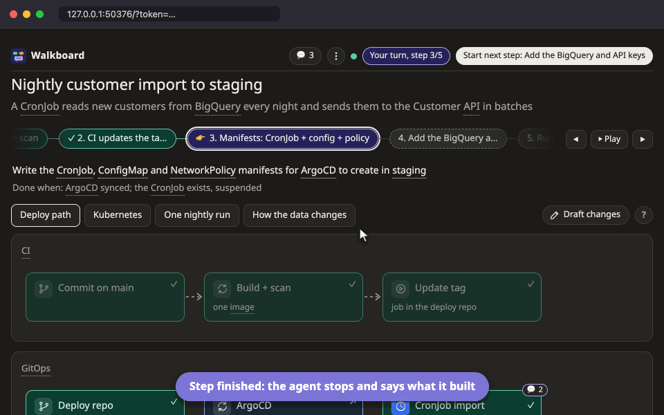
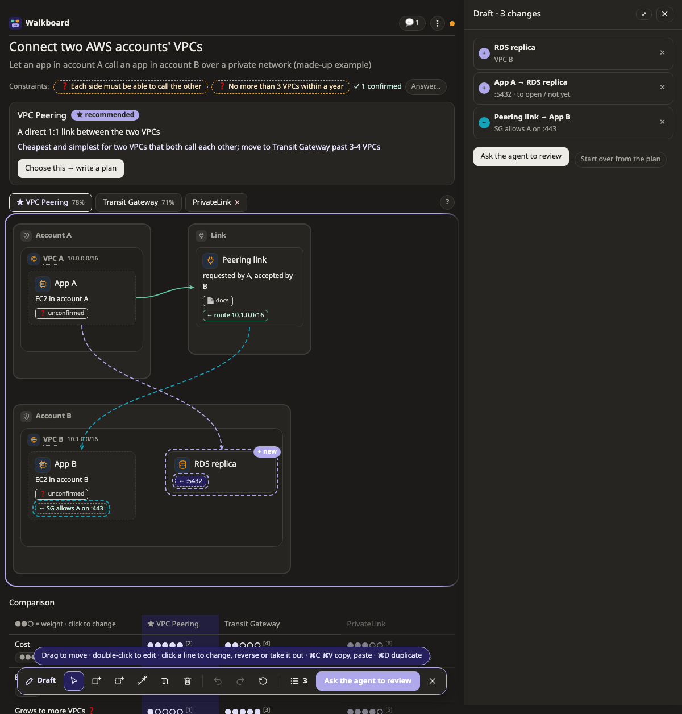

<p align="center">
  <picture>
    <source media="(prefers-color-scheme: dark)" srcset="docs/logo/logo-dark.svg">
    
  </picture>
</p>

<p align="center">
  A Claude Code skill that turns a plan, an explanation of existing code,<br>
  or a comparison of designs into a page you can click and talk to.
</p>

<p align="center">
  <a href="CHANGELOG.md"></a>
  <a href="LICENSE"></a>
  
</p>

<p align="center">
  
</p>

## Try it

In Claude Code (needs Node.js 18.18 or newer, nothing else):

```
/plugin marketplace add aiyaruch1320/walkboard
/plugin install walkboard@walkboard
```

Then, in any repository:

```
/walkboard explain how this project starts up
```

The agent asks a question or two, then gives you a link to a page on your machine. Click a box to ask about it; the agent answers there. Keep Claude Code open while you use the page: that is where the agent works.

Walkboard is young (0.10): built and tested with Claude Code on macOS. Windows, Linux and other agents should work but are not tried by hand yet; [issues](https://github.com/aiyaruch1320/walkboard/issues) are welcome.

## Why

Long AI-written plans are hard to follow, and it is easy to lose the feeling that the work is yours. Walkboard has the agent show its work as pictures on a local page instead. Click a box, a step or a table cell to ask about it, and the agent answers right there.

- **See it, don't scroll it.** Eleven kinds of picture (flow, map of a cloud, Kubernetes or network, sequence, data journey, state, timeline and more) replace pages of text. The agent picks the one that answers your question.
- **Ask on the spot.** Every box, step and comparison cell has its own thread. Your click wakes the agent, and its answer appears where you asked, not somewhere in a long chat.
- **You stay in charge.** Nothing is built before you press **Approve plan**, and after each step the agent stops until you start the next one.
- **Evidence, not guesses.** Explanations point at the real `file:line`, design scores cite a dated source, and anything the agent assumed is drawn dashed until you answer it in your own words.
- **Sketch, then ask.** Press **✎ Draft changes** and change the picture yourself; the agent reviews your sketch and puts in the plan only what you agree to.

Also: weigh options by your own priorities, export a plan as one HTML file or print it to PDF, and keep everything on your machine (127.0.0.1, random token, no telemetry). The page speaks English and Thai. A four-picture plan costs about 7 KB of JSON instead of 26–43 KB of hand-written HTML ([numbers](docs/reference.md#tokens)). Everything else is in the **[docs](docs/README.md)** ([ภาษาไทย](docs/th/README.md)).

## Three modes

| Mode | Use it to | You get |
|---|---|---|
| **Plan** | build or change something | 3-8 small steps you approve, then follow as the agent builds them, one click at a time |
| **Explain** | understand code that already exists | stages in order, each box tied to the real code, with notes on the lines that matter |
| **Design** | choose how to build something new | 2-4 options drawn side by side, scored against your criteria with sources, and a recommendation |

The agent picks the mode from your request and asks up to three short questions first if something would change the picture.

<table>
  <tr>
    <td width="50%"></td>
    <td width="50%"></td>
  </tr>
  <tr>
    <td align="center"><sub>Plan: check each step, then start the next</sub></td>
    <td align="center"><sub>Design: compare options by your own weights</sub></td>
  </tr>
</table>

## Use

Type `/walkboard` and say what you want, or just ask in your own words. On its own, `/walkboard` looks through the repository and offers things to see first:

```
/walkboard plan deploying this CronJob to staging
/walkboard explain how login works in project A
/walkboard compare ways to connect EC2 across two AWS accounts
```

<sub>If another command is already called `/walkboard`, use the full name `/walkboard:walkboard`.</sub>

1. The agent asks what it needs to know (for a plan: commit for you, or only suggest messages?). Save your answers in `~/.walkboard/config.json` and they are not asked again.
2. It writes the plan and gives you a link to a page on your machine.
3. Click a box to see what it does. Type in the chat to ask, or to say what to add, change or remove; paste or drop an image if that says it better. What to do next is always the button at the top right; **⋮** holds settings, export and the theme.
4. To change a picture yourself, press **✎ Draft changes** above it: a toolbar appears at the bottom. Your changes are drawn dashed with a sign (+ new, ~ edited, − out, ↦ moved) and listed; **Ask the agent to review** sends them. Outside draft mode a drag only arranges the picture. [All of it in the docs](docs/draft.md).

   
5. Switch who commits under **⋮**. Switching does not wake the agent or cost tokens.

**Updates:** `/plugin` → **Marketplaces** → **walkboard** → **Enable auto-update** gets new versions by themselves (Claude Code leaves it off for marketplaces outside its own). A running session keeps the version it started with until `/reload-plugins` or a new session; Walkboard says so when it opens a page. The page shows its version at the bottom of **⋮**.

Boxes carry icons for what they are, with AWS, Google Cloud, Azure, Huawei Cloud, Kubernetes and on-prem parts in their own colours. On a map, profiles say what each box, zone and line is on those platforms (an RDS in a private subnet, a CronJob in a namespace) and warn when something sits where it usually does not.

More screens, every picture and platform, FAQ and reference: **[docs](docs/README.md)** · [ภาษาไทย](docs/th/README.md).

## How it works

```
agent ──writes──► plan.json ──► page (pictures + chat)
  ▲                                   │ click / ask / start next
  └── wakes up ◄── local server ◄─────┘
```

The agent writes `plan.json`; a fixed page draws it, so every plan looks familiar and the agent never writes HTML. What you click or type is queued on disk and handed to a background `walkboard poll`, which wakes the agent; `walkboard reply` puts its answer back on the page. The idea of a local page whose messages reach the agent through a waiting `poll` comes from [lavish-axi](https://github.com/kunchenguid/lavish-axi).

## Security and privacy

Everything stays on your machine: one zero-dependency Node server per plan, bound to 127.0.0.1 behind a random token, no network requests, no telemetry. What it reads, writes and runs, and how to report a problem: [SECURITY.md](SECURITY.md).

## For AI agents

- **Using Walkboard for a user**: read [skills/walkboard/SKILL.md](skills/walkboard/SKILL.md) and follow it. It covers the three modes, the questions to ask first, the plan format and every command. From a clone, the CLI also works without installing: `node skills/walkboard/bin/walkboard.mjs <command>`.
- **Installing it for a user**: ask first, because it changes their agent's setup.
  1. Check `node -v` is 18.18 or newer.
  2. Claude Code: prefer the plugin, `claude plugin marketplace add aiyaruch1320/walkboard`, then `claude plugin install walkboard@walkboard`. Without plugins, clone this repository and copy `skills/walkboard` to `~/.claude/skills/walkboard`.
  3. Other agents that read `SKILL.md` skills (Codex, GitHub Copilot, Cursor, Gemini CLI, …): clone this repository and copy the whole `skills/walkboard` folder, not only `SKILL.md`, into the agent's user skills folder: `~/.agents/skills/walkboard` for Codex (and the shared location several agents read), otherwise the folder that agent's documentation names.
  4. Tell the user to start a new session. It worked if the agent lists the `walkboard` skill (in Claude Code, `/walkboard` appears in the slash-command menu) and `node <skill dir>/bin/walkboard.mjs` prints its usage.
  5. Only Claude Code is tested so far. Elsewhere the page and pictures work the same; the agent just waits for clicks with `poll` in the foreground instead of being woken in the background (see SKILL.md).
- **Changing this repository**: read [AGENTS.md](AGENTS.md) for the map, rules and checks.

## License

[MIT](LICENSE) · [Changelog](CHANGELOG.md) · Inspired by [lavish-axi](https://github.com/kunchenguid/lavish-axi) · Implemented with [Claude](https://claude.com/claude-code)
