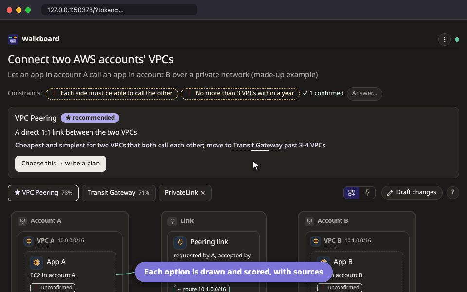

<p align="center">
  <picture>
    <source media="(prefers-color-scheme: dark)" srcset="docs/logo/logo-dark.svg">
    
  </picture>
</p>

<p align="center">
  A skill for Claude Code and other coding agents that turns a plan, an explanation of existing code,<br>
  or a comparison of designs into a page you can click and talk to.
</p>

<p align="center">
  <a href="CHANGELOG.md"></a>
  <a href="LICENSE"></a>
  
</p>

<p align="center">
  
</p>

## Getting started

You need Node.js 18.18 or newer and a coding agent. Nothing else. In Claude Code, run:

```
/plugin marketplace add aiyaruch1320/walkboard
/plugin install walkboard@walkboard
```

Start a new session, open one of your repositories, and try:

```
/walkboard explain how this project starts up
```

The agent may ask you a question or two. Then it sends you a link to a page on your machine. Click any box to ask about it, and the agent answers right there. Keep the agent's session open while you use the page, because that is where it does its work.

Using Codex, Gemini CLI or another agent that reads `SKILL.md` skills? See [Use other agents](https://aiyaruch1320.github.io/walkboard/other-agents.html): you copy one folder, and you tell the agent "check the page" when you want it to read what you did on the page.

Want to look before you install? [Open a live example](https://aiyaruch1320.github.io/walkboard/examples/pictures.html?view=map&step=all) in your browser.

> Walkboard is new (version 0.10). It is built and used every day with Claude Code on macOS. It has also been tried end to end with OpenCode. Windows, Linux and [other agents](https://aiyaruch1320.github.io/walkboard/other-agents.html) such as Codex or Gemini CLI should work, but nobody has tried them by hand yet. [Issues](https://github.com/aiyaruch1320/walkboard/issues) are very welcome.

## Why Walkboard

Long plans written by AI are hard to follow, and after a while you stop feeling that the work is yours. Walkboard has the agent show its work as pictures instead, on a page you can click and talk to.

- **Pictures instead of pages of text.** There are eleven kinds, from a simple flow to a map of your cloud network, a sequence of calls or a database model. The agent picks the one that answers your question.
- **Ask where it matters.** Every box, step and comparison cell has its own conversation. You ask on the box, and the answer appears on the box, not somewhere up in a long chat.
- **You stay in charge.** Nothing is built until you press **Approve plan**. After each step, the agent stops and waits for you to start the next one.
- **Shows its evidence.** Explanations point at the real file and line. Design scores cite their sources, with the date they were read. Anything the agent had to guess is drawn dashed until you answer it.
- **Draw it yourself.** Press **✎ Draft changes** to sketch a change on the picture. The agent reviews your sketch and puts into the plan only what you agree to.

It also lets you weigh options by your own priorities, export a plan as one HTML file or a PDF, and keeps everything on your machine. The page is in English and Thai.

## Three modes

| Mode | Use it to | You get |
|---|---|---|
| **Plan** | build or change something | 3–8 small steps that you approve, then watch the agent build one at a time |
| **Explain** | understand code that already exists | the code's stages in order, with each box tied to the real code and notes on the lines that matter |
| **Design** | choose how to build something new | 2–4 options drawn side by side, scored against your criteria with sources, and a recommendation |

The agent picks the mode from what you ask.

<table>
  <tr>
    <td width="50%"></td>
    <td width="50%"></td>
  </tr>
  <tr>
    <td align="center"><sub>Plan: check each step, then start the next</sub></td>
    <td align="center"><sub>Design: compare options by your own weights</sub></td>
  </tr>
</table>

## Documentation

Everything else is in the docs at **[aiyaruch1320.github.io/walkboard](https://aiyaruch1320.github.io/walkboard/)**: every part of the page, every kind of picture with a live example, the cloud platforms, sketching, sharing, and answers to common questions. There is also [a start page in Thai](https://aiyaruch1320.github.io/walkboard/th/).

## How it works

```
agent ──writes──► plan.json ──► page (pictures + chat)
  ▲                                   │ click / ask / start next
  └── wakes up ◄── local server ◄─────┘
```

The agent never writes HTML. It writes a small `plan.json`, and a fixed page draws it, so every plan looks familiar. When you click or type on the page, your message is queued on disk and handed to a `walkboard poll` waiting in the background, which wakes the agent. The agent answers with `walkboard reply`, and the answer appears on the page.

Because the agent only writes data, Walkboard is light on tokens. A plan with four pictures is about 7 KB of JSON, where a hand-written page would be 26–43 KB of HTML ([the numbers](https://aiyaruch1320.github.io/walkboard/reference.html#tokens)).

The idea of a local page whose messages reach the agent through a waiting `poll` comes from [lavish-axi](https://github.com/kunchenguid/lavish-axi).

## Security and privacy

Everything stays on your machine. Each plan gets its own small Node server with no dependencies. It listens only on 127.0.0.1, behind a random token, makes no network requests and sends no telemetry. [SECURITY.md](SECURITY.md) lists what it reads, writes and runs, and how to report a problem.

## For AI agents

- **Using Walkboard for a user**: read [skills/walkboard/SKILL.md](skills/walkboard/SKILL.md) and follow it. It covers the three modes, the questions to ask first, the plan format and every command. From a clone, the CLI also works without installing: `node skills/walkboard/bin/walkboard.mjs <command>`.
- **Installing it for a user**: ask first, because it changes their agent's setup.
  1. Check `node -v` is 18.18 or newer.
  2. Claude Code: prefer the plugin, `claude plugin marketplace add aiyaruch1320/walkboard`, then `claude plugin install walkboard@walkboard`. Without plugins, clone this repository and copy `skills/walkboard` to `~/.claude/skills/walkboard`.
  3. Other agents that read `SKILL.md` skills (Codex, GitHub Copilot, Cursor, Gemini CLI, …): clone this repository and copy the whole `skills/walkboard` folder, not only `SKILL.md`, into the agent's user skills folder: `~/.agents/skills/walkboard` for Codex (and the shared location several agents read), otherwise the folder that agent's documentation names.
  4. Tell the user to start a new session. It worked if the agent lists the `walkboard` skill (in Claude Code, `/walkboard` appears in the slash-command menu) and `node <skill dir>/bin/walkboard.mjs` prints its usage.
  5. Claude Code is used every day and OpenCode was tried end to end; others are untested. Elsewhere the page and pictures work the same. An agent that cannot be woken by a background command does not wait on the page: the user tells it "check the page" in its chat, and it reads what waits with `walkboard poll --now` (see SKILL.md).
- **Changing this repository**: read [AGENTS.md](AGENTS.md) for the map, rules and checks.

## License

[MIT](LICENSE) · [Changelog](CHANGELOG.md) · Inspired by [lavish-axi](https://github.com/kunchenguid/lavish-axi) · Implemented with [Claude](https://claude.com/claude-code)
