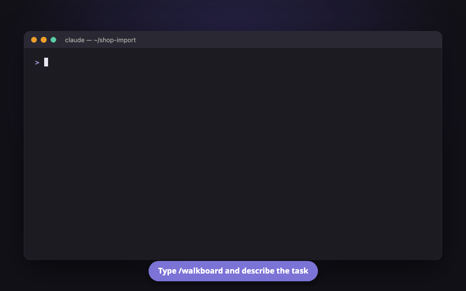
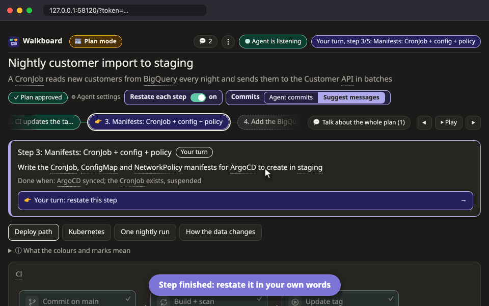
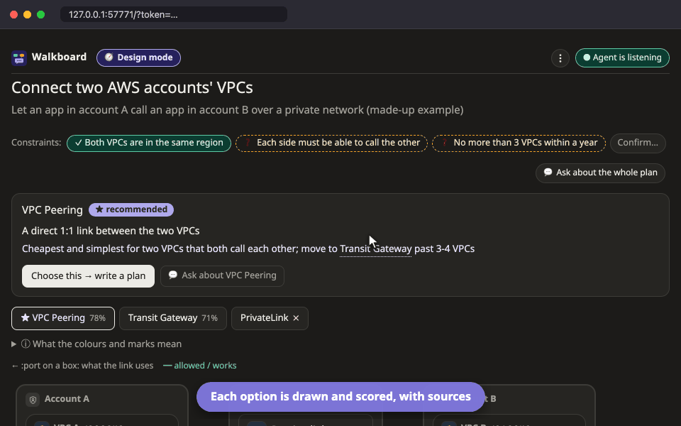

<p align="center">
  <picture>
    <source media="(prefers-color-scheme: dark)" srcset="docs/logo/logo-dark.svg">
    
  </picture>
</p>

<p align="center">
  A Claude Code skill that turns a plan, an explanation of existing code,<br>
  or a comparison of designs into a page you can click and talk to.
</p>

<p align="center">
  <a href="CHANGELOG.md"></a>
  <a href="LICENSE"></a>
  
</p>

<p align="center">
  
</p>

## Why

Long AI-written plans are hard to follow, and it is easy to lose the feeling that the work is yours. Walkboard has the agent show its work as pictures on a local page instead. Click a box, a step or a table cell to ask about it, and the agent answers right there.

### What you get

- **See it, don't scroll it.** Twelve kinds of picture (flow, Kubernetes, network map, sequence, data journey, state, timeline and more) replace pages of text. The agent picks the one that answers your question.
- **Ask on the spot.** Every box, step and comparison cell has its own thread. Your click wakes the agent, and its answer appears where you asked, not somewhere in a long chat.
- **You stay in charge.** Nothing is built before you press **Approve plan**. After each step you restate it in your own words and the agent corrects what you missed. Commit messages are suggested for you to edit, and proposed changes are drawn on the picture before anything is built.
- **Evidence, not guesses.** In explain mode every box points at the real `file:line`, the page shows that code with the important lines marked, and `walkboard check` notices when the code has moved since it was explained. In design mode every score cites a source with the date it was read. Anything the agent assumed is drawn dashed until you confirm it or mark it not true.
- **Sketch, then ask.** Press **✎ Draft changes** on a picture and change it yourself: add boxes, zones, tables, columns, lanes and lines, rename, take out, drag between zones or lanes. Nothing changes in the plan and the agent is not woken until you press **Ask the agent to review**; it says what each change means (network, migration, a missing step) and puts in the plan only what you agree to.
- **Decide with your own priorities.** Weigh what matters (cost, effort, scale), mark the must-haves, and the page tells you when your weights put a different option ahead of the agent's recommendation. Scores can show the figure behind them, such as a monthly price, and rows that rest on something not yet confirmed are marked ❓. Choosing an option turns it into a step-by-step plan.
- **Lighter than a hand-written explainer.** The agent writes a small JSON file once and updates it with one-line commands, while the page does the drawing. A four-picture plan is about 7 KB of JSON instead of 26–43 KB of HTML rewritten on every change ([numbers](docs/GUIDE.md#light-on-tokens)).
- **Easy to pass on.** Export a plan as one HTML file that anyone opens offline, read only, or print it to PDF: a design opens with the decision and why, and every step, picture and box is laid out for paper.
- **For the whole team.** A product owner can compare options without reading code; a new developer can follow a plan step by step; a senior can check claims against the code.
- **Private and simple.** Everything stays on your machine: a zero-dependency Node server on 127.0.0.1 behind a random token, no telemetry. The agent plans in the language you write in, and the page's labels follow (English and Thai).

## Three modes

| Mode | Use it to | You get |
|---|---|---|
| **Plan** | build or change something | 3-8 small steps you approve, then follow as the agent builds them, restating each one |
| **Explain** | understand code that already exists | stages in order, each box tied to the real code, with notes on the lines that matter |
| **Design** | choose how to build something new | 2-4 options drawn side by side, scored against your criteria with sources, and a recommendation |

The agent picks the mode from your request and asks up to three short questions first if something would change the picture.

<table>
  <tr>
    <td width="50%"></td>
    <td width="50%"></td>
  </tr>
  <tr>
    <td align="center"><sub>Plan: restate each step; the agent checks it</sub></td>
    <td align="center"><sub>Design: compare options by your own weights</sub></td>
  </tr>
</table>

## Install

```
/plugin marketplace add aiyaruch1320/walkboard
/plugin install walkboard@walkboard
```

Needs Node.js 18.18 or newer. Nothing else.

Walkboard is young (0.8): built and tested with Claude Code on macOS. Other agents and systems should work but are not tested yet; [issues](https://github.com/aiyaruch1320/walkboard/issues) are welcome.

## Use

Type `/walkboard` and say what you want, or just ask in your own words:

```
/walkboard plan deploying this CronJob to staging
/walkboard explain how login works in project A
/walkboard compare ways to connect EC2 across two AWS accounts
```

<sub>If another command is already called `/walkboard`, use the full name `/walkboard:walkboard`.</sub>

1. The agent asks what it needs to know (for a plan: commit for you, or only suggest messages?). Save your answers in `~/.walkboard/config.json` and they are not asked again.
2. It writes the plan and gives you a link to a page on your machine.
3. Click a box to see what it is, ask about it, or propose a change. 👉 and a purple bar mean it is your turn; **⋮** holds export, the theme and a short tour.
4. To change a picture yourself, press **✎ Draft changes** above it: a toolbar appears at the bottom (keys V, B, Z, L, R, D; Escape leaves). Your changes are drawn dashed with a sign (+ ~ − ↦) and listed; **Ask the agent to review** sends them. Dragging a box outside draft mode only arranges the picture, unless you drop it into another zone.

   
5. Switch restating and commits under **Agent settings** at the top of the page. Switching does not wake the agent or cost tokens. Keep Claude Code open while you use the page: that is where the agent works.

Boxes carry icons for what they are, with AWS, Google Cloud, Azure, Huawei Cloud, Kubernetes and on-prem parts in their own colours.

More screens, FAQ and reference: **[docs/GUIDE.md](docs/GUIDE.md)**.

## How it works

```
agent ──writes──► plan.json ──► page (pictures + chat)
  ▲                                   │ click / ask / restate
  └── wakes up ◄── local server ◄─────┘
```

The agent writes `plan.json`; a fixed page draws it, so every plan looks familiar and the agent never writes HTML. What you click or type is queued on disk and handed to a background `walkboard poll`, which wakes the agent; `walkboard reply` puts its answer back on the page. The idea of a local page whose messages reach the agent through a waiting `poll` comes from [lavish-axi](https://github.com/kunchenguid/lavish-axi).

## Security and privacy

Everything stays on your machine: one zero-dependency Node server per plan, bound to 127.0.0.1 behind a random token, no network requests, no telemetry. What it reads, writes and runs, and how to report a problem: [SECURITY.md](SECURITY.md).

## For AI agents

- **Using Walkboard for a user**: read [skills/walkboard/SKILL.md](skills/walkboard/SKILL.md) and follow it. It covers the three modes, the questions to ask first, the plan format and every command. From a clone, the CLI also works without installing: `node skills/walkboard/bin/walkboard.mjs <command>`.
- **Installing it for a user**: ask first, because it changes their agent's setup.
  1. Check `node -v` is 18.18 or newer.
  2. Claude Code: prefer the plugin, `claude plugin marketplace add aiyaruch1320/walkboard`, then `claude plugin install walkboard@walkboard`. Without plugins, clone this repository and copy `skills/walkboard` to `~/.claude/skills/walkboard`.
  3. Other agents that read `SKILL.md` skills (Codex, GitHub Copilot, Cursor, Gemini CLI, …): clone this repository and copy the whole `skills/walkboard` folder, not only `SKILL.md`, into the agent's user skills folder: `~/.agents/skills/walkboard` for Codex (and the shared location several agents read), otherwise the folder that agent's documentation names.
  4. Tell the user to start a new session. It worked if the agent lists the `walkboard` skill (in Claude Code, `/walkboard` appears in the slash-command menu) and `node <skill dir>/bin/walkboard.mjs` prints its usage.
  5. Only Claude Code is tested so far. Elsewhere the page and pictures work the same; the agent just waits for clicks with `poll` in the foreground instead of being woken in the background (see SKILL.md).
- **Changing this repository**: read [AGENTS.md](AGENTS.md) for the map, rules and checks.

## License

[MIT](LICENSE) · [Changelog](CHANGELOG.md) · Inspired by [lavish-axi](https://github.com/kunchenguid/lavish-axi) · Implemented with [Claude](https://claude.com/claude-code)
