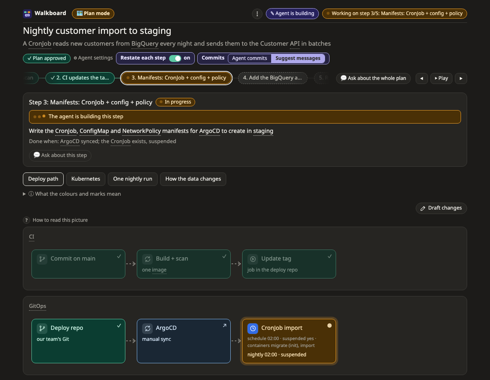
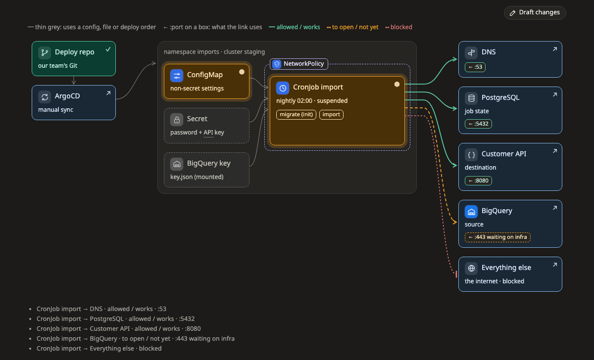
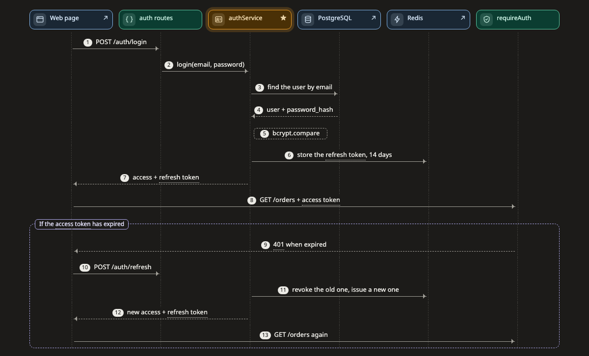
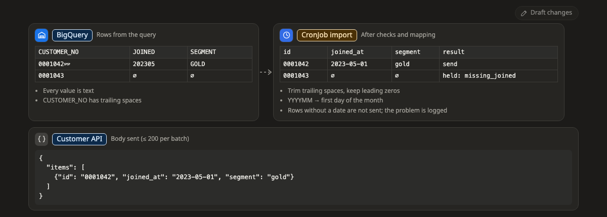
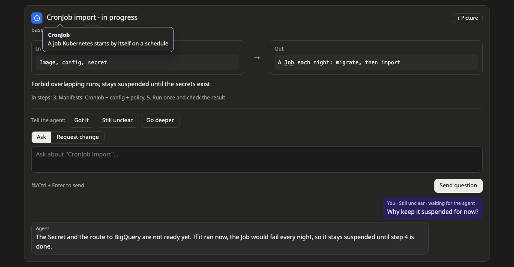
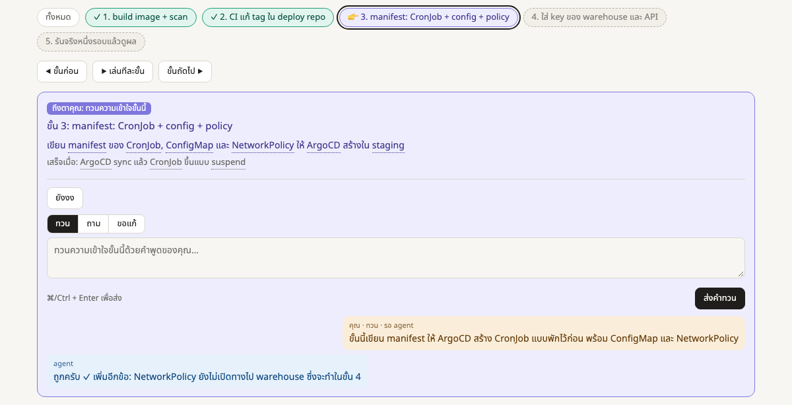
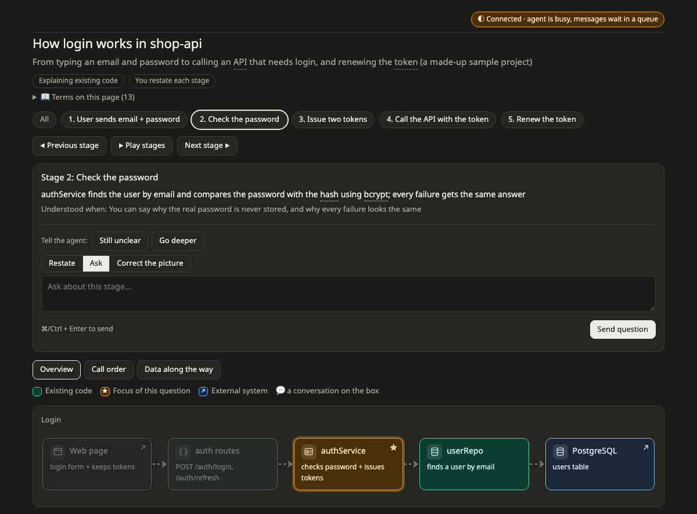

# Walkboard guide

Everything beyond the [README](../README.md): a tour of the page, explain mode, what makes it light on tokens, FAQ, limits and reference.

- [The plan page](#the-plan-page)
- [Pictures](#pictures)
- [Talking on the page](#talking-on-the-page)
- [Explain existing code](#explain-existing-code)
- [Light on tokens](#light-on-tokens)
- [FAQ](#faq)
- [Limitations](#limitations)
- [Reference](#reference)

## The plan page



| Part | What it does |
|---|---|
| Top bar (always visible) | ● agent listening now · ✎ agent is answering you · ◐ agent busy, your message waits in a queue · ○ server not reachable. Also **💬** lists every conversation on the page, newest first (it turns orange with "new" when the agent has replied; click one to carry on), **◐ / ☀ / ☾** switches the theme (follow the system, light, dark; remembered in this browser), and "✎ Plan changed" shows what the agent changed (outlined until you press **Mark as seen**). |
| Agent settings | Switch restating each step on or off and choose whether the agent commits or only suggests messages; each card says what the current choice means. Saved to the plan at once without waking the agent, which reads it before its next step. Defaults for every plan: `~/.walkboard/config.json`, e.g. `{"teachBack": true, "commit": "suggest"}`. |
| Step bar | Choose a step: everything it does not touch fades and the page switches to a picture that shows it. ✓ restated and confirmed, 👉 your turn. ⏵ Play walks through the steps once. The address keeps the step, picture and box, so a reload or a shared link opens the same place. |
| Step card | What the step does, its status and how we know it is done. When it is your turn, a purple bar opens the side panel. |
| Side panel | Everything you answer or decide: a box's details and conversation, restating, the suggested commits, approval. Opens when you click a box or a "your turn" bar, slides away with ✕, Esc or a second click on the same box; a sheet from the bottom on narrow screens. |
| Boxes | An icon for what the box is (cloud services in their provider's colours), its status (✓ done, ● in progress, dashed = to do, ↗ external) and 💬 when there is a conversation on it. |
| Dotted words | Glossary: tap for a plain explanation (inside a box, hover; a tap opens the box). |
| Mode pill | Next to the logo: plan, explain or design. Click it for one line on what this mode does; click again to close. |

## Pictures

| Kubernetes: what runs, what it uses, where it may connect | Call sequence, with alternative paths framed |
|---|---|
|  |  |

How data changes shape, with empty values (∅) and stray spaces (␠) made visible:



## Talking on the page

| Ask on a box; the answer appears in the side panel | Restate a step; the agent confirms it |
|---|---|
|  |  |

- **Still unclear · Go deeper** send at once.
- **Ask** or **Propose** (add after a box, change it, remove it) choose what the text you type is sent as. The agent decides whether a proposal just corrects the picture, changes a plan not yet approved, or is drawn as a proposal. **Restate** appears when it is your turn (and on every stage in explain mode).
- The first visit shows a three-stop tour; **?** lists the shortcuts (← → steps, Esc closes the panel, Enter sends, Shift+Enter starts a new line) and shows the tour again. In the side panel the details sit above the chat and the box you type in stays at the bottom, as in a chat. Click **▾ Details** or **▾ Chat** to fold it away, either or both; its arrow turns, the part slides shut and "folded" shows quietly beside the name; the choice is remembered. **⤢** widens the panel, keeping the picture on the left, and puts the details beside the chat; **⤡** goes back.
- **Approve plan** lets the agent start building. Nothing is built before.
- **Agent commits these, then goes on** / **I committed, go on** appear under the suggested commit message of a finished step when commits are only suggested; you can edit the message first. The agent waits for one of them before the next step.

The page speaks the plan's language: the agent writes the plan in the language you use and sets `lang`, and the buttons and labels follow (English and Thai today; other languages get English labels).

## Explain existing code



Every box that is code points at `file:line` and carries an `anchor`, a short piece of that code. `walkboard check` fails when the file or lines do not exist or the anchor is no longer in them (and says where it went); the page warns on the code itself when it changed since it was explained. The page shows the code beside the explanation, and the path opens in VS Code, Cursor or IntelliJ (`settings.editor`).


```bash
node skills/walkboard/bin/walkboard.mjs open examples/explain-login
```

## Compare designs

For something not built yet ("what should we use to connect EC2 across two accounts?"), the agent researches 2–4 options and draws each one as its own picture tab, with its score.

- **The table** scores every option on each criterion: ●●●●● is best for you (cheapest, easiest), ✓ / ✗ for things that work or do not. Click a cell for the reason and its sources; each source says when it was read. Click the weight dots under a criterion to say how much it matters; this saves at once and does not wake the agent.
- **Must-haves** are marked "must": an option that fails one is greyed out and out of the running. When your weights put another option ahead of the agent's ★ recommendation, a note says so and offers **Ask the agent to re-check**.
- **Assumptions** (constraints in the bar above, dashed boxes in the pictures) stay unconfirmed until you press **Confirm**; choosing an option lists the ones still open.
- **Choose this → write a plan** records the decision (why this one, why not the others) and starts a plan in a new page, linked from the choice.

## Light on tokens

The page does the explaining, so the agent spends tokens on content once and very little afterwards.

| Where tokens go | Hand-written explainer | Walkboard |
|---|---|---|
| A rich plan with four pictures | 26–43 KB of HTML and SVG, rewritten on every change | ~7 KB `plan.json` (compact JSON) written once; a simple plan is ~0.5 KB |
| Moving a step forward | rewrite or edit the page | `walkboard set … step:x status=review` ≈ 90 bytes |
| Code in explain mode | paste it | `file:line` + `highlight`; the server reads the excerpt |
| Common terms | explain each time | ~95 ship with Walkboard, in English and Thai |
| Each message from the page | — | one compact line, ~100–150 bytes |
| Switching restating or commits on the page | — | nothing: the agent is not woken; it reads the setting with its next message or step |
| Instructions loaded with the skill | — | SKILL.md ~7.5 KB; schema, pictures, design and rarer messages in references (2–6 KB each) read only when needed; icon names from `walkboard icons` |

Every message from the page wakes the agent once, which re-reads the conversation (mostly from cache). That is why "Got it" was removed and settings never wake it: only clicks that need an answer cost a turn.

## FAQ

**I click and nothing happens, or the page says it was opened from a file.**
Open the `http://127.0.0.1:…/?token=…` link the agent gave you, not the HTML file. `walkboard status <folder>` prints the link again.

**The badge says the agent isn't listening.**
It is busy (writing code, running tests). Your message waits in a queue and reaches it when it listens again. Say "check the page" in chat to hurry it.

**Claude Code asks for permission on every update.**
Allow `node …/skills/walkboard/bin/walkboard.mjs` commands and edits under `~/.walkboard/` in your Claude Code permissions.

**The server seems stuck or the port is taken.**
`walkboard stop <folder>`, then `walkboard open <folder>`. The link stays the same.

**Can teammates open my page?**
No, it runs on your machine. Share `plan.json` (anyone can `walkboard open` it) or screenshots.

**Where are plans kept?**
`~/.walkboard/<project>/<task>/` unless you choose a folder. Delete the folder to remove a plan and its conversation.

**Does my code leave the machine?**
Not through Walkboard. The agent itself works as Claude Code normally does.

## Limitations

- Page labels exist in English and Thai; plan content can be in any language.
- One machine, one viewer: no sharing or multi-user editing.
- Each message is delivered once; if the agent dies right after receiving it, ask again.
- Built and tested on macOS with Chrome and the Claude desktop app; Linux should work; Windows is untested.
- Kubernetes pictures with thousands of links redraw slowly.

## Reference

### Commands

Run from the repository root (the skill runs them for you).

| Command | Does |
|---|---|
| `node skills/walkboard/bin/walkboard.mjs check <dir>` | Validate `plan.json`; in explain mode, also that every `file:line` exists and still holds its `anchor` |
| `… set <dir> [plan \| step: \| node: \| constraint: \| option: \| criterion: \| source:<id>] key=value …` | Change fields in place; `key=` removes one, `settings.commit=auto` reaches inside, `what='"0042"'` keeps digits as text |
| `… open <dir> [--no-browser]` | Start or reuse the server and print the link |
| `… poll <dir>` | Wait for the page; one JSON line per message |
| `… reply <dir> [--node id \| --step id \| --option id [--criterion id]] <text>` | Answer on the page, in that box's, step's or design cell's thread |
| `… status <dir>` / `… stop <dir>` | Show the link and queue / stop the server |
| `… icons` | List the icon names for `icon` |

### Links into a page

Add `&step=<id>`, `&view=<id>`, `&node=<id>` (or `&step=all`) and `&theme=light|dark`.

### Plan format

[schema.md](../skills/walkboard/references/schema.md) describes `plan.json`; [views.md](../skills/walkboard/references/views.md) the four pictures. Examples (all data made up): `examples/nightly-import` (build), `examples/explain-login` (explain, with sample code), `examples/walkboard` (the plan that built walkboard, in Thai).

### Update or uninstall

```
/plugin marketplace update walkboard
/plugin uninstall walkboard@walkboard
```

Installed by hand: pull again, or delete `~/.claude/skills/walkboard`.
