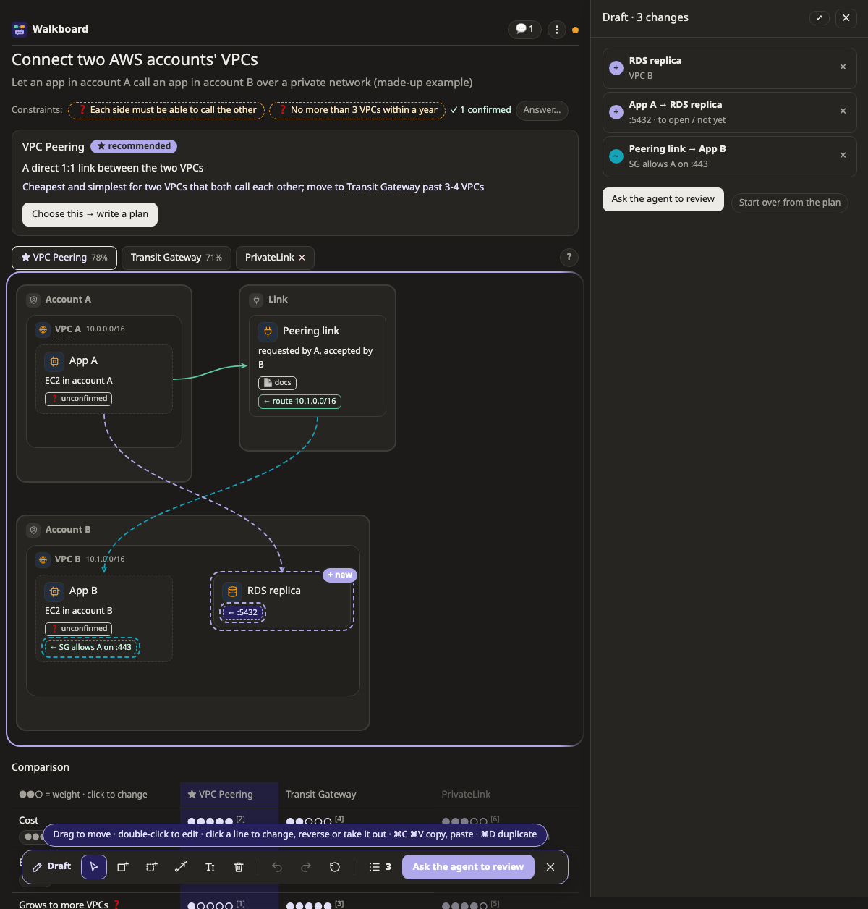
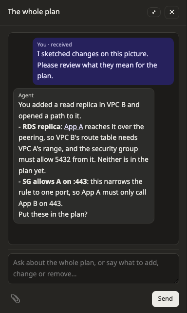
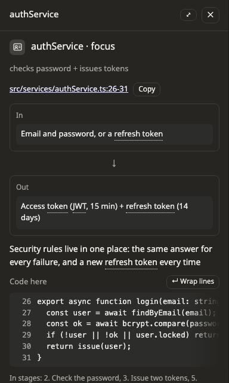

# Walkboard guide

Everything beyond the [README](../README.md): a tour of the page, explain mode, what makes it light on tokens, FAQ, limits and reference.

- [The plan page](#the-plan-page)
- [Pictures](#pictures)
- [Sketch your own changes](#sketch-your-own-changes)
- [Talking on the page](#talking-on-the-page)
- [Explain existing code](#explain-existing-code)
- [Light on tokens](#light-on-tokens)
- [FAQ](#faq)
- [Limitations](#limitations)
- [Reference](#reference)

## The plan page


| Part | What it does |
|---|---|
| Top bar (always visible) | What to do next is the button at the right: **Approve plan**, **Start next step: …** or **Check the commit message**, beside how far the work is. The dot says how the agent is: green listening, purple answering you, orange busy, your message waits in a queue; hover for words. Words appear when the server is not reachable. **💬** lists every conversation on the page, newest first (it turns orange with "new" when the agent has replied; click one to carry on), **⋮** holds the mode, who commits, Export, the theme and the shortcuts, and "✎ Plan changed" shows what the agent changed (outlined until you press **Mark as seen**). |
| Step bar | Choose a step: everything it does not touch fades and the page switches to a picture that shows it. ✓ done, 👉 your turn. ⏵ Play walks through the steps once. The address keeps the step, picture and box, so a reload or a shared link opens the same place. |
| Step text | What the step does and how we know it is done. |
| Tabs and tools | The plan's pictures, with **✎ Draft changes** and **?** on the same row. **?** says what the colours and marks mean and how to read this kind of picture. |
| Chat bar | At the bottom of the page: opens the conversation about what is on screen (the selected step, or the whole plan with **All** selected). |
| Side panel | A box's details and conversation, the suggested commits. Opens when you click a box or the chat bar, slides away with ✕, Esc or a second click on the same box; drag its left edge for the width you want; a sheet from the bottom on narrow screens. |
| Boxes | An icon for what the box is (cloud services in their provider's colours), its status (✓ done, ● in progress, dashed = to do, ↗ external) and 💬 when there is a conversation on it. |
| Dotted words | Glossary: tap for a plain explanation (inside a box, hover; a tap opens the box). |

## Pictures

| Kubernetes: what runs, what it uses, where it may connect | Call sequence, with alternative paths framed |
|---|---|
|  |  |

How data changes shape, with empty values (∅) and stray spaces (␠) made visible:


On a map, a profile says what a box, zone or line is on a platform (`aws:rds`, `k8s:deployment`): its icon and fields come from the kind, and a small amber ⚠ marks something that usually sits elsewhere. It is a hint, nothing is blocked. **Auto | By hand** over a map chooses whether the page lays it out or everything stays where you put it.

## Sketch your own changes



**✎ Draft changes** above a map, data model, flow, state, decision or impact picture opens a toolbar. Your changes stay out of the plan until the agent puts them in, and sketching does not wake it.

| To | Do |
|---|---|
| Add a box, zone, table, group or lane | Pick the tool (B, Z, the data model's C for a column), then click where it goes, or press Enter for the first free place in sight |
| Draw a line | L, then drag from one box to another. Near the window's edge the page scrolls with you |
| Edit or take out | R or double-click to edit, D or Delete to take out; both work on lines too |
| Move | Drag between zones, groups or lanes. On a flow, drag a lane's title to reorder |
| Copy | ⌘C ⌘V, or ⌘D to duplicate (Ctrl on other systems). A zone comes with what it holds |
| Go back | ⌘Z ⇧⌘Z; × on one change in the list; **Start over from the plan** for all of it; Escape leaves |

Outside draft mode a drag only arranges the picture. **↺ Arrange again** lays it out from the plan, keeping what you drew where you put it.

**Ask the agent to review** sends the sketch. The agent says what it means for the plan, in the names on the picture, and asks once before changing anything:



What it puts in the plan stays where you placed it, and what you turned down stays in your draft.

## Talking on the page

Ask on a box; the answer appears in the side panel:


- One box takes everything: a question, or what to add, change or remove. The agent decides whether a request just corrects the picture, changes a plan not yet approved, or is drawn as a proposal.
- **Attach images** by pasting, dropping or 📎: five to a message, 10 MB each (PNG, JPEG, GIF, WebP). A big image is scaled down before it is sent (a 3000×2000 screenshot to about 1300×880), so it costs the agent roughly 1,500 tokens at most. They stay beside the plan in `.walkboard/images`; an exported copy leaves them out.
- **Still unclear · Go deeper** send at once, in explain mode.
- The first time on a computer the picture draws itself along its arrows, then a hint says to click a box; **⋮ → Shortcuts** lists the shortcuts (← → steps, Esc closes the panel, Enter sends, Shift+Enter starts a new line) and shows it again. In the side panel the details sit above the chat and the box you type in stays at the bottom, as in a chat. Click **▾ Details** or **▾ Chat** to fold it away, either or both; its arrow turns, the part slides shut and "folded" shows quietly beside the name; the choice is remembered. Drag the panel's left edge for any width, or **⤢** to jump to a wide one and back: from 640 px the details sit beside the chat, and each folds into a thin rail so the other has the room.
- A message the agent has not taken yet says it is in line, with its place and what the agent is on (⏳ with a count in the top bar). A message answered on another box says so with a link to it. A message with no answer yet says the agent has it, and you can hide the note.
- **Approve plan** lets the agent start building. Nothing is built before.
- When a step is finished the agent stops. **Start next step: …** at the top goes on (**Finish** on the last one); **Run the rest** does the remaining steps without stopping, when the agent commits by itself.
- **Agent commits these, then goes on** / **I committed, go on** take its place when commits are only suggested and the step changed files; you can edit the message first. A step that changed no files asks for no message.

The page speaks the plan's language: the agent writes the plan in the language you use and sets `lang`, and the buttons and labels follow (English and Thai today; other languages get English labels).

## Explain existing code


Every box that is code points at `file:line` and carries an `anchor`, a short piece of that code. `walkboard check` fails when the file or lines do not exist or the anchor is no longer in them (and says where it went); the page warns on the code itself when it changed since it was explained. The page shows the code beside the explanation, and the path opens in VS Code, Cursor or IntelliJ (`settings.editor`).



```bash
node skills/walkboard/bin/walkboard.mjs open examples/explain-login
```

## Compare designs

For something not built yet ("what should we use to connect EC2 across two accounts?"), the agent researches 2–4 options and draws each one as its own picture tab, with its score.

- **The table** scores every option on each criterion: ●●●●● is best for you (cheapest, easiest), ✓ / ✗ for things that work or do not. Click a cell for the reason and its sources; each source says when it was read. Click the weight dots under a criterion to say how much it matters; this saves at once and does not wake the agent.
- **Must-haves** are marked "must": an option that fails one is greyed out and out of the running. When your weights put another option ahead of the agent's ★ recommendation, a note says so and offers **Ask the agent to re-check**.
- **Assumptions** (constraints in the bar above, dashed boxes in the pictures) stay unconfirmed until you answer them: press **✎ Answer** under one and type, "right" or what is true; a guess that is not a yes or no comes as a question. The bar shows the first three on one line; **Answer…** lists them all, with the numbers behind each. Choosing an option lists the ones still open.
- **Choose this → write a plan** records the decision (why this one, why not the others) and starts a plan in a new page, linked from the choice.

## Send a plan to someone

**⋮ → Export** in the top bar, or `walkboard export <folder>`:

- **HTML**: one file that opens anywhere, offline and read only: every picture, step and box, and in explain mode the code each box points at (untick it, or `--no-code`). The chat stays out unless you tick it (`--with-chat`). No server address, token or path on your machine goes into it, and the file cannot load anything from the network.
- **PDF**: the browser's print window with a layout for paper: every step, every picture one after another, then the boxes. Choose **Save as PDF**.
- **Your sketch goes along in both**, drawn on the pictures and listed in words as not in the plan yet. Untick it in Export to leave it out (`--no-draft`). Before / after pictures stay the plan's own.

On paper a picture whose names would come out under 7 pt prints as an overview, then parts at a size to read. A map goes by zone, and a line that leaves a part is a label on its box (`→ Aurora · 5432 · Part 3`). Other pictures go on sheets cut along the gaps between boxes, and their lines stop at the edge of the sheet. The overview numbers them.

Look at what the file contains before you send it: it is your plan and, unless left out, your code.

## Light on tokens

The page does the explaining, so the agent spends tokens on content once and very little afterwards.

| Where tokens go | Hand-written explainer | Walkboard |
|---|---|---|
| A rich plan with four pictures | 26–43 KB of HTML and SVG, rewritten on every change | ~7 KB `plan.json` (compact JSON) written once; a simple plan is ~0.5 KB |
| Moving a step forward | rewrite or edit the page | `walkboard set … step:x status=review` ≈ 90 bytes |
| Code in explain mode | paste it | `file:line` + `highlight`; the server reads the excerpt |
| Common terms | explain each time | ~95 ship with Walkboard, in English and Thai |
| Each message from the page | — | one compact line, ~100–150 bytes |
| Switching who commits on the page | — | nothing: the agent is not woken; it reads the setting with its next message or step |
| Instructions loaded with the skill | — | SKILL.md ~8.5 KB; the plan format, each picture, each platform, the review guide and rarer messages in small files read only when needed. An AWS map and a review read 27 KB in all; icon names from `walkboard icons` |

Every message from the page wakes the agent once, which re-reads the conversation (mostly from cache). That is why "Got it" was removed and settings never wake it: only clicks that need an answer cost a turn.

## FAQ

**I click and nothing happens, or the page says it was opened from a file.**
Open the `http://127.0.0.1:…/?token=…` link the agent gave you, not the HTML file. `walkboard status <folder>` prints the link again.

**The badge says the agent isn't listening.**
It is busy (writing code, running tests). Your message waits in a queue and reaches it when it listens again. Say "check the page" in chat to hurry it.

**Claude Code asks for permission on every update.**
Allow `node …/skills/walkboard/bin/walkboard.mjs` commands and edits under `~/.walkboard/` in your Claude Code permissions.

**The server seems stuck or the port is taken.**
`walkboard stop <folder>`, then `walkboard open <folder>`. The link stays the same.

**Can teammates open my page?**
No, it runs on your machine. Share `plan.json` (anyone can `walkboard open` it) or screenshots.

**Where are plans kept?**
`~/.walkboard/<project>/<task>/` unless you choose a folder. Delete the folder to remove a plan and its conversation.

**Does my code leave the machine?**
Not through Walkboard. The agent itself works as Claude Code normally does.

## Limitations

- Page labels exist in English and Thai; plan content can be in any language.
- One machine, one viewer: no sharing or multi-user editing.
- Each message is delivered once; if the agent dies right after receiving it, ask again.
- Built and tested on macOS with Chrome and the Claude desktop app; Linux should work; Windows is untested.
- Pictures with thousands of lines redraw slowly.
- A very large picture's overview on paper is only for its shape: read its parts.

## Reference

### Commands

Run from the repository root (the skill runs them for you).

| Command | Does |
|---|---|
| `node skills/walkboard/bin/walkboard.mjs check <dir>` | Validate `plan.json`; in explain mode, also that every `file:line` exists and still holds its `anchor` |
| `… set <dir> [plan \| step: \| node: \| constraint: \| option: \| criterion: \| source:<id>] key=value …` | Change fields in place; `key=` removes one, `settings.commit=auto` reaches inside, `what='"0042"'` keeps digits as text |
| `… open <dir> [--no-browser]` | Start or reuse the server and print the link |
| `… poll <dir> [--full] [--timeout s]` | Wait for the page; one short JSON line per message (`--full`: ids, times, every box's place) |
| `… reply <dir> [--node id \| --step id \| --option id [--criterion id]] <text>` | Answer on the page, in that box's, step's or design cell's thread. `[[node:id]]`, `[[step:id]]`, `[[option:id]]`, `[[plan]]` link to a place |
| `… status <dir>` / `… stop <dir>` | Show the link and queue / stop the server |
| `… draft <dir> [clear [view] [change …]]` | Print what was sketched, or clear it once it is in the plan |
| `… export <dir> [--html file] [--no-code] [--no-draft] [--with-chat]` | Write a read-only copy of the plan as one HTML file |
| `… icons` | List the icon names for `icon` |

### Links into a page

Add `&step=<id>`, `&view=<id>`, `&node=<id>` (or `&step=all`) and `&theme=light|dark`.

### Plan format

[schema.md](../skills/walkboard/references/schema.md) describes `plan.json`; [views.md](../skills/walkboard/references/views.md) the eleven kinds of picture. Examples (all data made up): `examples/nightly-import` (build), `examples/explain-login` (explain, with sample code), `examples/connect-vpcs` (design), `examples/walkboard` (the plan that built walkboard, in Thai).

### Update or uninstall

```
/plugin marketplace update walkboard
/plugin uninstall walkboard@walkboard
```

Installed by hand: pull again, or delete `~/.claude/skills/walkboard`.
