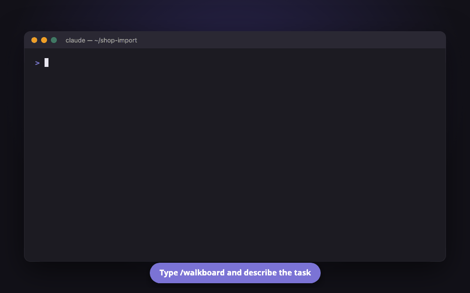

# Introduction

Welcome to the Walkboard docs.

**อ่านภาษาไทย:** [รู้จัก Walkboard](th/README.md)

## What is Walkboard?

Walkboard is a skill for coding agents, made first for Claude Code. When you ask the agent to plan a change or explain some code, it answers with pictures on a page in your browser instead of a long block of text in the chat.

The page is not just something to look at. You can click any box to see what it is, ask a question about it, or say what should change. The agent answers right there on that box, so the conversation stays next to the thing it is about.

A typical session goes like this:

1. In Claude Code, you type `/walkboard explain how login works`. With other agents, you ask in your own words.
2. The agent sends you a link. Open it, and you see the answer drawn as pictures.
3. You click a box and type a question. The agent replies on that box.

If you want to see a page before installing anything, [open the live example](https://aiyaruch1320.github.io/walkboard/examples/pictures.html?view=map&step=all). It runs in your browser, and you can click around freely.

## Who it is for

Walkboard is made for developers, architects and SREs, and for anyone who has to follow or check what an AI agent plans to do. It helps most when the answer has many moving parts: a feature that touches several services, a network across cloud accounts, or code you did not write.

For a quick question with a one-line answer, a normal chat is still faster.

## Three ways to use it

Walkboard has three modes. The agent picks one from what you ask, and you can change it later in the page's **⋮** menu.

- [Plan mode](modes/plan.md) is for building or changing something. The agent breaks the work into small steps, you approve the plan, and then it builds one step at a time.
- [Explain mode](modes/explain.md) is for understanding code that already exists. Each box points at the real file and line.
- [Design mode](modes/design.md) is for choosing how to build something new. The agent compares a few options, scores them, and shows where each fact came from.

## How to use the docs

The docs are organized into five sections:

- **Getting Started** walks you through installing Walkboard, opening your first page, and the three modes.
- **Guides** cover specific tasks, such as sketching a change yourself, sending a plan to a teammate, or using an agent other than Claude Code.
- **Pictures** explains each of the eleven kinds of picture: how to read it and what you can do on it.
- **Platforms** lists what boxes and zones mean on AWS, Google Cloud, Azure, Huawei Cloud, Kubernetes, containers and on-prem.
- **Reference** has the commands, the plan format and answers to common questions.

You can also reach these docs from a Walkboard page. Open **⋮ → Guide**, or press **?** next to a picture to read how that kind of picture works.

<!-- github only -->
These pages are also a website, with every picture shown and live examples to click: [aiyaruch1320.github.io/walkboard](https://aiyaruch1320.github.io/walkboard/).

## Getting help

If something is unclear or does not work, [open an issue on GitHub](https://github.com/aiyaruch1320/walkboard/issues/new/choose). Questions in Thai are welcome too. Issues are public, so do not paste plans or screenshots that show customer data, hostnames or passwords.

## Next steps

- [Installation](getting-started.md): install Walkboard and open your first page.
- [The page](page.md): what each part of the page does.
