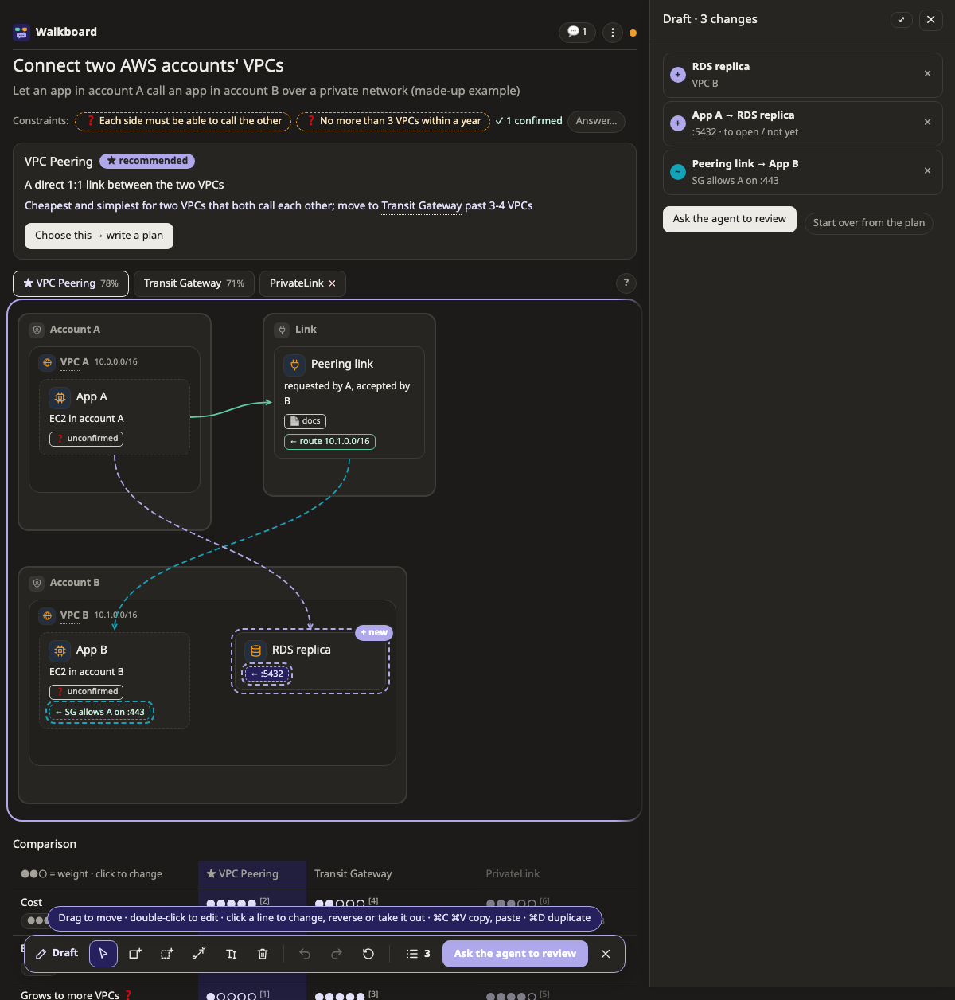
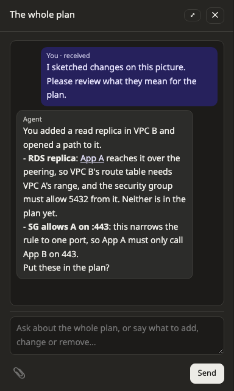

# Sketch your own changes

Sometimes it is quicker to draw what you mean than to type it. In **draft mode**, you change the picture yourself: add a box, draw a line, move something to another zone. Then the agent reviews your sketch, and only the changes you agree to go into the plan.

This page shows you how to sketch a change and ask the agent to review it.

## Starting a sketch

Press **✎ Draft changes** above the picture. A toolbar appears at the bottom, and a list beside the picture keeps track of every change you make.

You can sketch on six kinds of picture: [map](pictures/map.md), [data model](pictures/datamodel.md), [flow](pictures/flow.md), [state](pictures/state.md), [decision](pictures/decision.md) and [impact](pictures/impact.md). On a [before and after](pictures/diff.md) pair, press its pencil to choose which of the two pictures to sketch on. The other kinds have no draft mode, so ask for changes in the chat instead.

While you sketch, the plan stays as it is and the agent is not interrupted. Your sketch is saved as you go.

## Making changes

Here is what you can do on most pictures. Each picture's **?** lists the tools it has.

| To | Do this |
|---|---|
| Add a box, zone, table, group or lane | Pick the tool on the toolbar, then click where the new one goes |
| Add it without the mouse | Press the tool's key (B for a box, Z for a zone, C for a column on a data model), then Enter. It goes in the first free place you can see |
| Draw a line | Press L, then drag from one box to another. Near the edge of the window, the page scrolls with you |
| Edit something | Press R, or double-click it. This works on lines too |
| Take something out | Press D or Delete |
| Move something | Drag it into another zone, group or lane. On a flow, drag a lane by its title to reorder the lanes |
| Copy | ⌘C and ⌘V, or ⌘D to duplicate. Use Ctrl instead of ⌘ on Windows and Linux. Copying a zone copies what is inside it too |
| Undo | ⌘Z, and ⇧⌘Z to redo. To undo one change, press × next to it in the list. To throw away the whole sketch, press **Start over from the plan** |

Press Escape to leave draft mode. Your sketch stays for next time.

When you edit a box, its card has its name, a short note and its icon. On a map, it also has [what the box is on a platform](platforms/README.md), such as an RDS database or a Kubernetes CronJob.

> **Good to know:** A small amber ⚠ means something is placed where it does not usually go, such as a database outside any subnet. It is only a hint. Nothing stops you, and sometimes you mean it.

## Reading the signs

Until the agent puts your changes into the plan, they are marked on the picture:

| Sign | Means |
|---|---|
| **+** with a dashed outline | new, not in the plan yet |
| **~** | edited, not in the plan yet |
| **−** | you want it taken out, but it is still in the plan |
| **↦** | moved. The plan still has it in the old place |

## Asking the agent to review

When your sketch is ready, press **Ask the agent to review**. The agent reads what you drew and explains in plain words what it means for the plan, using the names on your picture. For example, it might point out that a new database needs a migration, or that a line you drew opens a port between two networks.

Before it changes the plan, the agent asks you which changes to keep. The ones you accept go into the plan and stay where you drew them. The ones you turn down stay in your sketch, so you can change them or throw them away.

## Arranging a picture

Outside draft mode you can still drag boxes around, but only to tidy the picture. Arranging never changes the plan. If you drop a box into a different zone, it goes back to where it was, with a message telling you to use draft mode for that.

To lay a picture out again from the plan, press **↺ Arrange again**. Anything you drew in a sketch stays where you put it. On a map, **Auto | By hand** decides whether the page lays it out for you or keeps everything where you dragged it.

## Sharing a sketch

When you export a plan or print it, your sketch goes with it, marked as not in the plan yet. That way you can talk it over with your team before you ask for a review. To leave it out, untick it in Export. See [Send a plan to someone](share.md).

## Next steps

- [Pictures](pictures/README.md): the tools each kind of picture has in draft mode.
- [Platforms](platforms/README.md): what the ⚠ means and where each kind of box usually goes.
