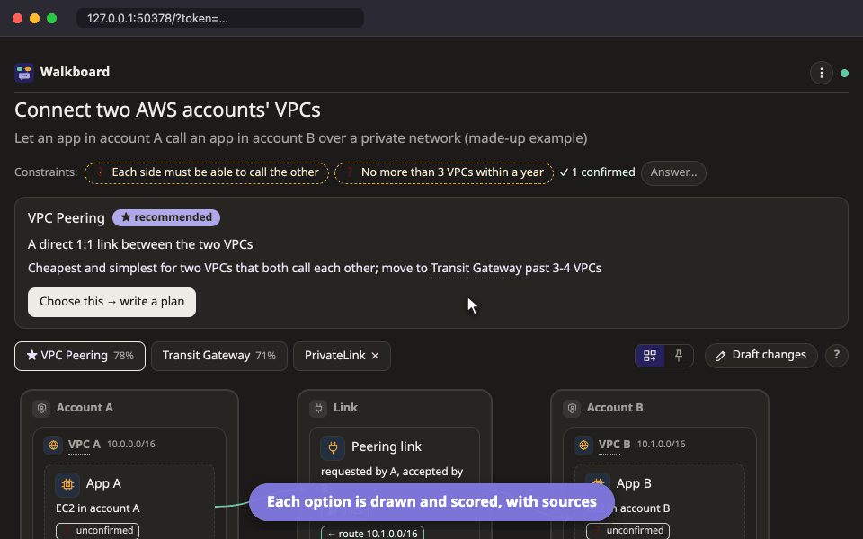

# Design mode

Design mode is for choosing how to build something new. The agent researches a few ways to do it, draws each one, and scores them side by side so you can see why it recommends one. You make the final choice.

For example:

```
/walkboard compare ways to connect EC2 across two AWS accounts
```



## Comparing the options

The agent looks into two to four options. Each option gets its own picture tab, with its score, and the one the agent recommends has a ★.

The comparison table scores every option on each **criterion**, such as cost or how hard it is to run. More dots (up to ●●●●●) are better for you: cheaper, easier, faster. Some criteria are a simple ✓ or ✗ for whether something works at all. A score can also show the figure behind it, such as a monthly price.

To see why an option got its score, click the cell. The side panel shows the reason and the sources, and each source says when the agent read it.

## Setting your priorities

Not every criterion matters equally to you. To change how much one counts, click the weight dots under it. This saves right away and does not interrupt the agent.

If your weights put a different option ahead of the one with the ★, a note tells you so and offers **Ask the agent to re-check**.

Some criteria are marked as a **must**. An option that fails a must is greyed out, whatever its other scores are.

## Answering the agent's guesses

The agent often has to assume things, such as how much traffic you expect. These guesses appear in the bar above the table and as dashed boxes in the pictures. To answer one, press **✎ Answer** and write what is true. Rows in the table that depend on a guess you have not answered yet are marked ❓.

## Making the decision

When you have chosen, press **Choose this → write a plan**. The agent writes down the decision, why you chose this option and why not the others, and starts a [plan](plan.md) for it on a new page. The plan links back to the decision.

## Your cloud accounts

Design mode never changes anything in your cloud accounts. If the agent wants to see what already exists, it uses only commands that read, such as `describe`, `list` and `get`, and it asks you before each one. If you would rather run them yourself, it gives you the command and asks for the output. Facts it found this way say so, with the date.

## Sharing a decision

When you export or print a design, it opens with the decision and the reasons for it. See [Send a plan to someone](../share.md).

## Trying it

If you have cloned the repository, you can open an example design without an agent:

```bash
node skills/walkboard/bin/walkboard.mjs open examples/connect-vpcs
```

## Next steps

- [Plan mode](plan.md): what happens after you choose an option.
- [Send a plan to someone](../share.md): share the decision with your team.
