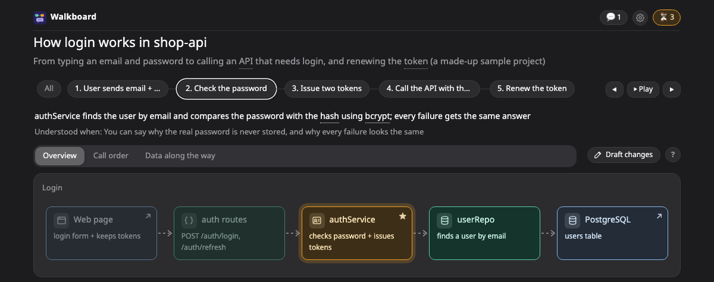
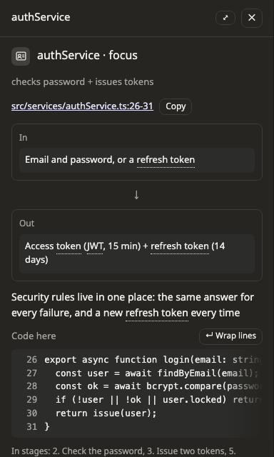

# Explain mode

Explain mode is for understanding code that already exists. The agent reads the code and draws how it works, and every box that stands for code points at the real file and line. Nothing in your project is changed.

For example:

```
/walkboard explain how login works in project A
```



## Following the stages

Instead of steps, an explanation has **stages**: what happens first, what happens next, and so on. Click a stage to see the boxes it involves.

Before it starts, the agent asks how deep to go, an overview or the details. It does not ask if you already said so in your request.

## Reading the code behind a box

Click a box that stands for code, and the side panel shows that code. The lines that matter are marked, with a short note on each one.



Click the file path to open it in your editor. Walkboard opens VS Code unless you choose another one. To use Cursor or IntelliJ instead, set `"editor"` to `"cursor"` or `"idea"` in `~/.walkboard/config.json`, or ask the agent to do it. Use `"none"` to show the path without a link.

If something is still not clear, press **Still unclear** under the box, and the agent explains it again in simpler words. Press **Go deeper** for more detail.

## Keeping the explanation true

Code changes, and an explanation can go out of date. To catch this, each box keeps a short piece of the code it points at.

When the agent checks the plan, it tells you if a file or its lines are gone, or if that piece of code has moved, and where it went. On the page, a box whose code changed after it was explained shows a warning on the code itself.

## Which code the page can show

When the agent makes an explanation, it names the folders the plan is about. The page reads code only from those folders and never from anywhere else on your machine. When you [send the explanation to someone](../share.md), you can choose to leave the code out.

## Pictures you will see

The agent picks the pictures that explain the code best. Often that is a [sequence](../pictures/sequence.md) of what calls what, or a [flow](../pictures/flow.md) of the stages. You may also see a [journey](../pictures/journey.md) that follows one request or record, a [transform](../pictures/transform.md) of how data changes shape, or a [state](../pictures/state.md) picture.

## Trying it

If you have cloned the repository, you can open an example explanation without an agent:

```bash
node skills/walkboard/bin/walkboard.mjs open examples/explain-login
```

## Next steps

- [Draw a system you already have](../existing.md): turn Terraform or Kubernetes files into a map.
- [Pictures](../pictures/README.md): how to read each kind of picture.
