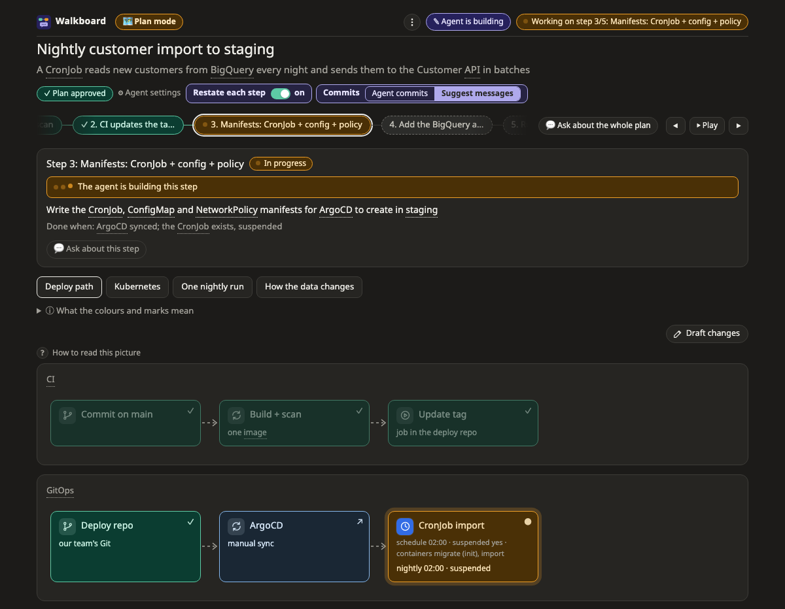
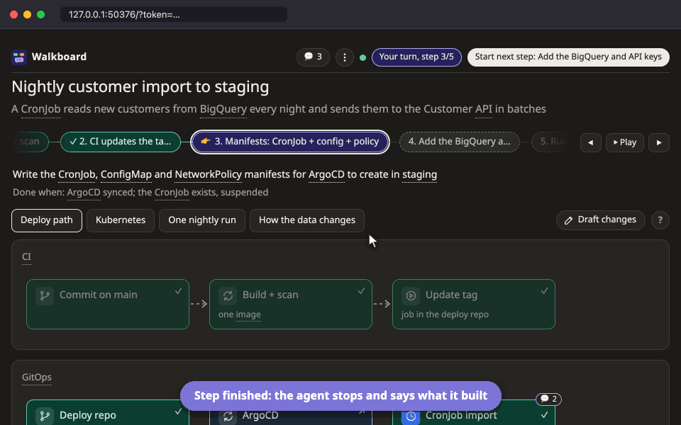

# Plan mode

[Docs](../README.md) › Plan mode

Use it to build or change something: `/walkboard plan deploying this CronJob to staging`.

## How it goes

1. **Questions.** The agent asks up to three short questions when the answer would change the plan, and whether it should commit for you or only suggest messages.
2. **The plan.** 3–8 small steps, each with what it does and how we know it is done, and one or two pictures that show them. Click a step to see what it touches; the rest fades.
3. **Talk it over.** Ask on any box or step, or say what to add, change or remove. Before you approve, the agent changes the plan itself and marks what changed (**✎ Plan changed**).
4. **Approve plan.** Nothing is built before you press it.
5. **One step at a time.** The agent builds a step, marks it for review and stops. Look at what it did, ask about it, then press **Start next step: …** at the top. The last one says **Finish**.

## Commits

Choose who commits under **⋮** (switching costs nothing and does not wake the agent):

- **Agent commits**: it commits each step itself. **Run the rest** then does the remaining steps without stopping.
- **Only suggest**: a step that changed files shows a suggested message. Edit it, then press **Agent commits these, then goes on** or **I committed, go on**. A step that changed no files asks for no message.

## Changes after approval

Once the plan is approved, a change you ask for is drawn as a proposal on the picture (+ add, ~ change, − remove) before anything is built. A bigger change can come as a **before / after** pair of pictures; see [Before and after](../pictures/diff.md).

You can also draw the change yourself: [Sketch your own changes](../draft.md).

## Pictures you will see

A plan usually has a [flow](../pictures/flow.md) built from its steps, and often a [map](../pictures/map.md) of where things run, a [sequence](../pictures/sequence.md) of who calls whom, or a [data model](../pictures/datamodel.md). See [all pictures](../pictures/README.md).
