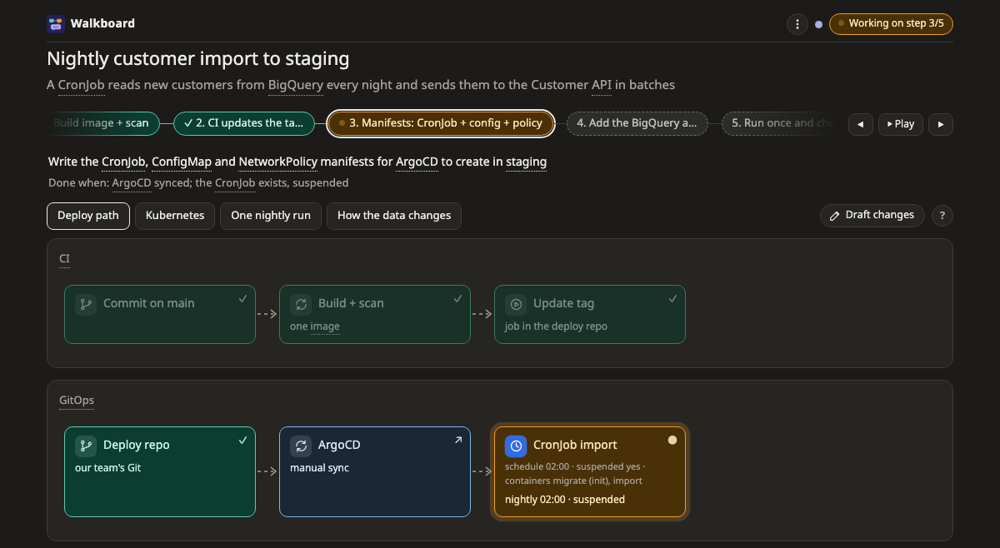
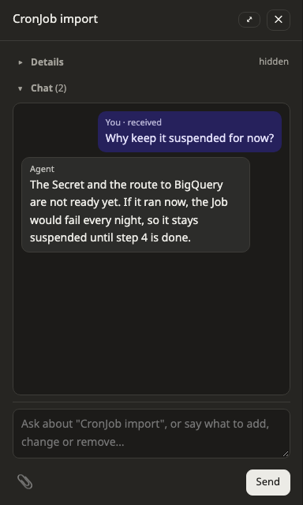

# The page

When the agent answers with Walkboard, it gives you a link to a page in your browser. This page explains what you see there and how to talk to the agent from it.

## Finding your way around

From top to bottom, a page has:

- **The top bar.** The button on the right always shows your next step, such as **Approve plan** or **Start next step: …**. Next to it you can see how many steps are done.
- **The step bar.** Click a step to focus on it. Everything the step does not touch fades out, and the page switches to a picture that shows it. A ✓ means the step is done, and 👉 means it is waiting for you. **⏵ Play** walks through all the steps once.
- **The picture tabs.** A plan usually has one or two pictures. The same row has **✎ Draft changes**, for [sketching a change yourself](draft.md), and **?**, which explains how to read the picture you are looking at.
- **The picture.** Click any box in it to open its details.
- **The chat bar**, at the bottom. Click it to talk about the step you have selected. To talk about the whole plan, choose **All** in the step bar first. The conversation opens in the side panel.

In the top right corner there are three more controls:

- **The dot** shows what the agent is doing. Green means it is listening, purple means it is answering you, and orange means it is busy with something else. Hover over the dot to see this in words.
- **💬** lists every conversation on the page, newest first. It turns orange and says "new" when the agent has replied. Click a conversation to carry on.
- **⋮** holds the settings: the mode, who commits, Export, the theme, this guide, the keyboard shortcuts and the version.

When the agent changes the plan, **✎ Plan changed** appears and the changed parts are outlined. They stay outlined until you press **Mark as seen**.

The first time you open a page in a browser, the picture draws itself along its arrows, and a hint tells you to click a box.

> **Good to know:** The page's address keeps the step, picture and box you are looking at. Reloading the page, or opening the same link later, brings you back to the same place.

## Reading a box

Each box has an icon for what it is, and a mark for where it stands:

| Mark | Means |
|---|---|
| ✓ | done |
| ● | in progress |
| dashed outline | still to do |
| ↗ | an outside system, not part of this work |
| 💬 | there is a conversation on this box |

Some words have a dotted underline. These are in the glossary: click one to read a short, plain explanation. Inside a box, hover over the word instead, because a click opens the box.

Each kind of picture has a few marks of its own. The [Pictures](pictures/README.md) section explains them.

## Asking about a box

To ask about something, click its box. The side panel opens with the box's details and its conversation. Type your question at the bottom of the panel, and the agent's answer appears in that conversation, so you can find it again later.

You do not need a special command to change things. Type what you want in the same place, for example "add a retry here" or "this should go through the queue". The agent works out what to do. Before you approve the plan, it changes the plan directly. After you approve it, it draws your change on the picture as a proposal, marked **+**, **~** or **−**, for you to accept or turn down.

You can also attach images. Paste them, drop them on the chat, or press 📎. You can send up to five images per message, 10 MB each, in PNG, JPEG, GIF or WebP. Large images are scaled down before the agent sees them, so each one costs at most about 1,500 tokens.

If the agent is busy when you send a message, your message waits in line. The page shows its place in the line, and the top bar shows ⏳ with how many messages are waiting. Sometimes the agent answers on a different box than the one you asked on. When that happens, your message links to the box with the answer.

> **Good to know:** Each message you send is one request to the agent, and it counts toward your Claude Code usage like any other. Changing settings, arranging a picture and sketching a draft stay on the page, so they cost nothing.

## Using the side panel

The side panel opens when you click a box or the chat bar. The box's details are at the top, and its conversation is below, with the place to type at the bottom.

- To fold away the details or the chat, click **▾ Details** or **▾ Chat**. The page remembers your choice.
- To make the panel wider, drag its left edge. Press **⤢** for a wide panel with the details and the chat side by side.
- To close it, press ✕ or Esc, or click the same box again.

On a narrow screen, such as a phone, the panel slides up from the bottom instead.

## Answering the agent's guesses

Sometimes the agent has to assume something it could not check, such as how much traffic a service gets. It marks every guess so you can see it. A guess appears either in the bar above the picture or as a dashed box with ❓.

To answer a guess, press **✎ Answer** under it and write in your own words. You can say that it is right, say what is true instead, or answer the question the agent asked. The bar shows the first three guesses. Press **Answer…** to see all of them, with the numbers behind each one.

## Choosing a language and theme

The agent writes the plan in the language you write to it in, and the page's buttons follow. Labels are in English and Thai today. Other languages get English labels.

To choose a light or dark theme, or to follow your system, open **⋮ → Theme**.

## Keyboard shortcuts

| Key | Does |
|---|---|
| ← → | go to the previous or next step |
| Esc | close the side panel, or leave draft mode |
| Enter | send your message. Shift+Enter starts a new line |

Draft mode has its own keys. They are listed in [Sketch your own changes](draft.md).

To see the shortcuts on the page, open **⋮ → Shortcuts**.

## Next steps

- [Plan mode](modes/plan.md): how a plan goes from questions to finished steps.
- [Pictures](pictures/README.md): how to read each kind of picture.
