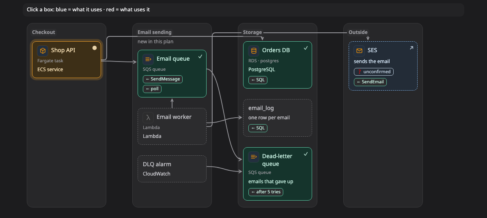

# Components

A **components** picture shows how a system or a codebase is split up. The parts sit in **layers**, columns that go from the user's side on the left to the data on the right, and an arrow from one part to another means the first one uses the second. It answers "what is this made of, and what uses what?".

[Open this picture in the live example ↗](https://aiyaruch1320.github.io/walkboard/examples/pictures.html?view=parts&step=all)

## Reading a components picture

Each column is a layer, such as the web app, the API, the domain logic or the database. The agent picks layers that fit your project, so they can also be services, packages or folders.

An arrow from A to B means A uses B: it calls it, imports it or reads from it. A label on a box, such as **← SQL** or **← HTTP**, says how a line reaches it.

Click a box to see its neighbours. What it uses turns blue, what uses it turns red, and the bar above the picture names them. Its details open beside the picture.

> **Good to know:** An [impact](impact.md) picture also shows what needs what, but it follows a failure all the way through, while a components picture shows only the parts next to the one you click.

## Changing a components picture

A components picture has no draft mode. To change it, tell the agent what is different in the chat, for example "the worker also writes to the cache".

## Next steps

- [Sequence](sequence.md): see the calls between the parts, in order.
- [Map](map.md): see where each part runs.
