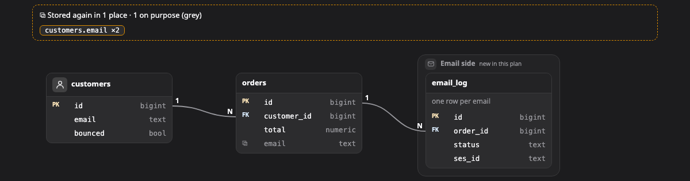

# Data model

A **data model** shows the tables, their keys, and how they relate to each other. It is useful when the work adds or changes tables, or when you need to see where a piece of data is stored.

[Open this picture in the live example ↗](https://aiyaruch1320.github.io/walkboard/examples/pictures.html?view=tables&step=all)

## Reading a data model

Each box is a table. It shows only the columns that matter here, with their types.

- **pk** marks the table's own key.
- **fk** marks a column that points at another table. A column can be both, when a table shares another table's key in a one-to-one relation.

A line goes from a foreign-key column to the column it points at. Lines are many-to-one (N:1) unless they say 1:1.

**⧉** marks a column that holds a copy of data stored somewhere else, with the number of places that hold it. Copies can drift apart, so they are worth a second look. A grey ⧉ is a copy kept on purpose, such as the price at the time of sale.

A frame groups tables that belong together, such as the tables of one service.

## Arranging a data model

Drag a table to arrange it. Drag it into or out of a frame to change its group. You can also move a selected table with the arrow keys, and hold Shift to move it further.

## Sketching on a data model

In [draft mode](../draft.md) you have these tools:

| Tool | What it does |
|---|---|
| Table | Click an empty spot to add a table. Inside a frame, it joins that group |
| Column (C) | Click a table, then type `name type`, adding `pk` or `fk` if needed |
| Line | Drag a column onto the column it points at to make a foreign key. Do it again to take it out, or drop it on another column to move it |
| Group | Click a table to start a new group with it |
| Edit | Click a table or a group's title to edit its name, note and icon. Click a column to edit it in place, or a line to switch between N:1 and 1:1 |
| Take out | Click a table, a column, a group's title or a line |

To make a column the key (pk), click the small space just left of its name.

## Next steps

- [Transform](transform.md): see sample rows and how the data changes shape.
- [Sketch your own changes](../draft.md): how a sketch becomes part of the plan.
