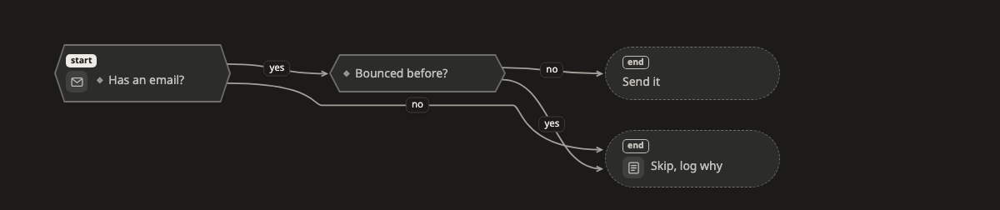

# Decision

A **decision** picture answers "if this, then what?". It is useful for rules, routing and validation, where the next step depends on an answer.

[Open this picture in the live example ↗](https://aiyaruch1320.github.io/walkboard/examples/pictures.html?view=rule&step=all)

## Reading a decision

Start at the box marked **start**. That is the first question asked.

There are three kinds of box:

| Box | Means |
|---|---|
| question | it has two or more ways out, one for each answer |
| step | something is done, and there is one way out |
| end | this is where it stops |

The words on a line are the answer that leads that way, such as yes, no, or over 100.

## Arranging a decision

Drag boxes to arrange the picture. The rest of the picture holds still while you do.

To choose which side of a box a line meets, click the line, or drag the dot at either end.

## Sketching on a decision

To add a rule in [draft mode](../draft.md):

1. Add a box, and choose **question** in its card.
2. Draw a line from it to what each answer leads to.
3. Type the answer on each line.
4. Where the path stops, choose **end** for that box.

To change a box's kind or make it the start, double-click it.

## Next steps

- [State](state.md): show the states something moves through.
- [Sketch your own changes](../draft.md): how a sketch becomes part of the plan.
