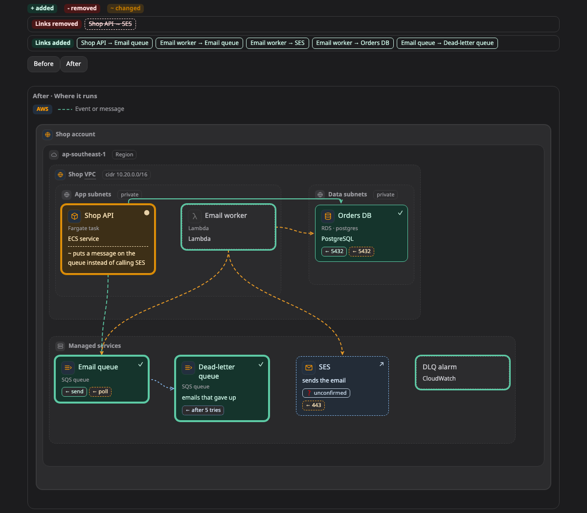

# Before and after

A **before and after** pair shows what the work will change. It puts two pictures side by side, how things are now and how they will be, and marks the difference.

[Open this picture in the live example ↗](https://aiyaruch1320.github.io/walkboard/examples/pictures.html?view=change&step=all)

## Reading a before and after

The picture on the left is how it is now, and the one on the right is how it will be. Boxes that are added, removed or changed are marked, with a note on what changed.

Lines that exist on only one side are listed under the pictures, as "Links added" and "Links removed".

## Changing a before and after

The pair has no draft mode of its own, and you cannot arrange it. Instead, its pencil takes you to the two pictures it compares. Sketch your change on the one you mean. See [Sketch your own changes](../draft.md).

## Next steps

- [Plan mode](../modes/plan.md): how changes are proposed after you approve a plan.
- [Pictures](README.md): the other kinds of picture.
