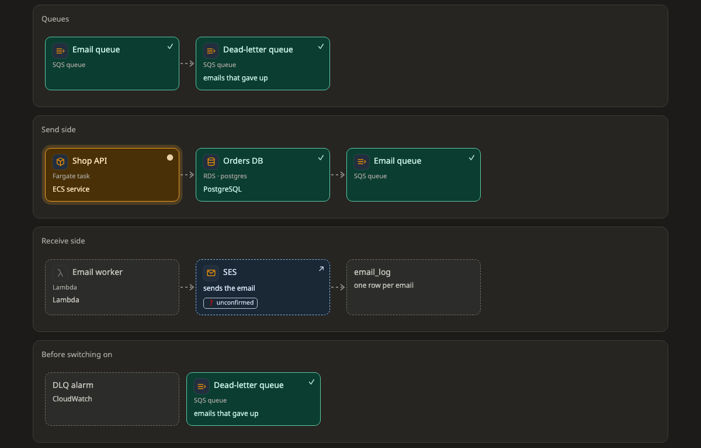

# Flow

A **flow** shows the steps of the work in order. Most plans have one, built from their steps, and it is often the first picture you see.

[Open this picture in the live example ↗](https://aiyaruch1320.github.io/walkboard/examples/pictures.html?view=flow&step=all)

## Reading a flow

A flow is made of rows called **lanes**. Each lane is a step, or one part of the work, and you read them from top to bottom. Inside a lane, the boxes go in order from left to right.

A lane without arrows is a checklist. Its boxes can be done in any order.

When you choose a step in the step bar, the boxes it does not touch fade out.

## Sketching on a flow

In [draft mode](../draft.md) you can add boxes and lanes, rename them, take them out, and drag a box to another place or lane. To reorder the lanes, drag a lane by its title.

| Tool | What it does |
|---|---|
| Box | Click inside the lane where the new box goes |
| Lane | Click between two lanes to add a lane there |
| Edit | Click a box to edit its name, note and icon, or a lane's title to rename it |
| Take out | Click a box to take it out |

A moved box shows **↦** until the agent puts the move into the plan.

> **Good to know:** A box can belong to several steps. If you drag it out of one lane, it leaves only that lane and stays in the others.

## Next steps

- [Sketch your own changes](../draft.md): how a sketch becomes part of the plan.
- [Pictures](README.md): the other kinds of picture.
