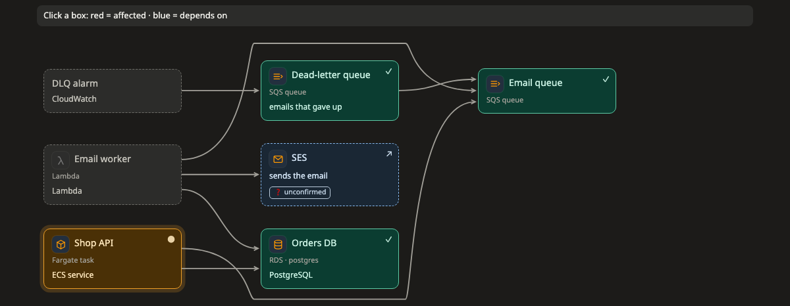

# Impact

[Docs](../README.md) › [Pictures](README.md) › Impact

**Answers:** if this goes down, what breaks?

[Try it: click a box, choose a step ↗](https://aiyaruch1320.github.io/walkboard/examples/pictures.html?view=deps&step=all)

## How to read it

- A line from A to B means A needs B: when B fails, A is hit.
- **Click a box:** what depends on it turns red, what it needs turns blue, and its details open beside the picture.

## Arranging

Drag boxes to arrange the picture; it holds still while you do. Click a line, or drag the dot at either end, to choose which side of each box it meets.

## Draft mode

Add boxes, draw lines, rename, take out. Click a line to reverse it. See [Sketch your own changes](../draft.md).
