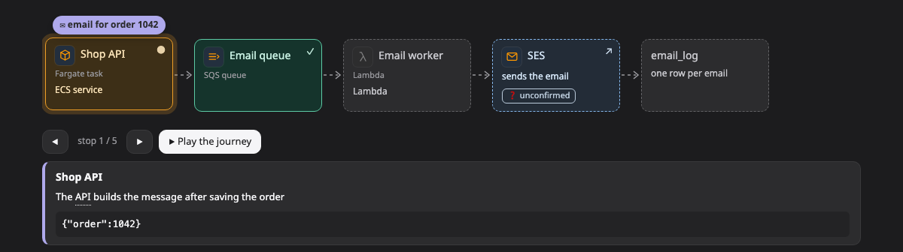

# Journey

A **journey** follows one piece of data along its way: one request, one message or one record, stop by stop. At each stop you see what happened and what the data looks like there.

[Open this picture in the live example ↗](https://aiyaruch1320.github.io/walkboard/examples/pictures.html?view=trip&step=all)

## Reading a journey

The stops sit in a row, usually three to nine of them. The same part can appear twice if the data passes through it twice. An envelope ✉ shows where the data is now.

To move the envelope, press ◀ or ▶. Press **Play** to watch it travel from start to finish.

Under the row, a note says what this stop did, and the data is shown as it is at this stop. The lines that changed here are highlighted.

Click a stop's box to open its details and conversation.

## Changing a journey

A journey has no draft mode. To change it, tell the agent what is different in the chat.

## Next steps

- [Transform](transform.md): compare the shape of the data at each stage side by side.
- [Sequence](sequence.md): see every call between the parts, in order.
