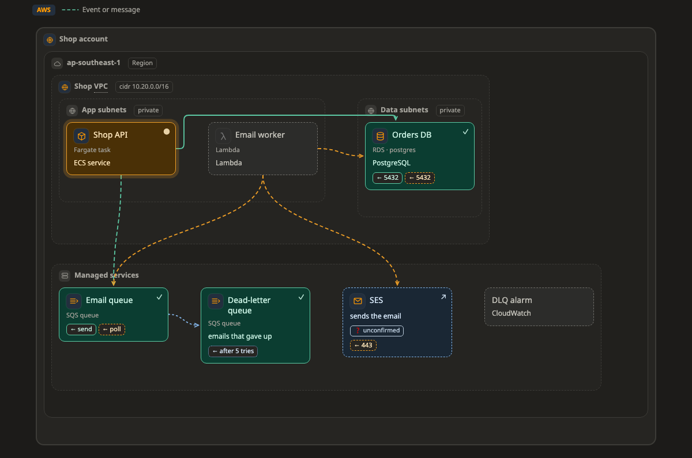

# Map

A **map** shows what sits inside what, and how the parts connect. For example, an AWS account holding a VPC with its subnets, a Kubernetes cluster with namespaces and pods, or a server with its containers.

[Open this picture in the live example ↗](https://aiyaruch1320.github.io/walkboard/examples/pictures.html?view=map&step=all)

## Reading a map

A **zone** is a frame that holds boxes and other zones, such as a region, a VPC, a subnet, a namespace or a server. Zones can be nested up to eight levels deep, but three or four are easiest to read.

A line goes from the side that starts a connection to the side that receives it. The label near the arrow's end is usually the port, such as `← :5432`.

The colour and style of a line tell you its state:

| Line | Means |
|---|---|
| solid green | allowed, and it works |
| dashed orange | still to be opened |
| dotted red, with a bar | blocked |
| dotted blue | standby, such as a backup path |

Only the arrow, the colour and the dashes carry meaning. The route a line takes can change when you move a box, so do not read anything into it.

A large system, with many boxes or four or more top-level zones, is drawn smaller, with one column per site or provider. Read it from left to right, from the outside in.

## Platforms

A box, zone or line can say what it is on a platform, such as an RDS database on AWS or a CronJob on Kubernetes. This gives it the right icon and fields, and the picture is tagged with the platform.

If something sits where it usually does not, such as an RDS database outside any subnet, a small amber **⚠** appears next to its name. It is only a hint, and nothing stops you. Hover over the ⚠ to read why, and follow its link to the platform's page, which lists every kind and where it usually goes. See [Platforms](../platforms/README.md).

## Drawing a system you already have

The agent can draw a map of infrastructure you already run, from the Terraform, Kubernetes manifests or Compose files in your repository. See [Draw a system you already have](../existing.md).

## Arranging a map

Drag boxes and zones to arrange the map, and drag a zone's edge to resize it. Above the map, **Auto | By hand** decides whether the page lays the map out for you or keeps everything where you put it.

To choose which side of a box a line meets, click the line, or drag the dot at either end.

## Sketching on a map

In [draft mode](../draft.md) you have these tools:

| Tool | What it does |
|---|---|
| Box (B) | Click inside the zone where the new box goes |
| Zone (Z) | Click inside a zone to add a zone in it, or on empty space for a new outer zone |
| Line (L) | Drag from one box and let go on another |
| Edit (R) | Click a box or a zone's title to edit its name, note, icon and kind. Click a line to edit its label and direction |
| Take out (D) | Click a box, a zone's title or a line |

To move a box or zone, drag it into another zone. When you copy and paste a zone, everything inside it comes along.

## Next steps

- [Platforms](../platforms/README.md): what each kind of box and zone means, and where it usually sits.
- [Sketch your own changes](../draft.md): how a sketch becomes part of the plan.
