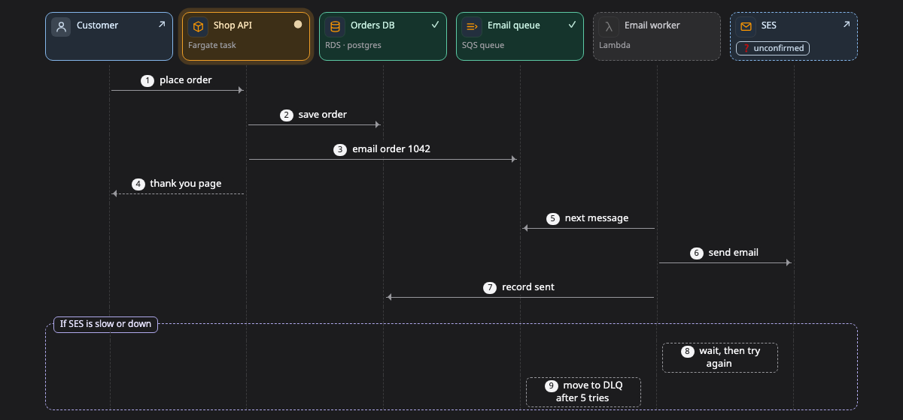

# Sequence

A **sequence** shows who calls whom, in what order, and what happens when something fails. It is useful for following one request through several services.

[Open this picture in the live example ↗](https://aiyaruch1320.github.io/walkboard/examples/pictures.html?view=calls&step=all)

## Reading a sequence

Each column is one part of the system, and time runs down the page.

- A solid arrow is a call, and a dashed arrow going back is its reply.
- An arrow from a column back to itself is something that part does on its own, such as splitting work into batches or retrying.
- A frame around some messages is another path the request can take. Its name is at the top, for example "If the write fails".

When you choose a step, the messages from other steps fade out.

Click a message to open the box that receives it, with its details and conversation.

## Changing a sequence

A sequence has no draft mode. To change it, tell the agent what is different in the chat.

## Next steps

- [Journey](journey.md): follow one piece of data and see how it changes at each stop.
- [Timeline](timeline.md): see when things happen and how long they take.
