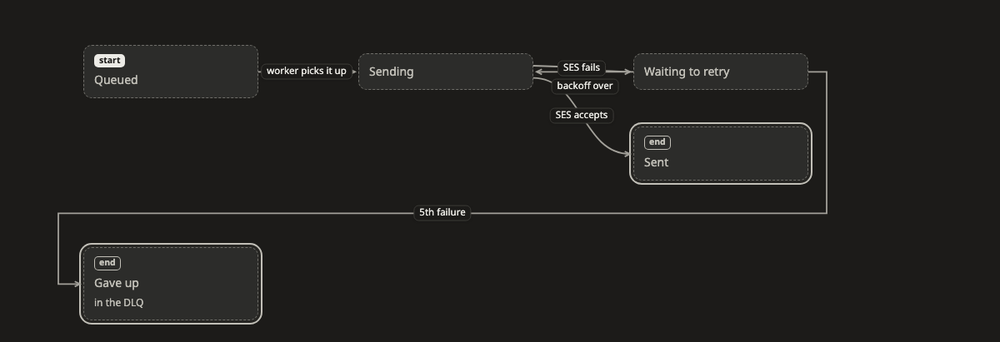

# State

A **state** picture shows which states something can be in, and what moves it from one state to the next. It works for anything with a life of its own, such as an order, a job or an account.

[Open this picture in the live example ↗](https://aiyaruch1320.github.io/walkboard/examples/pictures.html?view=life&step=all)

## Reading a state picture

Each box is a state. A line from A to B means it can move from A to B, and the words on the line say what makes it move. That can be an event, or a time limit such as "30 min unpaid".

A line that comes back into the same box means the same thing can happen again, such as a retry.

- **start** marks the state that something new begins in. Only one box can be the start.
- **end** marks a state where it can stop. Lines can still go on from an end, for example a refund after delivery.

> **Good to know:** The screens of an app work the same way. Each screen is a box, and each line is what you do to get to the next one, such as "tap Pay". Ask for "the screens of checkout as a state picture" to get one.

## Arranging a state picture

Drag boxes to arrange the picture. The rest of the picture holds still while you do.

To choose which side of a box a line meets, click the line, or drag the dot at either end.

## Sketching on a state picture

In [draft mode](../draft.md) you can add states, draw lines between them, rename them and take them out.

- To edit a state's name, note or icon, click it. Its card also lets you switch **start** and **end** on or off.
- To edit a line's label or direction, click the line.
- To connect a line to a different state, drag the line's end onto that box.

## Next steps

- [Decision](decision.md): show the rules that choose between paths.
- [Timeline](timeline.md): show how long each state lasts.
