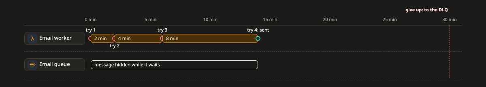

# Timeline

[Docs](../README.md) › [Pictures](README.md) › Timeline

**Answers:** when, and for how long? Retries, timeouts, schedules.

[Try it: click a box, choose a step ↗](https://aiyaruch1320.github.io/walkboard/examples/pictures.html?view=retry&step=all)

## How to read it

- One row per part of the system; time runs left to right in the unit shown (seconds, minutes, days).
- A dot is something that happens at one moment ("fail #1"); a bar is something that lasts ("wait, timeout 3 s").
- Colours are those of a map's lines: green works, orange to do or waiting, red blocked or failed, blue standby.
- A vertical mark across all rows is a moment that matters to all of them ("give up").

Click a row to open its box.

There is no draft mode on a timeline: ask for changes in the chat.
