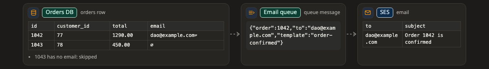

# Transform

[Docs](../README.md) › [Pictures](README.md) › Transform

**Answers:** what does the data look like before and after each stage?

[Try it: click a box, choose a step ↗](https://aiyaruch1320.github.io/walkboard/examples/pictures.html?view=shape&step=all)

## How to read it

- Each stage is a small table (columns and sample rows) or a piece of text, such as a request body, from left to right.
- **∅** is an empty value or `null`; **␠** is a space at the start or end of a value. Both are easy to miss in real data, so they are shown.
- Notes under a stage say what to watch for ("all values are text").

The rows are made-up samples, not your data. Click a stage to open its box.

There is no draft mode on a transform: ask for changes in the chat.
