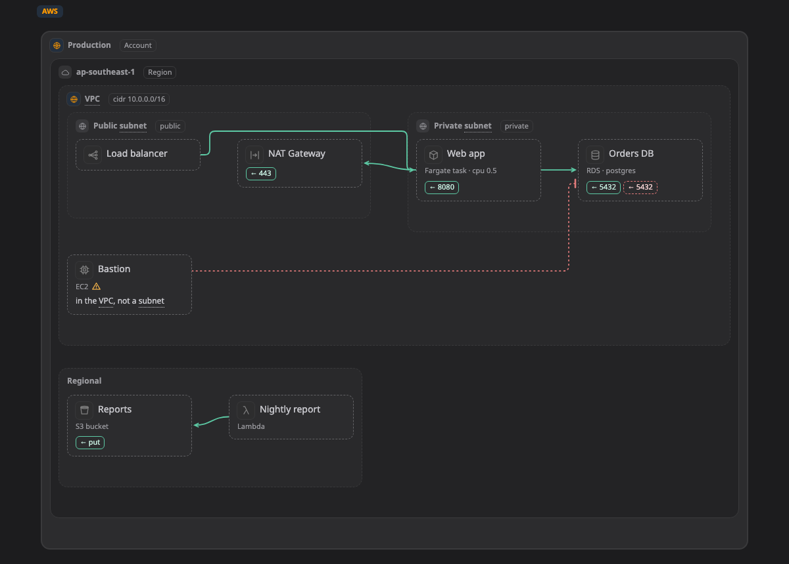

# Platforms

On a [map](../pictures/map.md), a box, zone or line can say what it is on a real platform. An RDS database in a private subnet, a CronJob in a namespace and a VLAN in a data centre are all examples. This section lists what Walkboard knows about each platform.

## Kinds and profiles

What a thing is on a platform is called its **kind**. A kind is written as the platform and a name, such as `aws:rds` or `k8s:cronjob`. You do not need to type these yourself: the agent sets them, and in draft mode you pick them from a list.

All the kinds for one platform make up a **profile**. Walkboard has these profiles:

| Profile | Covers |
|---|---|
| [AWS](aws.md) | accounts, regions, VPCs, Availability Zones, subnets, security groups, and AWS services |
| [Google Cloud](gcp.md) | organizations, folders, projects, VPC networks, regions, subnets, and Google Cloud services |
| [Azure](azure.md) | subscriptions, resource groups, virtual networks, subnets, and Azure services |
| [Huawei Cloud](huawei.md) | regions, enterprise projects, VPCs, subnets, and Huawei Cloud services |
| [Kubernetes](k8s.md) | clusters, node pools, namespaces, workloads, services, config and network policies |
| [Container](container.md) | container hosts, Compose projects, Swarm, Podman pods, containers and their networks |
| [On-prem](onprem.md) | data centres, sites, racks, VLANs, DMZs, servers, virtualization and appliances |

Each profile's page lists every kind, where it usually sits, other names for it, and its fields.

## What a kind adds to the map

When a box has a kind, it gets the platform's icon and colours, and its fields show under its name. For example, an RDS box shows its engine and size. The map is also tagged with the platform, so readers know where they are.

A kind also knows where that thing usually sits. If you put it somewhere else, a small amber **⚠** appears next to its name. Hover over the ⚠ to read why, for example "RDS usually sits in Subnet, VPC", and follow its link to the kind on the platform's page.

[Hover over the ⚠ next to Bastion in the live example ↗](https://aiyaruch1320.github.io/walkboard/examples/platforms.html?view=aws&step=all)

> **Good to know:** The ⚠ is a hint, never an error. Nothing is blocked, so you can sketch quickly and tidy up later. Some designs put things in unusual places on purpose, and that is fine.

A zone without a kind is skipped. The ⚠ looks at the nearest zone around the box that has a kind, so if no zone around it has one, it never gets a ⚠ and you can draw freely. Anything no profile covers is simply drawn without a kind, with the name you gave it.

## Mixing platforms on one map

You can mix profiles on the same map. For example, an EKS cluster in an AWS VPC is a Kubernetes cluster zone inside an AWS VPC zone, with namespaces and workloads inside it.

When a box from one platform sits in another platform's zone, the ⚠ names both, such as "a Google Cloud VM in an AWS subnet". This does not happen when the zone can run it, such as containers on an EC2 instance.

## Choosing a kind in draft mode

In [draft mode](../draft.md), the card of a box or zone has a search box for its kind. Kinds from the platform of the zone it is in come first. After those come kinds from the zones around it, then from other platforms the picture already uses.

## Missing a kind?

The profiles cover the common parts of each provider's official product list, but not every product. If you need one that is missing, [open an issue](https://github.com/aiyaruch1320/walkboard/issues/new/choose). In the meantime, draw it without a kind.

## Next steps

- [AWS](aws.md): every AWS kind and where it usually sits.
- [Kubernetes](k8s.md): clusters, namespaces and workloads.
