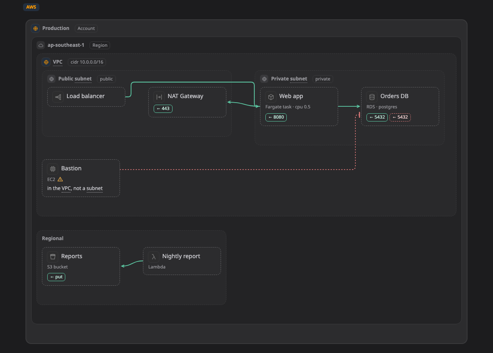

# AWS

[Docs](../README.md) › [Platforms](README.md) › AWS

What boxes, zones and lines can be on AWS, and where each usually sits. On a map the page draws a kind's icon and fields, and shows a small amber ⚠ when something sits outside the zones listed here. That is a hint, never a block: if you mean it, it is fine. How profiles work: [Platforms](README.md).

[Try it: click a box, see its kind and fields ↗](https://aiyaruch1320.github.io/walkboard/examples/platforms.html?view=aws&step=all)

This page is generated from `skills/walkboard/lib/profiles.mjs`.

## Zones

Frames that hold other things.

| Kind | Usually in | Notes | Also called | Fields |
|---|---|---|---|---|
| **Account** `aws:account` | anywhere |  |  |  |
| **Region** `aws:region` | [Account](#account) |  |  |  |
| **VPC** `aws:vpc` | [Account](#account), [Region](#region) |  |  | cidr |
| **Availability Zone** `aws:az` | [VPC](#vpc), [Region](#region) |  |  |  |
| **Subnet** `aws:subnet` | [VPC](#vpc), [Availability Zone](#az) |  |  | access (private, public); cidr |
| **Security group** `aws:sg` | [VPC](#vpc), [Subnet](#subnet), [Availability Zone](#az) | rules look through it to the zone around | security group, firewall | rules |

## Boxes

| Kind | Usually in | Notes | Also called | Fields |
|---|---|---|---|---|
| **EC2** `aws:ec2` | [Subnet](#subnet) | a box, or a zone when something runs inside it; can run [Container](container.md) inside | vm, server, instance | type; os |
| **ECS cluster** `aws:ecs` | [VPC](#vpc), [Subnet](#subnet), [Region](#region) | a box, or a zone when something runs inside it; can run [Container](container.md) inside | container |  |
| **Fargate task** `aws:fargate` | [ECS cluster](#ecs), [Subnet](#subnet) |  | container, task | cpu; memory |
| **EKS cluster** `aws:eks` | [VPC](#vpc), [Region](#region) | a box, or a zone when something runs inside it; can run [Kubernetes](k8s.md) inside | kubernetes, k8s | version |
| **Lambda** `aws:lambda` | [Region](#region), [Account](#account), [VPC](#vpc), [Subnet](#subnet) |  | function, serverless | runtime |
| **Application Load Balancer** `aws:alb` | [Subnet](#subnet), [VPC](#vpc) |  | lb, load balancer | scheme (internet-facing, internal) |
| **Network Load Balancer** `aws:nlb` | [Subnet](#subnet), [VPC](#vpc) |  | lb, load balancer | scheme (internet-facing, internal) |
| **Internet Gateway** `aws:internetgateway` | [VPC](#vpc) |  | igw |  |
| **NAT Gateway** `aws:natgateway` | [Subnet](#subnet) |  | nat |  |
| **VPC endpoint** `aws:endpoint` | [VPC](#vpc), [Subnet](#subnet) |  | privatelink, private link | service |
| **Transit Gateway** `aws:transitgateway` | [Region](#region), [Account](#account) |  |  |  |
| **Site-to-Site VPN** `aws:vpn` | [VPC](#vpc), [Region](#region) |  |  |  |
| **Direct Connect** `aws:directconnect` | [Region](#region), [Account](#account) |  |  | bandwidth |
| **API Gateway** `aws:apigateway` | [Region](#region), [Account](#account) |  | api | type (REST, HTTP, WebSocket) |
| **CloudFront** `aws:cloudfront` | [Account](#account) |  | cdn |  |
| **Route 53** `aws:route53` | [Account](#account) |  | dns |  |
| **WAF** `aws:waf` | [Account](#account), [Region](#region) |  |  |  |
| **RDS** `aws:rds` | [Subnet](#subnet), [VPC](#vpc) |  | db, database, postgres, mysql | engine (postgres, mysql, mariadb, oracle, sqlserver); size; multiAz (yes, no) |
| **Aurora** `aws:aurora` | [Subnet](#subnet), [VPC](#vpc) |  | db, database, postgres, mysql | engine (postgres, mysql); size; serverless (yes, no) |
| **DynamoDB** `aws:dynamodb` | [Region](#region), [Account](#account) |  | db, nosql, table | capacity (on-demand, provisioned) |
| **ElastiCache** `aws:elasticache` | [Subnet](#subnet), [VPC](#vpc) |  | redis, cache, valkey | engine (redis, valkey, memcached); size |
| **Redshift** `aws:redshift` | [Subnet](#subnet), [VPC](#vpc) |  |  |  |
| **S3 bucket** `aws:s3` | [Region](#region), [Account](#account) |  | bucket, object storage | versioning (on, off) |
| **EFS** `aws:efs` | [VPC](#vpc), [Subnet](#subnet) |  | nfs, file share |  |
| **SQS queue** `aws:sqs` | [Region](#region), [Account](#account) |  | queue | type (standard, fifo) |
| **SNS topic** `aws:sns` | [Region](#region), [Account](#account) |  | topic, notification |  |
| **EventBridge** `aws:eventbridge` | [Region](#region), [Account](#account) |  |  |  |
| **Kinesis** `aws:kinesis` | [Region](#region), [Account](#account) |  | stream |  |
| **MSK (Kafka)** `aws:msk` | [VPC](#vpc), [Subnet](#subnet) |  | kafka, stream |  |
| **Step Functions** `aws:stepfunctions` | [Region](#region), [Account](#account) |  |  |  |
| **Secrets Manager** `aws:secretsmanager` | [Region](#region), [Account](#account) |  | secret, password |  |
| **KMS key** `aws:kms` | [Region](#region), [Account](#account) |  |  |  |
| **IAM role** `aws:iam` | [Account](#account) |  | role, permission |  |
| **Cognito** `aws:cognito` | [Region](#region), [Account](#account) |  | login, auth |  |
| **CloudWatch** `aws:cloudwatch` | [Region](#region), [Account](#account) |  | logs, monitor, alarm |  |
| **ECR** `aws:ecr` | [Region](#region), [Account](#account) |  | registry, image |  |
| **SES** `aws:ses` | [Region](#region), [Account](#account) |  |  |  |
| **Athena** `aws:athena` | [Region](#region), [Account](#account) |  |  |  |
| **Glue** `aws:glue` | [Region](#region), [Account](#account) |  |  |  |
| **Bedrock** `aws:bedrock` | [Region](#region), [Account](#account) |  |  |  |
| **CodePipeline** `aws:codepipeline` | [Region](#region), [Account](#account) |  |  |  |

## Lines

A line without a kind is traffic: one part calling another.

| Kind | Means |
|---|---|
| `aws:event` | Event or message |
| `aws:peering` | VPC peering |
| `aws:iam` | Permission (IAM) |
| `aws:replication` | Replication |
