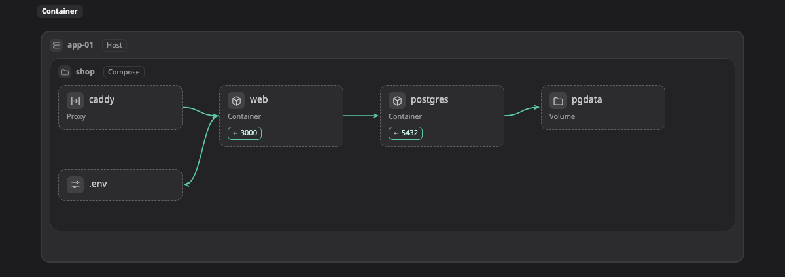

# Container

This page lists every Container kind that Walkboard knows: the boxes, zones and lines you can draw on a [map](../pictures/map.md), and where each one usually sits.

When a box has one of these kinds, the map shows its icon and fields. If you put it somewhere other than the zones listed under "Usually in", a small amber ⚠ appears next to its name. It is only a hint, so if you mean it, that is fine. To learn how kinds work, see [Platforms](README.md).

[Open this map in the live example and click a box to see its kind ↗](https://aiyaruch1320.github.io/walkboard/examples/platforms.html?view=container&step=all)

## Zones

A zone is a frame that holds boxes and other zones.

| Kind | Usually in | Notes | Also called | Fields |
|---|---|---|---|---|
| **Container host** `container:host` | [Swarm cluster](#swarm) |  | docker, podman, docker host | runtime (docker, podman, containerd); os |
| **Compose project** `container:compose` | [Container host](#host) |  | docker compose, stack |  |
| **Container network** `container:network` | [Container host](#host), [Compose project](#compose) |  | docker network, bridge | driver (bridge, host, overlay, macvlan, ipvlan) |
| **Swarm cluster** `container:swarm` | anywhere |  | docker swarm, cluster |  |

## Boxes

A box is one resource, such as a server, a database or a queue.

| Kind | Usually in | Notes | Also called | Fields |
|---|---|---|---|---|
| **Container** `container:container` | [Container host](#host), [Compose project](#compose), [Container network](#network), [Podman pod](#pod), [Swarm cluster](#swarm) |  | docker, service | image; ports; replicas; restart (no, always, unless-stopped, on-failure) |
| **Volume** `container:volume` | [Container host](#host), [Compose project](#compose), [Swarm cluster](#swarm) |  | disk, mount | mount; driver |
| **Env / config file** `container:envfile` | [Container host](#host), [Compose project](#compose) |  | env, .env, config |  |
| **Image registry** `container:registry` | anywhere |  | image |  |
| **Podman pod** `container:pod` | [Container host](#host), [Container network](#network) | a box, or a zone when something runs inside it | podman pod |  |
| **Reverse proxy** `container:proxy` | [Container host](#host), [Compose project](#compose), [Container network](#network), [Swarm cluster](#swarm) |  | traefik, nginx, caddy, ingress | ports |
| **Secret** `container:secret` | [Container host](#host), [Compose project](#compose), [Swarm cluster](#swarm) |  | password, compose secret |  |
| **Config** `container:config` | [Container host](#host), [Compose project](#compose), [Swarm cluster](#swarm) |  | compose config, config file |  |
| **Bind mount (host folder)** `container:bindmount` | [Container host](#host), [Compose project](#compose) |  | host path, folder | path |

## Lines

A line without a kind is plain traffic, one part calling another. These kinds are for lines that mean something else.

| Kind | Means |
|---|---|
| `container:uses` | Mounts or reads |
| `container:depends` | Starts after (depends_on) |
| `container:publishes` | Publishes a port |

> **Good to know:** This page is generated from `skills/walkboard/lib/profiles.mjs`. To add a kind, change that file and run `node scripts/profiles-doc.mjs`.
