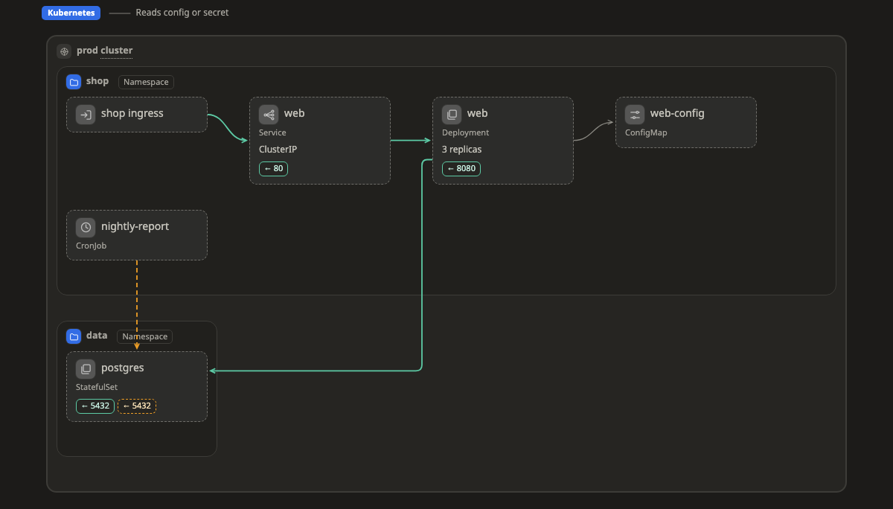

# Kubernetes

This page lists every Kubernetes kind that Walkboard knows: the boxes, zones and lines you can draw on a [map](../pictures/map.md), and where each one usually sits.

When a box has one of these kinds, the map shows its icon and fields. If you put it somewhere other than the zones listed under "Usually in", a small amber ⚠ appears next to its name. It is only a hint, so if you mean it, that is fine. To learn how kinds work, see [Platforms](README.md).

[Open this map in the live example and click a box to see its kind ↗](https://aiyaruch1320.github.io/walkboard/examples/platforms.html?view=k8s&step=all)

## Zones

A zone is a frame that holds boxes and other zones.

| Kind | Usually in | Notes | Also called | Fields |
|---|---|---|---|---|
| **Cluster** `k8s:cluster` | anywhere |  | kubernetes, k8s | version |
| **Namespace** `k8s:namespace` | [Cluster](#cluster) |  | ns |  |
| **Network policy** `k8s:networkpolicy` | [Namespace](#namespace) | a box inside it is checked against the zone around it | policy, firewall | rules |
| **Node pool** `k8s:nodepool` | [Cluster](#cluster) |  | node group, nodes | size; machine |
| **Service mesh** `k8s:mesh` | [Cluster](#cluster), [Namespace](#namespace) | a box inside it is checked against the zone around it | istio, linkerd, mesh |  |

## Boxes

A box is one resource, such as a server, a database or a queue.

| Kind | Usually in | Notes | Also called | Fields |
|---|---|---|---|---|
| **Deployment** `k8s:deployment` | [Namespace](#namespace) |  | pod, app | replicas; image; containers |
| **StatefulSet** `k8s:statefulset` | [Namespace](#namespace) |  |  | replicas; image; containers |
| **DaemonSet** `k8s:daemonset` | [Namespace](#namespace), [Node](#node), [Node pool](#nodepool) |  |  | image; containers |
| **CronJob** `k8s:cronjob` | [Namespace](#namespace) |  |  | schedule; image; containers; suspended (yes, no) |
| **Job** `k8s:job` | [Namespace](#namespace) |  |  | image; containers |
| **Pod** `k8s:pod` | [Namespace](#namespace), [Node](#node), [Node pool](#nodepool) |  |  | image; containers |
| **Service** `k8s:service` | [Namespace](#namespace) |  | svc | type (ClusterIP, NodePort, LoadBalancer, ExternalName, Headless); port |
| **Ingress** `k8s:ingress` | [Namespace](#namespace) |  |  | host |
| **ConfigMap** `k8s:configmap` | [Namespace](#namespace) |  | config |  |
| **Secret** `k8s:secret` | [Namespace](#namespace) |  | password |  |
| **PersistentVolumeClaim** `k8s:pvc` | [Namespace](#namespace) |  | volume, disk | size; storageClass |
| **PersistentVolume** `k8s:pv` | [Cluster](#cluster) |  | volume, disk | size |
| **HorizontalPodAutoscaler** `k8s:hpa` | [Namespace](#namespace) |  | autoscale | min; max |
| **ServiceAccount** `k8s:serviceaccount` | [Namespace](#namespace) |  |  |  |
| **Role / RoleBinding** `k8s:role` | [Namespace](#namespace) |  | rbac |  |
| **Node** `k8s:node` | [Cluster](#cluster), [Node pool](#nodepool) | a box, or a zone when something runs inside it | worker, machine | machine |
| **ReplicaSet** `k8s:replicaset` | [Namespace](#namespace) |  |  | replicas |
| **Operator / controller** `k8s:operator` | [Namespace](#namespace) |  | controller, crd |  |
| **Gateway (Gateway API)** `k8s:gateway` | [Namespace](#namespace) |  | gateway api, load balancer | class; listeners |
| **Route (HTTPRoute, GRPCRoute…)** `k8s:route` | [Namespace](#namespace) |  | httproute, grpcroute, tlsroute | type (HTTP, GRPC, TLS, TCP); host |
| **PodDisruptionBudget** `k8s:pdb` | [Namespace](#namespace) |  | disruption | minAvailable |
| **VerticalPodAutoscaler** `k8s:vpa` | [Namespace](#namespace) |  | autoscale |  |
| **ScaledObject (KEDA)** `k8s:scaledobject` | [Namespace](#namespace) |  | keda, autoscale, event scaling | trigger |
| **ResourceQuota / LimitRange** `k8s:resourcequota` | [Namespace](#namespace) |  | limits, quota |  |
| **StorageClass** `k8s:storageclass` | [Cluster](#cluster) |  | storage, csi | provisioner |
| **ClusterRole / ClusterRoleBinding** `k8s:clusterrole` | [Cluster](#cluster) |  | rbac |  |
| **CustomResourceDefinition** `k8s:crd` | [Cluster](#cluster) |  | custom resource |  |
| **Certificate (cert-manager)** `k8s:certificate` | [Namespace](#namespace) |  | cert-manager, tls |  |
| **ExternalSecret** `k8s:externalsecret` | [Namespace](#namespace) |  | external secrets, vault, secret store |  |
| **GitOps app (Argo CD / Flux)** `k8s:gitopsapp` | [Namespace](#namespace), [Cluster](#cluster) |  | argo cd, argocd, flux, gitops |  |

## Lines

A line without a kind is plain traffic, one part calling another. These kinds are for lines that mean something else.

| Kind | Means |
|---|---|
| `k8s:uses` | Reads config or secret |
| `k8s:mounts` | Mounts a volume |
| `k8s:selects` | Selects pods |
| `k8s:routes` | Routes to |
| `k8s:scales` | Scales |

> **Good to know:** This page is generated from `skills/walkboard/lib/profiles.mjs`. To add a kind, change that file and run `node scripts/profiles-doc.mjs`.
