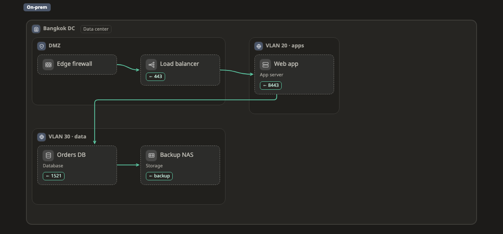

# On-prem

[Docs](../README.md) › [Platforms](README.md) › On-prem

What boxes, zones and lines can be on On-prem, and where each usually sits. On a map the page draws a kind's icon and fields, and shows a small amber ⚠ when something sits outside the zones listed here. That is a hint, never a block: if you mean it, it is fine. How profiles work: [Platforms](README.md).

[Try it: click a box, see its kind and fields ↗](https://aiyaruch1320.github.io/walkboard/examples/platforms.html?view=onprem&step=all)

This page is generated from `skills/walkboard/lib/profiles.mjs`.

## Zones

Frames that hold other things.

| Kind | Usually in | Notes | Also called | Fields |
|---|---|---|---|---|
| **Data center** `onprem:datacenter` | anywhere |  |  |  |
| **Rack** `onprem:rack` | [Data center](#datacenter) |  |  |  |
| **VLAN / network segment** `onprem:vlan` | [Data center](#datacenter), [DMZ](#dmz), [Site / office / branch](#site) |  | network, segment, subnet | id; cidr |
| **DMZ** `onprem:dmz` | [Data center](#datacenter), [Site / office / branch](#site) |  |  |  |
| **Site / office / branch** `onprem:site` | anywhere |  | office, branch, campus, headquarters |  |
| **Virtualization cluster** `onprem:cluster` | [Data center](#datacenter), [Rack](#rack), [VLAN / network segment](#vlan) | can run [Container](container.md) inside | vsphere, vcenter, proxmox, hyper-v, nutanix |  |

## Boxes

| Kind | Usually in | Notes | Also called | Fields |
|---|---|---|---|---|
| **Physical server** `onprem:server` | [Rack](#rack), [Data center](#datacenter), [VLAN / network segment](#vlan), [DMZ](#dmz), [Site / office / branch](#site) | a box, or a zone when something runs inside it; can run [Container](container.md), [Kubernetes](k8s.md) inside | host, machine, bare metal | cpu; memory; os |
| **Virtual machine** `onprem:vm` | [Physical server](#server), [VLAN / network segment](#vlan), [Data center](#datacenter), [DMZ](#dmz), [Virtualization cluster](#cluster), [Hypervisor host](#hypervisor) | a box, or a zone when something runs inside it; can run [Container](container.md), [Kubernetes](k8s.md) inside | server, vmware | cpu; memory; os |
| **Firewall** `onprem:firewall` | [Data center](#datacenter), [Rack](#rack), [DMZ](#dmz), [VLAN / network segment](#vlan), [Site / office / branch](#site) |  |  | model |
| **Router** `onprem:router` | [Data center](#datacenter), [Rack](#rack), [Site / office / branch](#site) |  |  |  |
| **Switch** `onprem:switch` | [Data center](#datacenter), [Rack](#rack), [VLAN / network segment](#vlan), [Site / office / branch](#site) |  |  |  |
| **Load balancer** `onprem:loadbalancer` | [Data center](#datacenter), [Rack](#rack), [DMZ](#dmz), [VLAN / network segment](#vlan) |  | lb, f5 | model |
| **VPN gateway** `onprem:vpn` | [Data center](#datacenter), [DMZ](#dmz), [Site / office / branch](#site) |  |  |  |
| **Database** `onprem:database` | [Physical server](#server), [Virtual machine](#vm), [VLAN / network segment](#vlan), [Data center](#datacenter) |  | db, oracle, postgres, mysql, sql server | engine |
| **Storage (NAS / SAN)** `onprem:storage` | [Data center](#datacenter), [Rack](#rack), [VLAN / network segment](#vlan) |  | nas, san, disk | size |
| **Directory (AD / LDAP)** `onprem:directory` | [Physical server](#server), [Virtual machine](#vm), [VLAN / network segment](#vlan), [Data center](#datacenter) |  | ad, ldap, active directory |  |
| **Hypervisor host** `onprem:hypervisor` | [Rack](#rack), [Data center](#datacenter), [Virtualization cluster](#cluster), [VLAN / network segment](#vlan) | a box, or a zone when something runs inside it; can run [Container](container.md) inside | esxi, proxmox, hyper-v, kvm | cpu; memory |
| **Application server** `onprem:appserver` | [Physical server](#server), [Virtual machine](#vm), [VLAN / network segment](#vlan), [Data center](#datacenter), [DMZ](#dmz) | a box, or a zone when something runs inside it; can run [Container](container.md) inside | tomcat, weblogic, websphere, jboss, iis, middleware | platform |
| **Proxy (forward / reverse)** `onprem:proxy` | [DMZ](#dmz), [VLAN / network segment](#vlan), [Data center](#datacenter), [Physical server](#server), [Virtual machine](#vm) |  | reverse proxy, nginx, haproxy, squid |  |
| **Web application firewall** `onprem:waf` | [DMZ](#dmz), [Data center](#datacenter), [Rack](#rack), [VLAN / network segment](#vlan) |  | waf |  |
| **IDS / IPS** `onprem:ids` | [Data center](#datacenter), [Rack](#rack), [DMZ](#dmz), [VLAN / network segment](#vlan) |  | intrusion detection, intrusion prevention |  |
| **DNS / DHCP server** `onprem:dnsserver` | [Physical server](#server), [Virtual machine](#vm), [VLAN / network segment](#vlan), [Data center](#datacenter), [DMZ](#dmz) |  | dns, dhcp, bind |  |
| **Mail server** `onprem:mailserver` | [Physical server](#server), [Virtual machine](#vm), [VLAN / network segment](#vlan), [Data center](#datacenter), [DMZ](#dmz) |  | smtp, exchange, email |  |
| **File server** `onprem:fileserver` | [Physical server](#server), [Virtual machine](#vm), [VLAN / network segment](#vlan), [Data center](#datacenter) |  | smb, nfs, file share |  |
| **Object storage** `onprem:objectstorage` | [Data center](#datacenter), [Rack](#rack), [VLAN / network segment](#vlan), [Physical server](#server), [Virtual machine](#vm) |  | minio, ceph, s3 compatible, bucket |  |
| **Backup server / tape** `onprem:backupserver` | [Data center](#datacenter), [Rack](#rack), [VLAN / network segment](#vlan) |  | backup, veeam, tape |  |
| **Cache** `onprem:cache` | [Physical server](#server), [Virtual machine](#vm), [VLAN / network segment](#vlan), [Data center](#datacenter) |  | redis, memcached |  |
| **Message queue** `onprem:mq` | [Physical server](#server), [Virtual machine](#vm), [VLAN / network segment](#vlan), [Data center](#datacenter) |  | ibm mq, rabbitmq, kafka, activemq, queue |  |
| **Mainframe** `onprem:mainframe` | [Data center](#datacenter), [Rack](#rack) |  | ibm z, as/400, cobol |  |
| **SIEM / log server** `onprem:siem` | [Physical server](#server), [Virtual machine](#vm), [VLAN / network segment](#vlan), [Data center](#datacenter) |  | syslog, splunk, qradar, elk, logs |  |
| **Monitoring** `onprem:monitoring` | [Physical server](#server), [Virtual machine](#vm), [VLAN / network segment](#vlan), [Data center](#datacenter) |  | zabbix, nagios, prometheus, grafana |  |
| **Jump host / PAM** `onprem:bastion` | [VLAN / network segment](#vlan), [DMZ](#dmz), [Data center](#datacenter), [Physical server](#server), [Virtual machine](#vm) |  | bastion, pam, cyberark |  |
| **HSM** `onprem:hsm` | [Data center](#datacenter), [Rack](#rack) |  | hardware security module, keys |  |
| **CI/CD server** `onprem:cicd` | [Physical server](#server), [Virtual machine](#vm), [VLAN / network segment](#vlan), [Data center](#datacenter) |  | jenkins, gitlab, ci, build |  |
| **Wi-Fi access point** `onprem:accesspoint` | [Site / office / branch](#site), [VLAN / network segment](#vlan) |  | wifi, wireless, ap |  |

## Lines

A line without a kind is traffic: one part calling another.

| Kind | Means |
|---|---|
| `onprem:replication` | Replication |
| `onprem:backup` | Backup |
| `onprem:wan` | WAN / VPN link |
