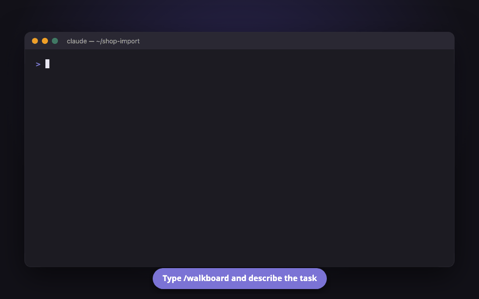
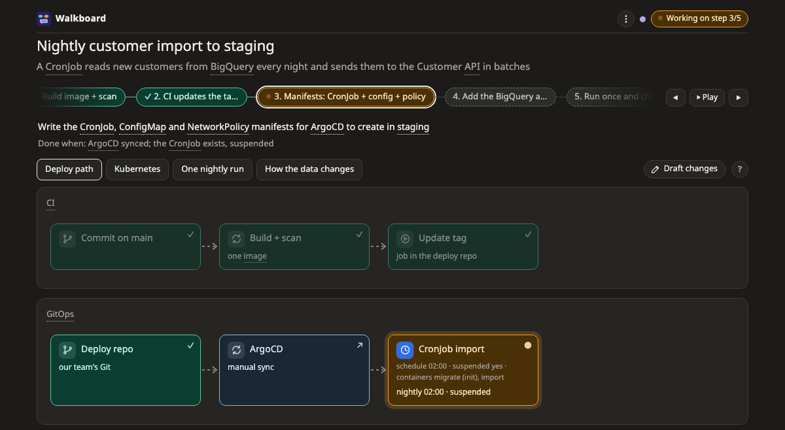

# เริ่มใช้งาน Walkboard

หน้านี้อธิบายว่า Walkboard คืออะไร ติดตั้งยังไง และลองใช้ครั้งแรกแล้วจะเจออะไรบ้าง

## Walkboard คืออะไร

Walkboard เป็น skill สำหรับ coding agent ทำมาสำหรับ Claude Code ก่อน แต่ agent อื่นที่อ่าน `SKILL.md` ได้ก็ใช้ได้ เวลาให้ agent วางแผนงานหรืออธิบายโค้ด แทนที่จะได้ข้อความยาวเหยียดในแชท agent จะวาดคำตอบออกมาเป็นภาพบนหน้าเว็บในเครื่องของคุณ

ภาพนี้ไม่ได้มีไว้ดูอย่างเดียว คุณคลิกกล่องไหนก็ได้เพื่อดูว่ามันคืออะไร ถามเรื่องนั้น หรือบอกว่าอยากให้แก้ตรงไหน แล้ว agent จะตอบอยู่ที่กล่องนั้นเลย บทสนทนาจึงอยู่ติดกับเรื่องที่คุยกัน ไม่จมหายไปในแชทยาวๆ



ถ้าอยากเห็นหน้าตาก่อนติดตั้ง [เปิดหน้าตัวอย่างได้เลย](https://aiyaruch1320.github.io/walkboard/examples/pictures.html?view=map&step=all) หน้านี้เปิดในเบราว์เซอร์ได้ทันที กดเล่นได้ตามสบาย

## ใช้ทำอะไรได้บ้าง

Walkboard มี 3 โหมด agent จะเลือกให้เองจากสิ่งที่คุณขอ

- **โหมดวางแผน** ใช้ตอนจะสร้างหรือแก้อะไรสักอย่าง agent จะแบ่งงานเป็นขั้นเล็กๆ 3–8 ขั้น ให้คุณอนุมัติแผนก่อน แล้วค่อยลงมือทำทีละขั้น
- **โหมดอธิบาย** ใช้ตอนอยากเข้าใจโค้ดหรือระบบที่มีอยู่แล้ว agent จะวาดเป็นลำดับขั้นตอนหรือเป็นภาพระบบ และแต่ละกล่องชี้ไปที่ไฟล์และบรรทัดจริงในโค้ด
- **โหมดออกแบบ** ใช้ตอนยังไม่แน่ใจว่าจะทำแบบไหนดี agent จะหาทางเลือกมา 2–4 แบบ วาดเทียบกัน ให้คะแนนพร้อมแหล่งอ้างอิง และบอกว่าแนะนำทางไหน

Walkboard เหมาะกับนักพัฒนา architect SRE และทุกคนที่ต้องตามหรือตรวจแผนงานของ AI โดยเฉพาะงานที่มีหลายส่วนเกี่ยวข้องกัน แต่ถ้าเป็นคำถามสั้นๆ ที่ตอบบรรทัดเดียวจบ ถามในแชทธรรมดาจะเร็วกว่า

## ก่อนติดตั้ง

สิ่งที่ต้องมีคือ Claude Code และ Node.js เวอร์ชัน 18.18 ขึ้นไป (เช็กได้ด้วย `node -v`) ไม่ต้องสมัครบัญชีหรือใช้ API key เพิ่ม

Walkboard ใช้ฟรี เป็น open source (MIT) งานที่ agent ทำให้จะนับรวมกับการใช้ Claude Code ตามปกติ เหมือนคำขออื่นๆ

ตอนนี้ใช้งานจริงบน macOS กับ Chrome ทั้งใน terminal และแอป Claude desktop ส่วน Linux และ Windows ผ่านเทสต์อัตโนมัติแล้ว แต่ยังไม่มีใครลองใช้จริง ถ้าคุณได้ลอง ช่วยเล่าให้ฟังด้วย

## ติดตั้ง

ใน Claude Code พิมพ์สองบรรทัดนี้

```
/plugin marketplace add aiyaruch1320/walkboard
/plugin install walkboard@walkboard
```

จากนั้นเปิด session ใหม่ หรือรัน `/reload-plugins` แล้วจะเห็น `/walkboard` ในเมนูคำสั่ง

## ลองใช้ครั้งแรก

เปิด Claude Code ใน repository ของคุณ แล้วลองพิมพ์อย่างใดอย่างหนึ่ง

```
/walkboard อธิบายว่าโปรเจกต์นี้เริ่มทำงานยังไง
/walkboard วางแผนเพิ่ม health check endpoint
/walkboard เทียบวิธีเก็บไฟล์ที่ผู้ใช้อัปโหลด
```

ไม่ต้องใช้คำสั่งก็ได้ พูดธรรมดาอย่าง "ขอดูการทำงานของ login เป็นภาพ" ก็ใช้ได้เหมือนกัน

หลังจากนั้นจะเป็นแบบนี้

1. agent อาจถามสั้นๆ ไม่เกิน 3 ข้อ เฉพาะเรื่องที่มีผลกับภาพ ถ้าเป็นแผน จะถามด้วยว่าให้ agent commit ให้เลย หรือแค่เสนอข้อความ commit มาให้ดู agent จำคำตอบไว้ได้ ครั้งหน้าจะไม่ถามซ้ำ
2. agent ส่งลิงก์หน้าตาประมาณ `http://127.0.0.1:…/?token=…` มาให้ เปิดลิงก์นั้นในเบราว์เซอร์
3. คลิกกล่องเพื่อดูรายละเอียด ถ้าอยากถาม หรืออยากให้เพิ่ม แก้ หรือเอาอะไรออก พิมพ์ในช่องแชทด้านล่างได้เลย จะแปะหรือลากรูปมาใส่ก็ได้

ระหว่างใช้หน้าเว็บ **เปิด Claude Code ค้างไว้ด้วย** เพราะ agent ทำงานอยู่ในนั้น จุดสีมุมขวาบนจะบอกว่า agent ว่างไหม สีเขียวคือพร้อมฟัง สีม่วงคือกำลังตอบคุณ สีส้มคือกำลังทำงานอื่นอยู่ ระหว่างนั้นข้อความของคุณจะเข้าคิวรอไว้

ถ้าคุณพิมพ์เป็นภาษาไทย แผนและปุ่มบนหน้าเว็บก็จะเป็นภาษาไทยด้วย

## ใช้งานบนหน้าเว็บ



### ปุ่มมุมขวาบน

ปุ่มนี้จะบอกเสมอว่าขั้นต่อไปต้องทำอะไร เช่น **อนุมัติแผน** หรือ **เริ่มขั้นถัดไป: …** agent จะไม่ลงมือทำอะไรจนกว่าคุณจะกดอนุมัติ และจะหยุดรอทุกครั้งที่ทำเสร็จหนึ่งขั้น ให้คุณดูก่อนไปต่อ

### เมนู ⋮ และปุ่ม ?

ในเมนู **⋮** มีการตั้งค่าทั้งหมด เช่น โหมด ใครเป็นคน commit, Export, ธีม, คู่มือ, คีย์ลัด และเลขเวอร์ชัน

ปุ่ม **?** ข้างแท็บภาพจะบอกวิธีอ่านภาพที่เปิดอยู่ และมีลิงก์มาที่หน้าคู่มือของภาพแบบนั้น

### กล่องเส้นประที่มี ❓

กล่องแบบนี้คือสิ่งที่ agent เดาไว้แต่ยังตรวจไม่ได้ กด **ตอบ** แล้วพิมพ์ว่าเดาถูกไหม หรือความจริงเป็นยังไง

### ร่างการแก้ไขเอง

บางทีวาดให้ดูง่ายกว่าพิมพ์อธิบาย กด **✎ ร่างการแก้ไข** แล้วแก้ภาพได้เอง เช่น เพิ่มกล่อง โซน เส้น หรือตาราง และย้ายของไปไว้ที่อื่น ระหว่างร่าง แผนจริงยังไม่เปลี่ยน และ agent จะยังไม่เห็นจนกว่าคุณจะส่งให้รีวิว

พอร่างเสร็จ กด **ให้ agent รีวิวภาพนี้** agent จะอธิบายว่าที่คุณร่างไว้หมายถึงอะไรกับแผน และถามคุณก่อนเปลี่ยนแผนจริง ([อ่านเพิ่ม](../draft.md))

### ป้าย ⚠ เล็กๆ

ป้ายนี้บนภาพระบบ (map) แปลว่าของชิ้นนั้นไม่ได้อยู่ในตำแหน่งที่มักจะอยู่ เช่น เอา EC2 ไปไว้ใน VPC ตรงๆ แทนที่จะอยู่ใน subnet เป็นแค่คำเตือน ไม่ใช่ error ถ้าตั้งใจวางแบบนั้นก็ไม่เป็นไร ชี้ที่ป้ายเพื่ออ่านเหตุผลได้ ([ดูตัวอย่าง](https://aiyaruch1320.github.io/walkboard/examples/platforms.html?view=aws&step=all))

### ส่งแผนให้คนอื่น

เพื่อนร่วมทีมเปิดลิงก์ของคุณไม่ได้ เพราะหน้าเว็บรันอยู่ในเครื่องคุณ ใช้ **⋮ → Export** แทน จะได้ไฟล์ HTML ไฟล์เดียวที่เปิดได้แม้ไม่มีเน็ต หรือจะพิมพ์เป็น PDF ก็ได้ ([อ่านเพิ่ม](../share.md))

## คำถามที่พบบ่อย

### ไม่เห็น `/walkboard` ในเมนู

ลองเปิด session ใหม่ หรือรัน `/reload-plugins` ถ้ายังไม่เห็น เปิด `/plugin` แล้วดูว่าติดตั้งและเปิดใช้ walkboard อยู่ไหม

ถ้ามี plugin อื่นใช้ชื่อ `/walkboard` ไปแล้ว ให้พิมพ์ `/walkboard:walkboard` แทน หรือจะขอเป็นคำพูดธรรมดาก็ได้

### คลิกแล้วไม่มีอะไรเกิดขึ้น หรือหน้าเว็บบอกว่าเปิดจากไฟล์

น่าจะเปิดไฟล์ HTML ตรงๆ อยู่ ต้องเปิดลิงก์ `http://127.0.0.1:…/?token=…` ที่ agent ส่งมา ถ้าลิงก์หาย บอก agent ว่า "ขอลิงก์ walkboard อีกที"

### จุดสถานะบอกว่า agent ติดงานอื่น

แปลว่า agent กำลังทำอย่างอื่นอยู่ เช่น เขียนโค้ดหรือรันเทสต์ ข้อความของคุณจะเข้าคิวรอไว้ แล้ว agent จะได้รับเมื่อว่าง ถ้าอยากเร่ง พิมพ์ใน Claude Code ว่า "ดูหน้า walkboard หน่อย"

### ใช้กับ agent อื่นที่ไม่ใช่ Claude Code ได้ไหม

ได้ เช่น Codex, Gemini CLI หรือ Cursor ภาพและหน้าเว็บเหมือนกันทุกอย่าง ต่างกันแค่ agent ส่วนใหญ่ไม่ตื่นขึ้นมาเองเวลาคุณคลิก ข้อความบนหน้าเว็บจะรอไว้ (จุดสถานะเป็นสีเทา) พอพร้อมแล้ว พิมพ์บอก agent ในแชทว่า "ดูหน้า walkboard" agent จะอ่านทั้งหมดแล้วตอบตรงกล่องที่ถาม วิธีติดตั้งอยู่ใน [Use other agents](../other-agents.md) ตอนนี้ยังทดสอบจริงแค่กับ Claude Code

### อัปเดตแล้วแต่หน้าเว็บยังเป็นเวอร์ชันเก่า

session ที่เปิดอยู่จะใช้เวอร์ชันเดิมไปจนกว่าจะรัน `/reload-plugins` หรือเปิด session ใหม่ หลังจากนั้นให้ agent เปิดแผนอีกครั้ง เลขเวอร์ชันดูได้ที่บรรทัดล่างสุดของ **⋮**

### อยากได้เวอร์ชันใหม่อัตโนมัติ

เปิด `/plugin` แล้วไปที่ **Marketplaces → walkboard → Enable auto-update** หรือจะอัปเดตเองด้วย `/plugin marketplace update walkboard` ก็ได้

### Claude Code ถาม permission ทุกครั้ง

ไปตั้ง permission ของ Claude Code ให้อนุญาตคำสั่ง `node …/skills/walkboard/bin/walkboard.mjs` และการแก้ไฟล์ใน `~/.walkboard/`

### โค้ดหรือข้อมูลจะออกไปนอกเครื่องไหม

หน้าเว็บและ server ของ Walkboard อยู่ในเครื่องคุณทั้งหมด server รับการเชื่อมต่อจากเครื่องตัวเองเท่านั้น (127.0.0.1) และต้องมี token ที่สุ่มขึ้นมา ไม่ส่งอะไรออกไปทาง network และไม่เก็บ telemetry

ส่วนสิ่งที่ agent อ่านเพื่อทำแผน จะถูกส่งไปที่โมเดลเหมือนการใช้ Claude Code ตามปกติ

### จะไปแก้อะไรใน cloud account ไหม

ไม่แก้อะไรเลย ในโหมดออกแบบ ถ้า agent อยากดูว่ามีอะไรอยู่จริง จะใช้แค่คำสั่งที่อ่านอย่างเดียว เช่น `describe` `list` `get` และถามคุณก่อนทุกครั้ง หรือส่งคำสั่งมาให้คุณรันเอง

### วาดระบบที่มีอยู่แล้วได้ไหม

ได้ บอก agent เช่น "อธิบาย network บน AWS จาก Terraform ในโฟลเดอร์ infra/" agent จะอ่าน Terraform, Kubernetes manifest หรือ compose file ใน repository แล้ววาดออกมาเป็นภาพระบบ ถ้าตรงไหนไม่ตรงกับของจริง บอกให้แก้ หรือร่างการแก้ไขเองก็ได้ ([อ่านเพิ่ม](../existing.md))

### แผนเก็บไว้ที่ไหน

อยู่ใน `~/.walkboard/<project>/<task>/` ถ้าอยากลบแผนพร้อมบทสนทนา ลบโฟลเดอร์นั้นได้เลย

### กิน token เยอะไหม

น้อยกว่าให้ agent เขียนหน้า HTML เอง เพราะ agent เขียนไฟล์ JSON เล็กๆ แค่ครั้งเดียว แล้วแก้ด้วยคำสั่งบรรทัดเดียว ทุกข้อความที่ส่งจากหน้าเว็บนับเป็นหนึ่งรอบของ agent ส่วนการตั้งค่า การจัดภาพ และการร่างการแก้ไข ไม่ส่งไปถึง agent จึงไม่เสีย token ([ดูตัวเลข](../reference.md#tokens))

### ถอนการติดตั้งยังไง

พิมพ์ `/plugin uninstall walkboard@walkboard` แผนเดิมจะยังอยู่ใน `~/.walkboard/` จนกว่าคุณจะลบโฟลเดอร์นั้นเอง

## แจ้งปัญหาหรือเสนอไอเดีย

[เปิด issue บน GitHub](https://github.com/aiyaruch1320/walkboard/issues/new/choose) ได้เลย เขียนเป็นภาษาไทยก็ได้ ช่วยใส่เลขเวอร์ชัน (บรรทัดล่างสุดของ **⋮**) ระบบที่ใช้ และภาพหน้าจอถ้ามี

แต่ **อย่าแปะแผนหรือภาพที่มีข้อมูลลูกค้า hostname หรือรหัสผ่านจริง** เพราะ issue เปิดให้ทุกคนเห็น

## อ่านต่อ (ภาษาอังกฤษ)

- [หน้าเว็บทุกส่วน](../page.md) อธิบายทุกปุ่มบนหน้าเว็บ
- [โหมดวางแผน](../modes/plan.md) · [โหมดอธิบาย](../modes/explain.md) · [โหมดออกแบบ](../modes/design.md) เล่าแต่ละโหมดละเอียดขึ้น
- [ภาพทั้ง 11 แบบ](../pictures/README.md) บอกวิธีอ่านภาพแต่ละแบบ
- [แพลตฟอร์ม](../platforms/README.md) บอกว่ากล่องแต่ละแบบบน AWS, Kubernetes ฯลฯ ควรอยู่ตรงไหน
- [คำถามเพิ่มเติม](../faq.md)
