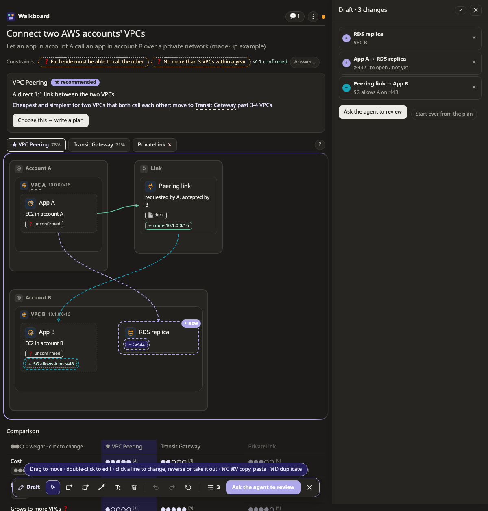
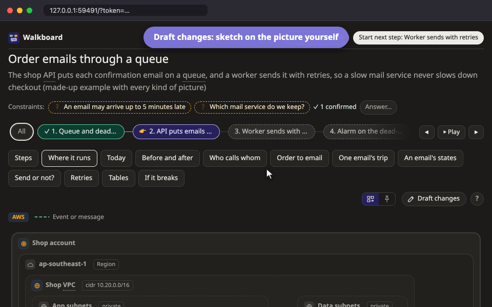
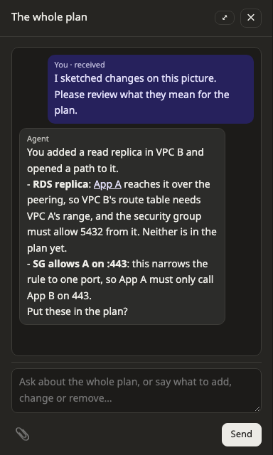

# ร่างการแก้ไขเอง

บางทีวาดให้ดูง่ายกว่าพิมพ์อธิบาย ใน **โหมดร่าง** (draft mode) คุณแก้ภาพได้เอง เช่น เพิ่มกล่อง ลากเส้น หรือย้ายของไปไว้อีกโซน จากนั้น agent จะรีวิวสิ่งที่คุณร่าง และมีแค่การแก้ไขที่คุณตกลงเท่านั้นที่จะเข้าไปอยู่ในแผน

หน้านี้อธิบายวิธีร่างการแก้ไข และวิธีส่งให้ agent รีวิว

## เริ่มร่าง

กด **✎ ร่างการแก้ไข** เหนือภาพ แถบเครื่องมือ (toolbar) จะขึ้นมาที่ด้านล่าง ตัวเลขข้าง **≡** บอกว่าคุณแก้ไปกี่อย่างแล้ว กดที่มันเพื่อเปิดรายการร่าง

ภาพที่ร่างได้มี 6 แบบ คือ [map](pictures/map.md) (ภาพระบบ), [data model](pictures/datamodel.md), [flow](pictures/flow.md), [state](pictures/state.md), [decision](pictures/decision.md) และ [impact](pictures/impact.md) ถ้าเป็นภาพ [before and after](pictures/diff.md) ที่เทียบสองภาพ ให้กดรูปดินสอของมันเพื่อเลือกว่าจะร่างบนภาพไหน ภาพแบบอื่นยังไม่มีโหมดร่าง ถ้าอยากแก้ให้บอกในแชทแทน

ระหว่างร่าง แผนจริงยังเหมือนเดิม และไม่ไปขัดจังหวะ agent สิ่งที่ร่างไว้จะถูกบันทึกไปเรื่อยๆ ระหว่างที่คุณทำ

> **ควรรู้:** การร่างต้องใช้เมาส์ และหน้าต่างกว้างอย่างน้อย 640 pixel หน้าต่างที่แคบหรือซูมอยู่ก็ยังร่างได้ ตราบใดที่ยังกว้างถึงขนาดนี้ บนมือถือคุณเปิดอ่านร่างได้ และส่งให้รีวิวจากรายการร่างได้ แต่วาดไม่ได้

## แก้ภาพ

นี่คือตัวอย่างการร่างบน map ตั้งแต่กล่องแรกจนถึงส่งให้รีวิว

ตารางนี้คือสิ่งที่ทำได้บนภาพส่วนใหญ่ ในโหมดร่าง ปุ่ม **?** บนแถบเครื่องมือจะแสดงเครื่องมือของภาพที่เปิดอยู่ และมีลิงก์มาที่หน้าคู่มือของภาพแบบนั้น ซึ่งอธิบายเครื่องมือพร้อมภาพประกอบ

| อยากทำอะไร | ทำแบบนี้ |
|---|---|
| เพิ่มกล่อง โซน ตาราง กลุ่ม หรือ lane | เลือกเครื่องมือบนแถบเครื่องมือ แล้วคลิกตรงที่จะวาง |
| เพิ่มโดยไม่ใช้เมาส์ | กดปุ่มลัดของเครื่องมือ (B สำหรับกล่อง, Z สำหรับโซน, C สำหรับ column บน data model) แล้วกด Enter ของใหม่จะไปอยู่ในที่ว่างแรกที่มองเห็นอยู่ |
| ลากเส้น | กด L แล้วลากจากกล่องหนึ่งไปอีกกล่อง ถ้าลากไปใกล้ขอบหน้าต่าง หน้าเว็บจะเลื่อนตามให้ |
| แก้ของที่มีอยู่ | กด R หรือดับเบิลคลิกที่มัน ใช้กับเส้นได้ด้วย |
| เอาออก | กด D หรือ Delete |
| ย้าย | ลากไปไว้ในโซน กลุ่ม หรือ lane อื่น บน flow ลากหัวของ lane เพื่อสลับลำดับ lane ได้ |
| คัดลอก | ⌘C แล้ว ⌘V หรือ ⌘D เพื่อทำสำเนาทันที บน Windows และ Linux ใช้ Ctrl แทน ⌘ คัดลอกโซนจะได้ของข้างในไปด้วย |
| ย้อนกลับ (undo) | ⌘Z และ ⇧⌘Z เพื่อ redo ถ้าจะย้อนแค่อย่างเดียว กด × ข้างรายการนั้นในรายการร่าง ถ้าจะทิ้งร่างทั้งหมด กด **เริ่มใหม่ตามแผน** |

กด Escape เพื่อออกจากโหมดร่าง สิ่งที่ร่างไว้ยังอยู่ กลับมาร่างต่อได้

เวลาแก้กล่อง การ์ดของมันจะมีชื่อ คำอธิบายสั้นๆ และ icon ถ้าเป็น map จะมี [ชนิดของกล่องบนแพลตฟอร์ม](platforms/README.md) ด้วย เช่น ฐานข้อมูล RDS หรือ CronJob ของ Kubernetes

> **ควรรู้:** ป้าย ⚠ สีเหลืองอำพันเล็กๆ แปลว่าของชิ้นนั้นไปอยู่ในที่ที่ปกติไม่ค่อยวางกัน เช่น ฐานข้อมูลที่ไม่ได้อยู่ใน subnet ไหนเลย เป็นแค่คำแนะนำ ไม่มีอะไรห้ามคุณ และบางครั้งคุณก็ตั้งใจวางแบบนั้นจริงๆ

## อ่านป้ายบนภาพ

จนกว่า agent จะเอาการแก้ไขของคุณเข้าแผน ภาพจะมีป้ายบอกไว้แบบนี้

| ป้าย | แปลว่า |
|---|---|
| **+** กับเส้นขอบประ | ของใหม่ ยังไม่อยู่ในแผน |
| **~** | แก้แล้ว ยังไม่อยู่ในแผน |
| **−** | คุณอยากเอาออก แต่ในแผนยังมีอยู่ |
| **↦** | ย้ายแล้ว ในแผนยังอยู่ที่เดิม |

## ส่งให้ agent รีวิว

พอร่างเสร็จ กด **ให้ agent รีวิวภาพนี้** agent จะอ่านสิ่งที่คุณวาด แล้วอธิบายเป็นภาษาง่ายๆ ว่ามันหมายถึงอะไรกับแผน โดยใช้ชื่อเดียวกับบนภาพของคุณ เช่น อาจบอกว่าฐานข้อมูลตัวใหม่ต้องมี migration หรือเส้นที่คุณลากไว้คือการเปิด port ระหว่างสอง network

> **ควรรู้:** ถ้าใช้ agent อื่นที่ไม่ใช่ Claude Code คำขอรีวิวจะรออยู่บนหน้าเว็บเหมือนข้อความอื่นๆ พิมพ์บอก agent ในแชทว่า "ดูหน้า walkboard" (ใช้คำไหนก็ได้) แล้ว agent จะอ่านร่างของคุณตอนนั้น ดู [ใช้กับ agent อื่น](other-agents.md)

ก่อนจะแก้แผน agent จะถามคุณก่อนว่าจะเก็บการแก้ไขไหนไว้ อันที่คุณรับจะเข้าไปอยู่ในแผน และอยู่ตรงตำแหน่งที่คุณวาดไว้ ส่วนอันที่คุณไม่รับจะยังอยู่ในร่าง คุณจะแก้ต่อหรือทิ้งไปก็ได้

## จัดภาพ

นอกโหมดร่าง คุณยังลากกล่องไปมาได้ แต่แค่เพื่อจัดภาพให้อ่านง่าย การจัดภาพไม่เปลี่ยนแผนเลย ถ้าคุณปล่อยกล่องลงในโซนอื่น มันจะเด้งกลับที่เดิม พร้อมข้อความบอกให้ใช้โหมดร่างแทน

ถ้าอยากให้ภาพกลับไปจัดตามแผนใหม่ กด **↺ จัดภาพใหม่** ของที่คุณวาดไว้ในร่างจะยังอยู่ที่เดิม บน map มีตัวเลือก **จัดอัตโนมัติ | วางเอง** ให้เลือกว่าจะให้หน้าเว็บจัดวางให้ หรือให้ทุกอย่างอยู่ตรงที่คุณลากไว้

## ส่งร่างให้คนอื่นดู

เวลา export แผนหรือพิมพ์ออกมา ร่างของคุณจะติดไปด้วย และมีป้ายบอกว่ายังไม่อยู่ในแผน คุณจึงเอาไปคุยกับทีมก่อนส่งให้ agent รีวิวได้ ถ้าไม่อยากให้ติดไป เอาเครื่องหมายถูกออกใน Export ดู [ส่งแผนให้คนอื่น](share.md)

## อ่านต่อ

- [ภาพแต่ละแบบ](pictures/README.md) บอกว่าภาพแต่ละแบบมีเครื่องมืออะไรในโหมดร่าง
- [แพลตฟอร์ม](platforms/README.md) บอกว่าป้าย ⚠ หมายถึงอะไร และกล่องแต่ละแบบมักอยู่ตรงไหน
