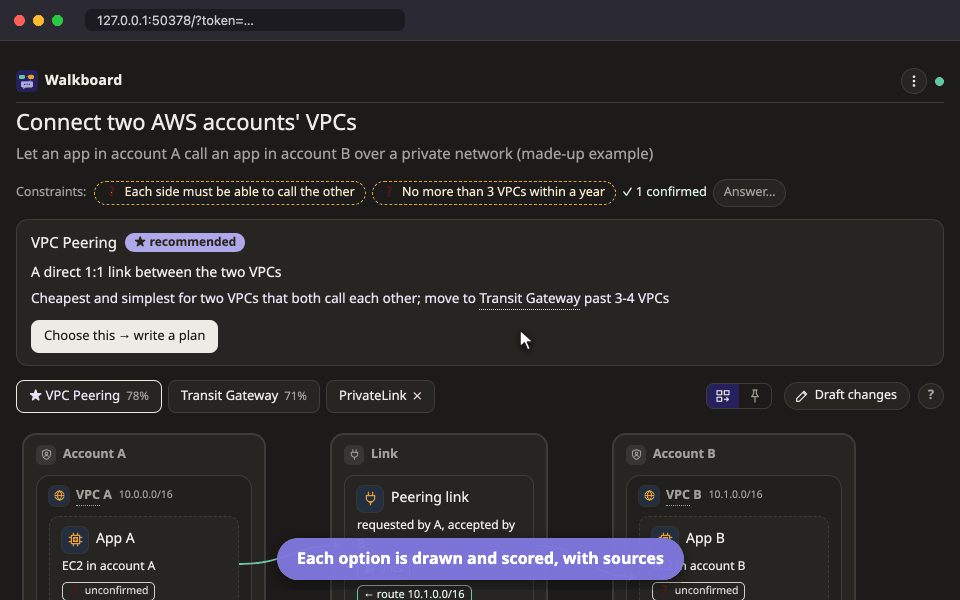

# โหมดออกแบบ

โหมดออกแบบใช้ตอนต้องเลือกว่าจะสร้างของใหม่แบบไหน agent จะหาข้อมูลวิธีทำมาไม่กี่แบบ วาดแต่ละแบบ แล้วให้คะแนนเทียบกัน คุณจะเห็นว่าทำไม agent ถึงแนะนำทางนั้น แต่คนตัดสินใจสุดท้ายคือคุณ

ตัวอย่างเช่น

```
/walkboard เทียบวิธีเชื่อม EC2 ข้าม AWS account สองบัญชี
```



## เทียบทางเลือก

agent จะดูทางเลือก 2 ถึง 4 แบบ แต่ละทางเลือกมี tab ภาพของตัวเองพร้อมคะแนน และทางที่ agent แนะนำจะมี ★

ตารางเปรียบเทียบให้คะแนนทุกทางเลือกตามแต่ละ **เกณฑ์** (criterion) เช่น ค่าใช้จ่าย หรือดูแลยากแค่ไหน ยิ่งจุดเยอะ (สูงสุด ●●●●●) ยิ่งดีกับคุณ คือถูกกว่า ง่ายกว่า หรือเร็วกว่า บางเกณฑ์เป็นแค่ ✓ หรือ ✗ ว่าใช้ได้หรือไม่ได้เลย คะแนนบาง cell อาจแสดงตัวเลขเบื้องหลังด้วย เช่น ราคาต่อเดือน

ถ้าอยากรู้ว่าทำไมทางเลือกนั้นได้คะแนนเท่านี้ คลิก cell นั้น side panel จะแสดงเหตุผลและแหล่งอ้างอิง แต่ละแหล่งบอกด้วยว่า agent อ่านมาเมื่อไร

## ตั้งว่าอะไรสำคัญกับคุณ

แต่ละเกณฑ์อาจสำคัญกับคุณไม่เท่ากัน ถ้าจะเปลี่ยนว่าเกณฑ์ไหนนับมากน้อยแค่ไหน คลิกจุดน้ำหนักใต้เกณฑ์นั้น ค่าจะ save ทันที และไม่ขัดจังหวะ agent

ถ้าน้ำหนักของคุณทำให้ทางเลือกอื่นขึ้นนำทางที่มี ★ จะมีโน้ตบอก พร้อมปุ่ม **ให้ agent ดูใหม่**

บางเกณฑ์มีป้าย **ต้องมี** (must) ทางเลือกที่ไม่ผ่านเกณฑ์นี้จะเป็นสีเทา ไม่ว่าคะแนนข้ออื่นจะดีแค่ไหน

## ตอบสิ่งที่ agent เดาไว้

agent มักต้องสมมติบางอย่าง เช่น คุณคาดว่าจะมี traffic เท่าไร สิ่งที่เดาไว้จะขึ้นในแถบเหนือตาราง และเป็นกล่องเส้นประในภาพ ถ้าจะตอบ กด **✎ ตอบ** แล้วเขียนว่าความจริงเป็นยังไง แถวในตารางที่ขึ้นอยู่กับสิ่งที่เดาไว้และคุณยังไม่ได้ตอบ จะมี ❓

## ตัดสินใจ

พอเลือกได้แล้ว กด **เลือกทางนี้ → เขียนเป็นแผน** agent จะจดการตัดสินใจไว้ ว่าทำไมเลือกทางนี้และทำไมไม่เลือกทางอื่น แล้วเริ่ม[แผน](plan.md)สำหรับทางนั้นในหน้าใหม่ แผนนั้นจะมีลิงก์กลับมาที่การตัดสินใจนี้

## cloud account ของคุณ

โหมดออกแบบไม่แก้อะไรใน cloud account ของคุณเลย ถ้า agent อยากดูว่ามีอะไรอยู่แล้วบ้าง จะใช้แค่คำสั่งที่อ่านอย่างเดียว เช่น `describe` `list` และ `get` และถามคุณก่อนทุกครั้ง ถ้าคุณอยากรันเอง agent จะให้คำสั่งมา แล้วขอผลลัพธ์จากคุณ ข้อมูลที่ได้มาแบบนี้จะบอกไว้ พร้อมวันที่

## แชร์การตัดสินใจ

เวลา export หรือพิมพ์งานออกแบบ เอกสารจะขึ้นต้นด้วยการตัดสินใจและเหตุผล ดู[ส่งแผนให้คนอื่น](../share.md)

## ลองดู

ถ้า clone repository มาแล้ว เปิดตัวอย่างงานออกแบบได้โดยไม่ต้องใช้ agent

```bash
node skills/walkboard/bin/walkboard.mjs open examples/connect-vpcs
```

## อ่านต่อ

- [โหมดวางแผน](plan.md): หลังเลือกทางแล้วจะเกิดอะไรต่อ
- [ส่งแผนให้คนอื่น](../share.md): แชร์การตัดสินใจให้ทีม
