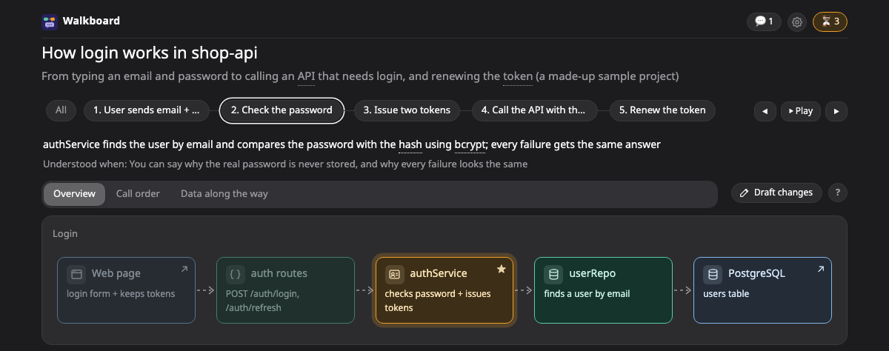
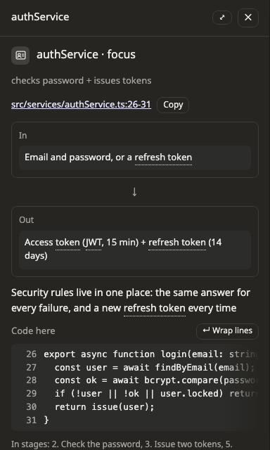

# โหมดอธิบาย

โหมดอธิบายใช้ตอนอยากเข้าใจโค้ดที่มีอยู่แล้ว agent จะอ่านโค้ดแล้ววาดว่ามันทำงานยังไง ทุกกล่องที่แทนโค้ดจะชี้ไปที่ไฟล์และบรรทัดจริง และไม่มีอะไรในโปรเจกต์ของคุณถูกแก้

ตัวอย่างเช่น

```
/walkboard อธิบายว่า login ในโปรเจกต์ A ทำงานยังไง
```



## ไล่ดูทีละช่วง

คำอธิบายไม่ได้แบ่งเป็นขั้น แต่แบ่งเป็น **ช่วง** (stage) คืออะไรเกิดขึ้นก่อน อะไรเกิดต่อ ไปเรื่อยๆ คลิกช่วงไหนก็ได้เพื่อดูกล่องที่เกี่ยวกับช่วงนั้น

ก่อนเริ่ม agent จะถามว่าอยากได้ลึกแค่ไหน ภาพรวมหรือรายละเอียด ถ้าคุณบอกไว้ในคำขอแล้ว agent จะไม่ถาม

## ดูโค้ดเบื้องหลังกล่อง

คลิกกล่องที่แทนโค้ด แผงด้านข้างจะแสดงโค้ดส่วนนั้น บรรทัดสำคัญจะถูกไฮไลต์ไว้ พร้อมโน้ตสั้นๆ แต่ละบรรทัด



คลิก path ของไฟล์เพื่อเปิดใน editor ปกติ Walkboard จะเปิด VS Code ถ้าอยากใช้ Cursor หรือ IntelliJ ให้ตั้ง `"editor"` เป็น `"cursor"` หรือ `"idea"` ใน `~/.walkboard/config.json` หรือบอกให้ agent ตั้งให้ก็ได้ ถ้าตั้งเป็น `"none"` จะแสดงแค่ path โดยไม่มีลิงก์

ถ้ายังไม่เข้าใจ กด **ยังงง** ใต้กล่อง แล้ว agent จะอธิบายใหม่ด้วยคำที่ง่ายขึ้น ถ้าอยากได้รายละเอียดเพิ่ม กด **ขอละเอียดขึ้น**

## ทำให้คำอธิบายยังตรงกับโค้ด

โค้ดเปลี่ยนได้ คำอธิบายจึงอาจล้าสมัย เพื่อจับเรื่องนี้ แต่ละกล่องจะเก็บโค้ดสั้นๆ ส่วนที่มันชี้ไว้ด้วย

เวลา agent ตรวจแผน agent จะบอกถ้าไฟล์หรือบรรทัดนั้นหายไป หรือโค้ดส่วนนั้นย้ายไปที่อื่น และบอกว่าย้ายไปไหน บนหน้าเว็บ กล่องที่โค้ดเปลี่ยนไปหลังจากอธิบายแล้วจะมีคำเตือนขึ้นที่ตัวโค้ด

## หน้าเว็บแสดงโค้ดจากไหนได้บ้าง

ตอนทำคำอธิบาย agent จะระบุโฟลเดอร์ที่แผนนี้เกี่ยวข้อง หน้าเว็บอ่านโค้ดได้จากโฟลเดอร์เหล่านั้นเท่านั้น ไม่อ่านจากที่อื่นในเครื่องของคุณเลย เวลา[ส่งคำอธิบายให้คนอื่น](../share.md) คุณเลือกได้ว่าจะไม่ใส่โค้ดไปด้วย

## ภาพที่จะได้เห็น

คำอธิบายมักมีภาพ [flow](../pictures/flow.md) หรือ [sequence](../pictures/sequence.md) ว่าอะไรเรียกอะไร คุณอาจได้เห็น [journey](../pictures/journey.md) ที่ตามคำขอหรือข้อมูลหนึ่งชิ้นไปตลอดทาง [transform](../pictures/transform.md) ว่าข้อมูลเปลี่ยนรูปยังไง หรือภาพ [state](../pictures/state.md) ด้วย

## ลองดู

ถ้า clone repository มาแล้ว เปิดตัวอย่างคำอธิบายได้โดยไม่ต้องใช้ agent

```bash
node skills/walkboard/bin/walkboard.mjs open examples/explain-login
```

## อ่านต่อ

- [วาดระบบที่มีอยู่แล้ว](../existing.md): เปลี่ยนไฟล์ Terraform หรือ Kubernetes ให้เป็นภาพ map
- [ภาพ](../pictures/README.md): วิธีอ่านภาพแต่ละแบบ
