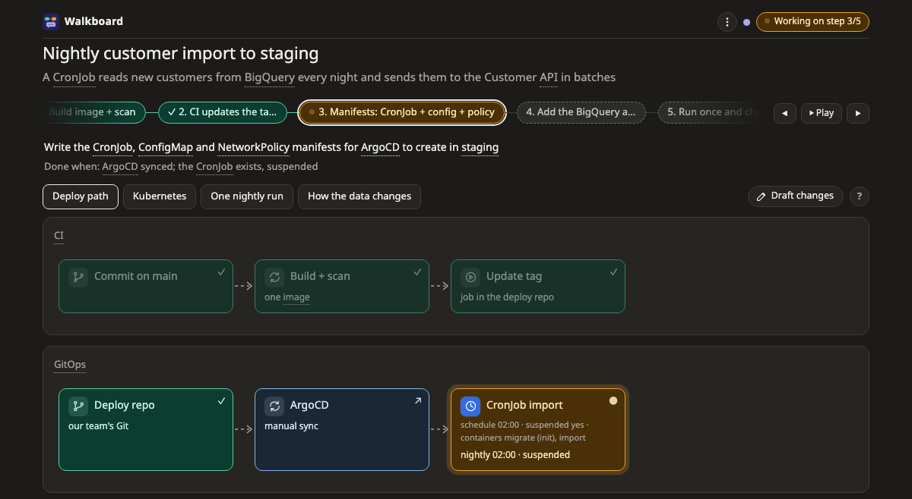
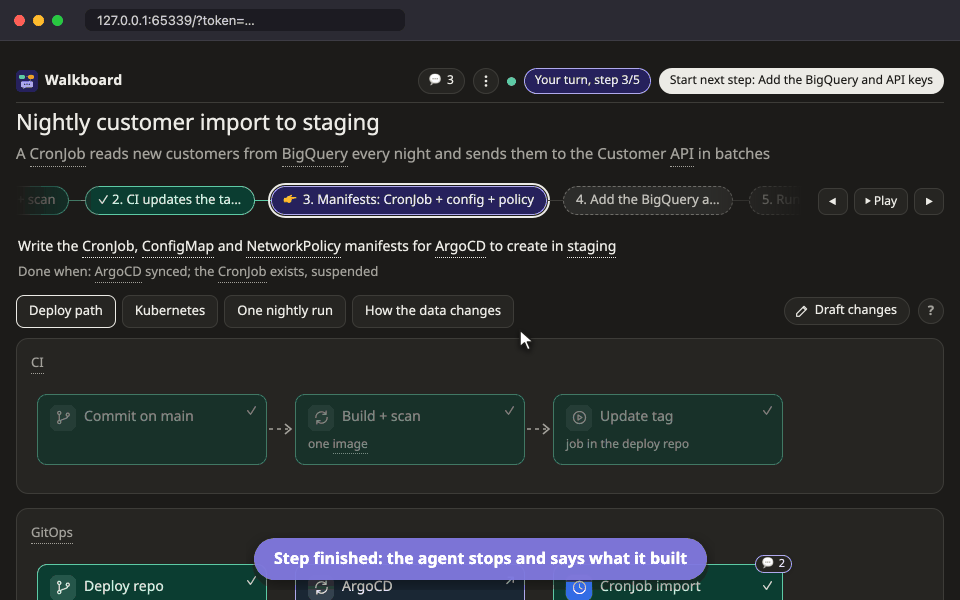

# โหมดวางแผน

โหมดวางแผนใช้ตอนจะสร้างหรือแก้อะไรสักอย่าง agent จะแบ่งงานเป็นขั้นเล็กๆ แล้ววาดออกมา คุณอนุมัติแผน จากนั้น agent ค่อยลงมือทำทีละขั้น ไม่มีอะไรถูกสร้างจนกว่าคุณจะบอกให้ทำ

ตัวอย่างเช่น

```
/walkboard วางแผน deploy CronJob นี้ขึ้น staging
```



## แผนหนึ่งเดินไปยังไง

1. **agent ถามก่อน** ถ้าคำตอบจะทำให้แผนเปลี่ยน agent จะถามสั้นๆ ไม่เกิน 3 ข้อ และถามด้วยว่าให้ commit ให้เลย หรือแค่เสนอ commit message มาให้
2. **agent วาดแผน** แผนหนึ่งมี 3 ถึง 8 ขั้นเล็กๆ แต่ละขั้นบอกว่าทำอะไร และจะรู้ได้ยังไงว่าเสร็จ มีภาพหนึ่งหรือสองภาพแสดงขั้นเหล่านั้น คลิกขั้นไหนก็ได้เพื่อดูว่ามันแตะอะไรบ้าง ส่วนที่เหลือจะจางลง
3. **คุยกันก่อน** ถามเรื่องกล่องหรือขั้นไหนก็ได้ หรือบอกว่าให้เพิ่ม แก้ หรือเอาอะไรออก ระหว่างที่ยังไม่อนุมัติ agent จะแก้แผนให้ทันที และบอกว่าเปลี่ยนอะไรไปด้วย **✎ แผนเปลี่ยน**
4. **คุณอนุมัติ** พอพอใจแล้ว กด **อนุมัติแผน**
5. **agent ทำทีละขั้น** agent ทำเสร็จหนึ่งขั้น ทำเครื่องหมายให้คุณตรวจ แล้วหยุดรอ ดูสิ่งที่ agent ทำ และถามได้ตามต้องการ พร้อมแล้วกด **เริ่มขั้นถัดไป: …** ด้านบน พอถึงขั้นสุดท้าย ปุ่มจะเปลี่ยนเป็น **จบงาน**



## เลือกว่าใครเป็นคน commit

เลือกได้ในเมนู **⋮** ว่าใครจะเป็นคน commit และเปลี่ยนใจเมื่อไรก็ได้ การสลับไม่ขัดจังหวะ agent และไม่เสียอะไรเลย

- ถ้าเลือก **agent commit ให้** agent จะ commit แต่ละขั้นเอง และคุณจะมีปุ่ม **ทำต่อจนจบ** ให้ agent ทำขั้นที่เหลือทั้งหมดโดยไม่หยุดรอ
- ถ้าเลือก **แนะนำ commit message** ทุกขั้นที่มีการแก้ไฟล์จะแสดง commit message ที่ agent แนะนำ จะแก้ข้อความก่อนก็ได้ แล้วกด **ให้ agent commit ตามนี้ แล้วไปต่อ** หรือ commit เองแล้วกด **commit เองแล้ว ไปต่อ** ขั้นที่ไม่ได้แก้ไฟล์จะไม่ถามหา commit message

## แก้แผนหลังอนุมัติแล้ว

พออนุมัติแผนแล้ว agent จะไม่แก้แผนตรงๆ อีก สิ่งที่คุณขอให้เปลี่ยนจะถูกวาดบนภาพเป็น **ข้อเสนอ** (proposal) แทน **+** คือของที่เพิ่ม **~** คือของที่เปลี่ยน และ **−** คือของที่เอาออก ไม่มีอะไรถูกสร้างจนกว่าคุณจะรับข้อเสนอนั้น

ถ้าเป็นการเปลี่ยนใหญ่ อาจมาเป็นสองภาพวางข้างกัน ภาพหนึ่งคือตอนนี้ อีกภาพคือหลังเปลี่ยน ดู[ก่อนและหลัง](../pictures/diff.md)

ถ้าวาดง่ายกว่าพิมพ์อธิบาย คุณ[ร่างการแก้ไขเองได้](../draft.md)

## ภาพที่จะได้เห็น

แผนส่วนใหญ่มีภาพ [flow](../pictures/flow.md) ที่สร้างจากขั้นของแผน แล้วแต่งาน คุณอาจได้เห็น [map](../pictures/map.md) ว่าอะไรรันอยู่ที่ไหน [sequence](../pictures/sequence.md) ว่าใครเรียกใคร หรือ [data model](../pictures/datamodel.md) ของตารางในฐานข้อมูลด้วย

## อ่านต่อ

- [ร่างการแก้ไขเอง](../draft.md): วาดการแก้ไขลงบนภาพ แล้วให้ agent รีวิว
- [ภาพ](../pictures/README.md): วิธีอ่านภาพแต่ละแบบ
