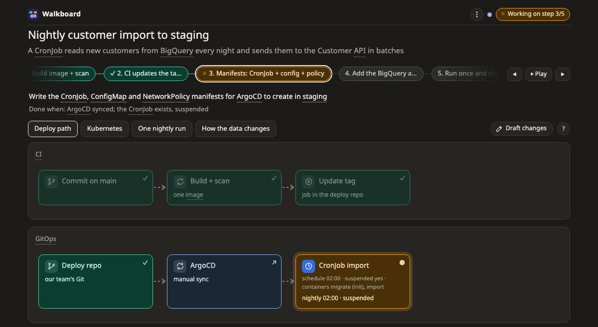
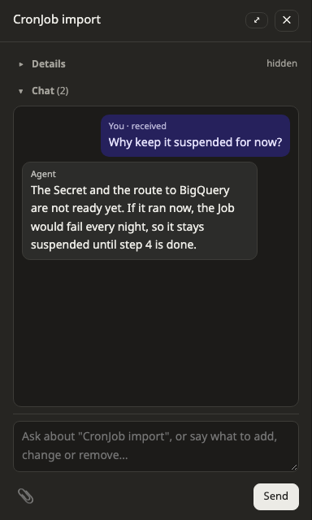

# หน้าเว็บ

เวลา agent ตอบด้วย Walkboard จะส่งลิงก์หน้าเว็บมาให้คุณเปิดใน browser หน้านี้อธิบายว่าบนหน้านั้นมีอะไรบ้าง และคุยกับ agent จากหน้านั้นยังไง

## ดูว่าอะไรอยู่ตรงไหน

ไล่จากบนลงล่าง หน้าเว็บมีส่วนต่างๆ ดังนี้

- **แถบบนสุด** ปุ่มด้านขวาจะบอกขั้นต่อไปของคุณเสมอ เช่น **อนุมัติแผน** หรือ **เริ่มขั้นถัดไป: …** ข้างๆ กันจะบอกว่าทำเสร็จไปกี่ขั้นแล้ว
- **แถบขั้นตอน** คลิกขั้นไหนก็ได้เพื่อดูเฉพาะขั้นนั้น อะไรที่ขั้นนั้นไม่ได้แตะจะจางลง และหน้าเว็บจะสลับไปที่ภาพที่แสดงขั้นนั้น ✓ แปลว่าขั้นนั้นเสร็จแล้ว ส่วน 👉 แปลว่ากำลังรอคุณ ปุ่ม **⏵ เล่น** จะไล่ดูทุกขั้นให้หนึ่งรอบ
- **tab ภาพ** แผนหนึ่งมักมีภาพหนึ่งหรือสองภาพ แถวเดียวกันมีปุ่ม **✎ ร่างการแก้ไข** สำหรับ[ร่างการแก้ไขเอง](draft.md) และปุ่ม **?** ที่อธิบายวิธีอ่านภาพที่เปิดอยู่
- **ภาพ** คลิกกล่องไหนก็ได้เพื่อเปิดรายละเอียดของกล่องนั้น
- **ช่องแชท** อยู่ล่างสุด คลิกเพื่อคุยเรื่องขั้นที่เลือกอยู่ ถ้าอยากคุยเรื่องทั้งแผน ให้เลือก **ทั้งหมด** ในแถบขั้นตอนก่อน บทสนทนาจะเปิดขึ้นใน **side panel**

มุมขวาบนมีอีกสามอย่าง

- **จุดสี** บอกว่า agent กำลังทำอะไร สีเขียวคือกำลังฟัง สีม่วงคือกำลังตอบคุณ สีส้มคือกำลังทำอย่างอื่นอยู่ สีเทาแปลว่าหน้าเว็บปลุก agent ไม่ได้ ข้อความของคุณจะรอไว้จนกว่าคุณจะพิมพ์บอก agent ในแชทให้มาดูหน้าเว็บ agent ส่วนใหญ่ที่ไม่ใช่ Claude Code ทำงานแบบนี้ ดู[ใช้กับ agent อื่น](other-agents.md) hover ที่จุดเพื่ออ่านสถานะเป็นข้อความ
- **💬** รวมบทสนทนาทั้งหมดบนหน้านี้ เรียงจากใหม่ไปเก่า ปุ่มจะเป็นสีส้มและขึ้นคำว่า "ใหม่" เมื่อ agent ตอบแล้ว คลิกบทสนทนาเพื่อคุยต่อ
- **⋮** รวม setting ทั้งหมด ได้แก่ โหมด ใครเป็นคน commit, Export, ธีม, คู่มือนี้, คีย์ลัด และเลขเวอร์ชัน

เมื่อ agent เปลี่ยนแผน จะขึ้น **✎ แผนเปลี่ยน** และส่วนที่เปลี่ยนจะมีกรอบล้อมไว้ กรอบจะอยู่จนกว่าคุณจะกด **รับทราบ**

ครั้งแรกที่เปิดหน้าใน browser ภาพจะค่อยๆ วาดตัวเองไปตามลูกศร และมีคำแนะนำบอกให้ลองคลิกกล่อง

> **ควรรู้:** URL ของหน้าเว็บจำขั้น ภาพ และกล่องที่คุณดูอยู่ไว้ รีโหลดหน้า หรือเปิดลิงก์เดิมทีหลัง ก็จะกลับมาที่เดิม

## อ่านกล่อง

ทุกกล่องมี icon บอกว่าเป็นอะไร และมีเครื่องหมายบอกสถานะ

| เครื่องหมาย | ความหมาย |
|---|---|
| ✓ | ทำแล้ว |
| ● | กำลังทำ |
| ขอบเส้นประ | ยังไม่ทำ |
| ↗ | ระบบภายนอก ไม่ได้เป็นส่วนของงานนี้ |
| 💬 | มีการคุยบนกล่องนี้ |

คำบางคำมีขีดเส้นใต้แบบจุด คำเหล่านี้อยู่ใน **glossary** คลิกเพื่ออ่านคำอธิบายสั้นๆ ที่เข้าใจง่าย ถ้าคำนั้นอยู่ในกล่อง ให้ hover ค้างไว้แทน เพราะการคลิกจะเปิดกล่อง

ภาพแต่ละแบบมีเครื่องหมายเฉพาะของตัวเองอีกนิดหน่อย ดูได้ในหมวด [ภาพ](pictures/README.md)

## ถามเรื่องกล่อง

ถ้าอยากถามเรื่องอะไร ให้คลิกกล่องนั้น side panel จะเปิดขึ้นพร้อมรายละเอียดและบทสนทนาของกล่อง พิมพ์คำถามที่ด้านล่างของ panel คำตอบของ agent จะขึ้นในบทสนทนานั้น จึงกลับมาหาอ่านทีหลังได้

ถ้าอยากเปลี่ยนอะไร ไม่ต้องใช้คำสั่งพิเศษ พิมพ์สิ่งที่ต้องการในช่องเดียวกันได้เลย เช่น "เพิ่ม retry ตรงนี้" หรือ "ตรงนี้ควรผ่าน queue" agent จะคิดเองว่าต้องทำอะไร ถ้ายังไม่ได้อนุมัติแผน agent จะแก้แผนให้ทันที แต่ถ้าอนุมัติไปแล้ว agent จะวาดสิ่งที่คุณขอลงบนภาพเป็น **ข้อเสนอ** (proposal) ติดเครื่องหมาย **+**, **~** หรือ **−** ให้คุณเลือกรับหรือไม่รับ

แนบรูปได้ด้วย จะวางรูป ลากมาวางในแชท หรือกด 📎 ก็ได้ ส่งได้ไม่เกิน 5 รูปต่อข้อความ รูปละไม่เกิน 10 MB เป็น PNG, JPEG, GIF หรือ WebP รูปใหญ่จะถูกย่อก่อนถึง agent แต่ละรูปจึงใช้ไม่เกินราว 1,500 token

ถ้า agent ไม่ว่างตอนคุณส่งข้อความ ข้อความจะเข้าคิวรอไว้ หน้าเว็บจะบอกว่าอยู่ลำดับที่เท่าไร และแถบบนสุดจะขึ้น ⏳ พร้อมจำนวนข้อความที่รออยู่ บางครั้ง agent ตอบที่กล่องอื่น ไม่ใช่กล่องที่คุณถาม ถ้าเป็นแบบนั้น ข้อความของคุณจะมีลิงก์ไปที่กล่องที่มีคำตอบ

> **ควรรู้:** ทุกข้อความที่คุณส่งนับเป็นหนึ่งคำขอถึง agent และนับรวมกับการใช้งาน agent เหมือนคำขออื่นๆ ส่วนการเปลี่ยน setting การจัดภาพ และการร่างการแก้ไข อยู่บนหน้าเว็บอย่างเดียว จึงไม่เสียอะไรเลย

## ใช้ side panel

side panel จะเปิดเมื่อคุณคลิกกล่องหรือช่องแชท รายละเอียดของกล่องอยู่ด้านบน บทสนทนาอยู่ด้านล่าง และช่องพิมพ์อยู่ล่างสุด

- ถ้าอยากพับรายละเอียดหรือแชทเก็บ คลิก **▾ รายละเอียด** หรือ **▾ แชท** หน้าเว็บจะจำไว้ว่าคุณเลือกแบบไหน
- ถ้าอยากให้ panel กว้างขึ้น ลากขอบซ้ายของ panel หรือกด **⤢** เพื่อขยาย panel ให้รายละเอียดกับแชทอยู่ข้างกัน
- ถ้าจะปิด กด ✕ หรือ Esc หรือคลิกกล่องเดิมอีกครั้ง

บนจอแคบ เช่น มือถือ panel จะเลื่อนขึ้นมาจากด้านล่างแทน

## ตอบสิ่งที่ agent เดาไว้

บางครั้ง agent ต้องสมมติบางอย่างที่ตรวจเองไม่ได้ เช่น service หนึ่งมี traffic เท่าไร agent จะทำเครื่องหมายทุกจุดที่เดาไว้ให้คุณเห็น สิ่งที่เดาไว้จะอยู่ในแถบเหนือภาพ หรือเป็นกล่องเส้นประที่มี ❓

ถ้าจะตอบ กด **✎ ตอบ** ใต้สิ่งที่เดาไว้ แล้วเขียนด้วยคำพูดของคุณเอง จะบอกว่าเดาถูก บอกว่าความจริงเป็นยังไง หรือตอบคำถามที่ agent ถามไว้ก็ได้ แถบนี้แสดงแค่ 3 ข้อแรก กด **ตอบ…** เพื่อดูทั้งหมด พร้อมตัวเลขที่อยู่เบื้องหลังแต่ละข้อ

## เลือกภาษาและธีม

agent เขียนแผนเป็นภาษาเดียวกับที่คุณพิมพ์ และปุ่มบนหน้าเว็บก็จะเป็นภาษานั้นด้วย ตอนนี้ label บนหน้าเว็บมีภาษาอังกฤษกับภาษาไทย ภาษาอื่นจะใช้ label ภาษาอังกฤษ

ถ้าจะเลือกธีมสว่าง ธีมมืด หรือให้ตามระบบ เปิด **⋮ → ธีม**

## คีย์ลัด

| คีย์ | ทำอะไร |
|---|---|
| ← → | ไปขั้นก่อนหน้าหรือขั้นถัดไป |
| Esc | ปิด side panel หรือออกจากโหมดร่าง |
| Enter | ส่งข้อความ ส่วน Shift+Enter ขึ้นบรรทัดใหม่ |

โหมดร่างมี shortcut ของตัวเอง ดูได้ใน[ร่างการแก้ไขเอง](draft.md)

ถ้าจะดู shortcut บนหน้าเว็บ เปิด **⋮ → คีย์ลัด**

## อ่านต่อ

- [โหมดวางแผน](modes/plan.md): แผนหนึ่งเดินจากคำถามแรกไปจนทำครบทุกขั้นยังไง
- [ภาพ](pictures/README.md): วิธีอ่านภาพแต่ละแบบ
