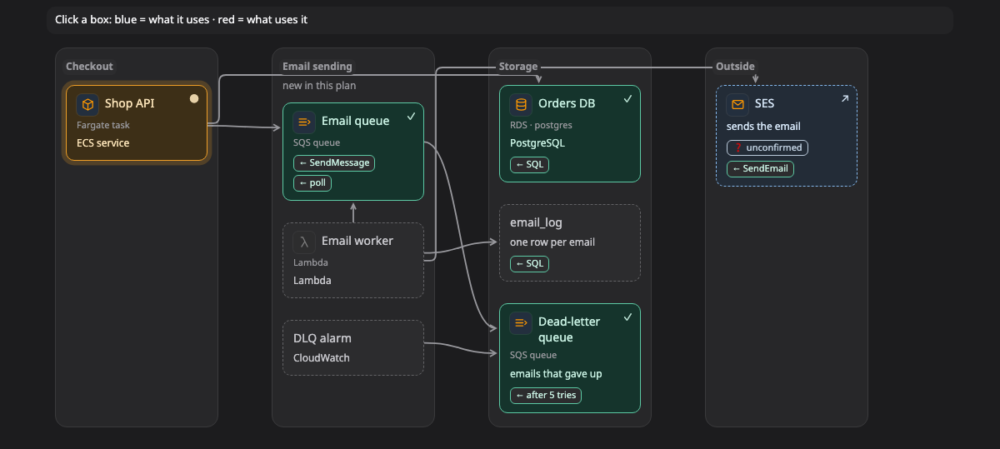

# Components (ส่วนประกอบ)

ภาพ **components** แสดงว่าระบบหรือ codebase แบ่งเป็นส่วนไหนบ้าง แต่ละส่วนอยู่ใน **layer** (ชั้น) ซึ่งเป็น column เรียงจากฝั่งผู้ใช้ทางซ้ายไปจนถึงข้อมูลทางขวา ลูกศรจากส่วนหนึ่งไปอีกส่วนแปลว่าส่วนแรกใช้ส่วนที่สอง ภาพนี้ตอบคำถามว่า "ระบบนี้ประกอบด้วยอะไร และอะไรใช้อะไร"

[เปิดภาพนี้ในหน้าตัวอย่าง ↗](https://aiyaruch1320.github.io/walkboard/examples/pictures.html?view=parts&step=all)

## อ่านภาพ components ยังไง

แต่ละ column คือหนึ่ง layer เช่น web app, API, domain logic หรือ database agent จะเลือก layer ให้เข้ากับโปรเจกต์ของคุณ จึงอาจเป็น service, package หรือ folder ก็ได้

ลูกศรจาก A ไป B แปลว่า A ใช้ B คือเรียก import หรืออ่านข้อมูลจาก B label บนกล่อง เช่น **← SQL** หรือ **← HTTP** บอกว่าเส้นมาถึงกล่องนั้นด้วยอะไร

คลิกกล่องเพื่อดูส่วนที่อยู่ติดกัน สิ่งที่มันใช้จะเป็นสีน้ำเงิน สิ่งที่ใช้มันจะเป็นสีแดง และแถบเหนือภาพจะบอกชื่อ รายละเอียดของกล่องจะเปิดขึ้นข้างภาพ

> **ควรรู้:** ภาพ [impact](impact.md) ก็บอกว่าอะไรต้องใช้อะไรเหมือนกัน แต่ไล่ผลของการล่มไปจนสุดทาง ส่วนภาพ components แสดงแค่ส่วนที่อยู่ติดกับกล่องที่คุณคลิก

## แก้ภาพ components

ภาพ components ไม่มีโหมดร่าง ถ้าจะแก้ ให้บอก agent ในแชทว่าอะไรต่างไป เช่น "worker เขียนลง cache ด้วย"

## อ่านต่อ

- [Sequence](sequence.md) ดูว่าแต่ละส่วนเรียกกันตามลำดับยังไง
- [Map](map.md) ดูว่าแต่ละส่วนรันอยู่ที่ไหน
