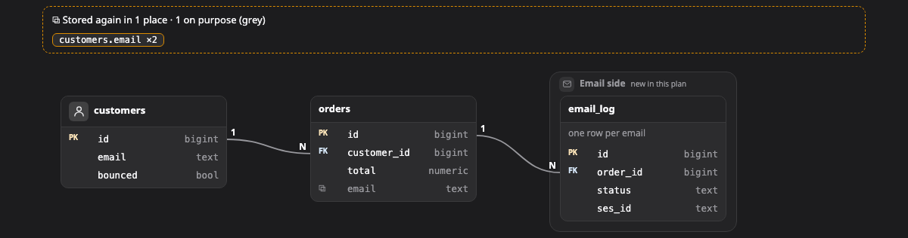

# Data model (โครงสร้างข้อมูล)

**data model** คือภาพที่บอกว่ามีตารางอะไรบ้าง แต่ละตารางมีคีย์อะไร และเชื่อมกันยังไง เหมาะกับงานที่เพิ่มหรือแก้ตาราง หรือตอนที่อยากรู้ว่าข้อมูลชิ้นหนึ่งเก็บอยู่ที่ไหน

[เปิดภาพนี้ในหน้าตัวอย่าง ↗](https://aiyaruch1320.github.io/walkboard/examples/pictures.html?view=tables&step=all)

## อ่าน data model ยังไง

แต่ละกล่องคือหนึ่งตาราง แสดงเฉพาะ column ที่เกี่ยวกับเรื่องนี้ พร้อมชนิดของ column

- **pk** (primary key) คือคีย์หลักของตารางเอง
- **fk** (foreign key) คือ column ที่ชี้ไปหาอีกตาราง column หนึ่งเป็นทั้งสองอย่างได้ ในกรณีที่ตารางใช้คีย์ร่วมกับอีกตารางแบบหนึ่งต่อหนึ่ง

เส้นลากจาก column ที่เป็น foreign key ไปหา column ที่มันชี้ถึง ถ้าเส้นไม่ได้เขียนว่า 1:1 ก็คือแบบหลายต่อหนึ่ง (N:1)

**⧉** คือ column ที่เก็บสำเนาของข้อมูลที่มีอยู่ที่อื่นแล้ว พร้อมตัวเลขบอกว่ามีเก็บไว้กี่ที่ สำเนามีโอกาสไม่ตรงกันทีหลัง จึงควรดูให้ดีอีกรอบ ส่วน ⧉ สีเทาคือสำเนาที่ตั้งใจเก็บ เช่น ราคา ณ ตอนที่ขาย

กรอบคือการจัดกลุ่มตารางที่อยู่ด้วยกัน เช่น ตารางของ service เดียวกัน

## จัด data model

ลากตารางเพื่อจัดภาพ ลากเข้าหรือออกจากกรอบเพื่อเปลี่ยนกลุ่ม หรือเลือกตารางแล้วใช้ปุ่มลูกศรย้ายก็ได้ กด Shift ค้างไว้เพื่อย้ายทีละมากขึ้น

## ร่างบน data model

ใน[โหมดร่าง](../draft.md) มีเครื่องมือเหล่านี้

| เครื่องมือ | ใช้ทำอะไร |
|---|---|
| เพิ่มตาราง | คลิกที่ว่างเพื่อเพิ่มตาราง ถ้าคลิกในกรอบ ตารางจะอยู่ในกลุ่มนั้น |
| เพิ่ม column (C) | คลิกตาราง แล้วพิมพ์ `ชื่อ ชนิด` ต่อท้ายด้วย `pk` หรือ `fk` ถ้าต้องการ |
| ต่อเส้น | ลาก column ไปปล่อยบน column ที่มันชี้ถึง จะได้ foreign key ทำซ้ำอีกครั้งเพื่อเอาออก หรือปล่อยบน column อื่นเพื่อย้ายเส้น |
| จัดกลุ่มตาราง | คลิกตารางเพื่อตั้งกลุ่มใหม่ที่มีตารางนั้น |
| แก้ไข | คลิกตารางหรือหัวกลุ่มเพื่อแก้ชื่อ คำอธิบาย และ icon คลิก column เพื่อแก้ในแถวนั้นเลย หรือคลิกเส้นเพื่อสลับระหว่าง N:1 กับ 1:1 |
| เอาออก | คลิกตาราง column หัวกลุ่ม หรือเส้น |

ถ้าจะตั้ง column เป็นคีย์หลัก (pk) ให้คลิกช่องเล็กๆ ทางซ้ายของชื่อ column

## อ่านต่อ

- [Transform](transform.md) ดูแถวตัวอย่าง และดูว่าข้อมูลเปลี่ยนรูปยังไง
- [ร่างการแก้ไขเอง](../draft.md) ดูว่าสิ่งที่ร่างไว้กลายเป็นส่วนหนึ่งของแผนได้ยังไง
