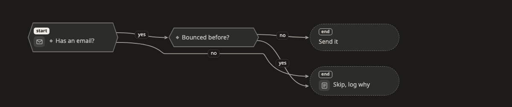

# Decision (การตัดสินใจ)

ภาพ **decision** ตอบคำถามว่า "ถ้าเป็นแบบนี้ แล้วไปทางไหน" เหมาะกับกฎ การ route และการ validate ที่ขั้นต่อไปขึ้นอยู่กับคำตอบ

[เปิดภาพนี้ในหน้าตัวอย่าง ↗](https://aiyaruch1320.github.io/walkboard/examples/pictures.html?view=rule&step=all)

## อ่าน decision ยังไง

เริ่มที่กล่องที่มีป้าย **เริ่ม** นั่นคือคำถามแรกที่ถาม

กล่องมีสามชนิด

| กล่อง | ความหมาย |
|---|---|
| คำถาม | มีทางออกตั้งแต่สองทางขึ้นไป ทางละหนึ่งคำตอบ |
| ขั้นตอน | ทำอย่างหนึ่ง แล้วมีทางออกทางเดียว |
| จบ | เรื่องจบตรงนี้ |

คำบนเส้นคือคำตอบที่พาไปทางนั้น เช่น ใช่ ไม่ หรือ เกิน 100

## จัดภาพ decision

ลากกล่องเพื่อจัดภาพ ส่วนอื่นของภาพจะอยู่นิ่งระหว่างที่คุณลาก

ถ้าอยากเลือกว่าเส้นจะติดกล่องด้านไหน ให้คลิกเส้น หรือลากจุดที่ปลายเส้นด้านใดด้านหนึ่ง

## ร่างบนภาพ decision

วิธีเพิ่มกฎใน[โหมดร่าง](../draft.md)

1. เพิ่มกล่อง แล้วเลือก **คำถาม** ในการ์ดของกล่อง
2. ลากเส้นจากกล่องนั้นไปยังสิ่งที่แต่ละคำตอบพาไป
3. พิมพ์คำตอบบนแต่ละเส้น
4. กล่องที่เรื่องจบ ให้เลือก **จบ**

ถ้าจะเปลี่ยนชนิดของกล่อง หรือตั้งเป็นจุดเริ่ม ให้ดับเบิลคลิกที่กล่อง

## อ่านต่อ

- [State](state.md) แสดงสถานะที่ของสิ่งหนึ่งเปลี่ยนผ่าน
- [ร่างการแก้ไขเอง](../draft.md) ดูว่าสิ่งที่ร่างไว้กลายเป็นส่วนหนึ่งของแผนได้ยังไง
