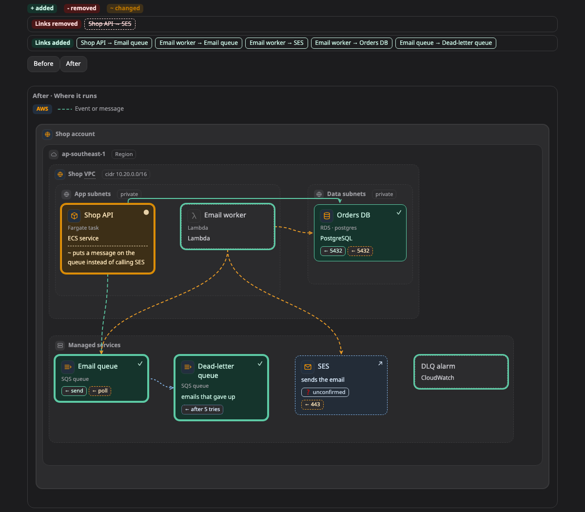

# Before and after (ก่อนและหลัง)

ภาพ **before and after** บอกว่างานนี้จะเปลี่ยนอะไร โดยวางสองภาพไว้ข้างกัน ภาพหนึ่งคือตอนนี้ อีกภาพคือหลังทำเสร็จ แล้วมีเครื่องหมายบอกส่วนที่ต่างกัน

[เปิดภาพนี้ในหน้าตัวอย่าง ↗](https://aiyaruch1320.github.io/walkboard/examples/pictures.html?view=change&step=all)

## อ่านภาพ before and after ยังไง

ภาพซ้ายคือตอนนี้ ภาพขวาคือหลังทำเสร็จ กล่องที่เพิ่ม เอาออก หรือเปลี่ยน จะมีเครื่องหมาย พร้อมโน้ตบอกว่าเปลี่ยนอะไร

เส้นที่มีอยู่แค่ฝั่งเดียวจะอยู่ในรายการใต้ภาพ ในหัวข้อ "เส้นที่เพิ่มมา" และ "เส้นที่หายไป"

## แก้ภาพ before and after

ภาพคู่นี้ไม่มีโหมดร่างของตัวเอง และจัดภาพไม่ได้ ปุ่มดินสอของมันจะพาไปที่สองภาพที่มันเทียบกันแทน ให้ร่างการแก้ไขบนภาพที่คุณหมายถึง ดู[ร่างการแก้ไขเอง](../draft.md)

## อ่านต่อ

- [โหมดวางแผน](../modes/plan.md) ดูว่า agent เสนอการแก้ยังไงหลังคุณอนุมัติแผนแล้ว
- [ภาพทั้ง 11 แบบ](README.md) ภาพแบบอื่นๆ
