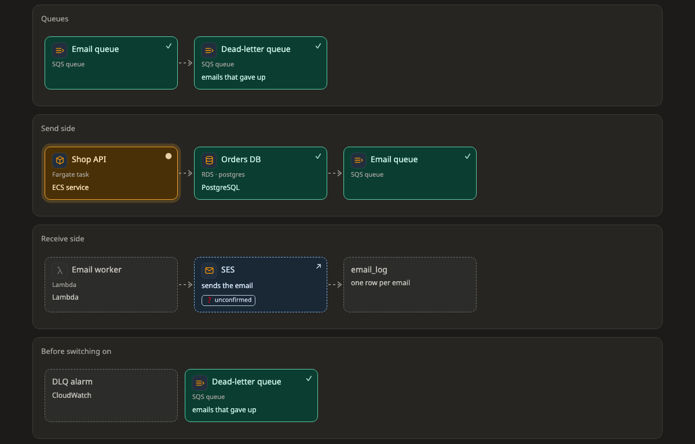

# Flow (ลำดับขั้นตอน)

**flow** คือภาพที่เรียงขั้นตอนของงานตามลำดับ หน้าเว็บสร้างภาพนี้จากขั้นของแผนเอง แล้ววางไว้ที่ tab แรก **ภาพรวม** ก่อนภาพอื่นที่ agent วาด

[เปิดภาพนี้ในหน้าตัวอย่าง ↗](https://aiyaruch1320.github.io/walkboard/examples/pictures.html?view=flow&step=all)

## อ่าน flow ยังไง

flow ประกอบด้วยแถวที่เรียกว่า **lane** (เลน) แต่ละเลนคือหนึ่งขั้น หรือส่วนหนึ่งของงาน อ่านจากบนลงล่าง ส่วนกล่องในเลนเดียวกันเรียงตามลำดับจากซ้ายไปขวา

เลนที่ไม่มีลูกศรคือ checklist กล่องในเลนนั้นทำก่อนหลังยังไงก็ได้

พอเลือกขั้นในแถบขั้นตอนด้านบน กล่องที่ขั้นนั้นไม่ได้แตะจะจางลง

> **ควรรู้:** แผนที่มีขั้นเดียวและมีภาพอื่นอยู่แล้วจะไม่มี tab ภาพรวม และถ้า agent วาด flow ที่แบ่งเลนเอง ภาพนั้นจะอยู่แทน tab นี้

## ร่างบน flow

ใน[โหมดร่าง](../draft.md) คุณเพิ่มกล่องและเลน เปลี่ยนชื่อ เอาออก และลากกล่องไปไว้ที่อื่นหรือเลนอื่นได้ ถ้าจะสลับลำดับเลน ให้ลากที่หัวเลน

| เครื่องมือ | ใช้ทำอะไร |
|---|---|
| เพิ่มกล่อง | คลิกในเลนที่จะวางกล่องใหม่ |
| เพิ่มเลน | คลิกระหว่างสองเลนเพื่อเพิ่มเลนตรงนั้น |
| แก้ไข | คลิกกล่องเพื่อแก้ชื่อ คำอธิบาย และ icon หรือคลิกหัวเลนเพื่อเปลี่ยนชื่อ |
| เอาออก | คลิกกล่องที่จะเอาออก |

กล่องที่ย้ายแล้วจะมีป้าย **↦** จนกว่า agent จะเอาการย้ายนั้นเข้าแผน

> **ควรรู้:** กล่องหนึ่งอยู่ได้หลายขั้น ถ้าลากกล่องออกจากเลนหนึ่ง กล่องจะออกจากเลนนั้นเลนเดียว และยังอยู่ในเลนอื่นเหมือนเดิม

## อ่านต่อ

- [ร่างการแก้ไขเอง](../draft.md) ดูว่าสิ่งที่ร่างไว้กลายเป็นส่วนหนึ่งของแผนได้ยังไง
- [ภาพทั้ง 11 แบบ](README.md) ภาพแบบอื่นๆ
