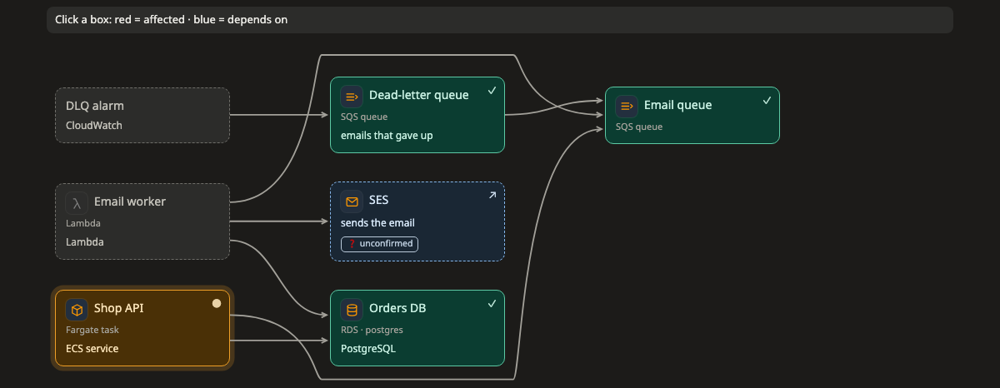

# Impact (ผลกระทบ)

ภาพ **impact** ตอบคำถามว่า "ถ้าตัวนี้ล่ม อะไรพังบ้าง" ภาพนี้บอกว่าแต่ละส่วนต้องพึ่งอะไร จึงเห็นได้ว่าถ้ามีอะไรล่ม ผลจะลามไปได้ไกลแค่ไหน

[เปิดภาพนี้ในหน้าตัวอย่าง ↗](https://aiyaruch1320.github.io/walkboard/examples/pictures.html?view=deps&step=all)

## อ่านภาพ impact ยังไง

เส้นจาก A ไป B แปลว่า A ต้องใช้ B ถ้า B ล่ม A ก็ได้รับผลกระทบ

คลิกกล่องเพื่อดูว่ามันกระทบไปถึงไหน ทุกอย่างที่พึ่งกล่องนั้นจะเป็นสีแดง ทุกอย่างที่กล่องนั้นต้องใช้จะเป็นสีน้ำเงิน และรายละเอียดของกล่องจะเปิดขึ้นข้างภาพ

## จัดภาพ impact

ลากกล่องเพื่อจัดภาพ ส่วนอื่นของภาพจะอยู่นิ่งระหว่างที่คุณลาก

ถ้าอยากเลือกว่าเส้นจะติดกล่องด้านไหน ให้คลิกเส้น หรือลากจุดที่ปลายเส้นด้านใดด้านหนึ่ง

## ร่างบนภาพ impact

ใน[โหมดร่าง](../draft.md) คุณเพิ่มกล่อง ลากเส้น เปลี่ยนชื่อ และเอาของออกได้ ถ้าจะกลับทิศเส้น ให้คลิกที่เส้น

## อ่านต่อ

- [Map](map.md) ดูว่าแต่ละส่วนรันอยู่ที่ไหน และเชื่อมกันยังไง
- [ร่างการแก้ไขเอง](../draft.md) ดูว่าสิ่งที่ร่างไว้กลายเป็นส่วนหนึ่งของแผนได้ยังไง
