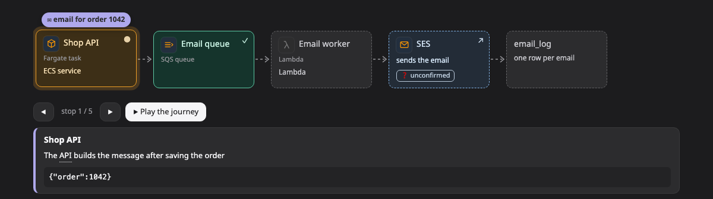

# Journey (เส้นทางของข้อมูล)

**journey** คือภาพที่ตามข้อมูลชิ้นเดียวไปตลอดทาง เช่น request เดียว message เดียว หรือ record เดียว ทีละจุด ในแต่ละจุดคุณจะเห็นว่าเกิดอะไรขึ้น และข้อมูลตอนนั้นหน้าตาเป็นยังไง

[เปิดภาพนี้ในหน้าตัวอย่าง ↗](https://aiyaruch1320.github.io/walkboard/examples/pictures.html?view=trip&step=all)

## อ่าน journey ยังไง

จุดต่างๆ เรียงเป็นแถวเดียว ปกติมี 3–9 จุด ส่วนเดียวกันอาจขึ้นสองครั้งได้ ถ้าข้อมูลผ่านส่วนนั้นสองรอบ ซอง ✉ บอกว่าตอนนี้ข้อมูลอยู่ที่ไหน

กด ◀ หรือ ▶ เพื่อเลื่อนซอง หรือกด **▶ เล่นเส้นทาง** เพื่อดูมันเดินทางตั้งแต่ต้นจนจบ

ใต้แถวมีโน้ตบอกว่าจุดนี้ทำอะไร และแสดงข้อมูลตามที่เป็นอยู่ ณ จุดนี้ บรรทัดที่เปลี่ยนตรงจุดนี้จะถูกไฮไลต์ไว้

คลิกกล่องของจุดไหนก็ได้เพื่อเปิดรายละเอียดและบทสนทนา

## แก้ journey

journey ไม่มีโหมดร่าง ถ้าอยากแก้ ให้บอก agent ในแชทว่าอะไรต่างไปจากนี้

## อ่านต่อ

- [Transform](transform.md) เทียบรูปร่างของข้อมูลในแต่ละช่วงแบบวางข้างกัน
- [Sequence](sequence.md) ดูทุกการเรียกระหว่างส่วนต่างๆ ตามลำดับ
