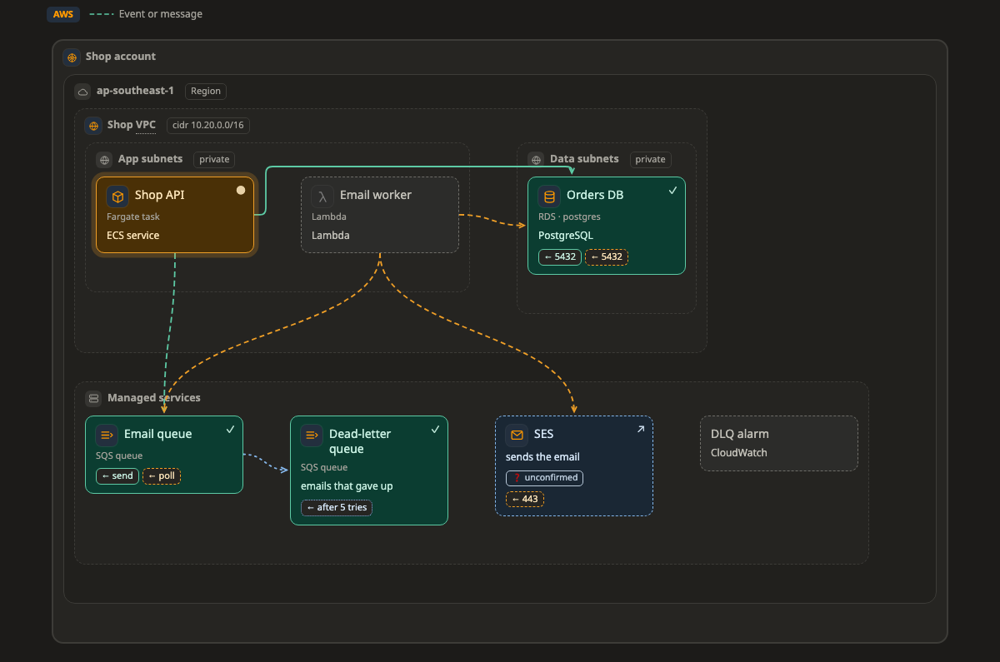
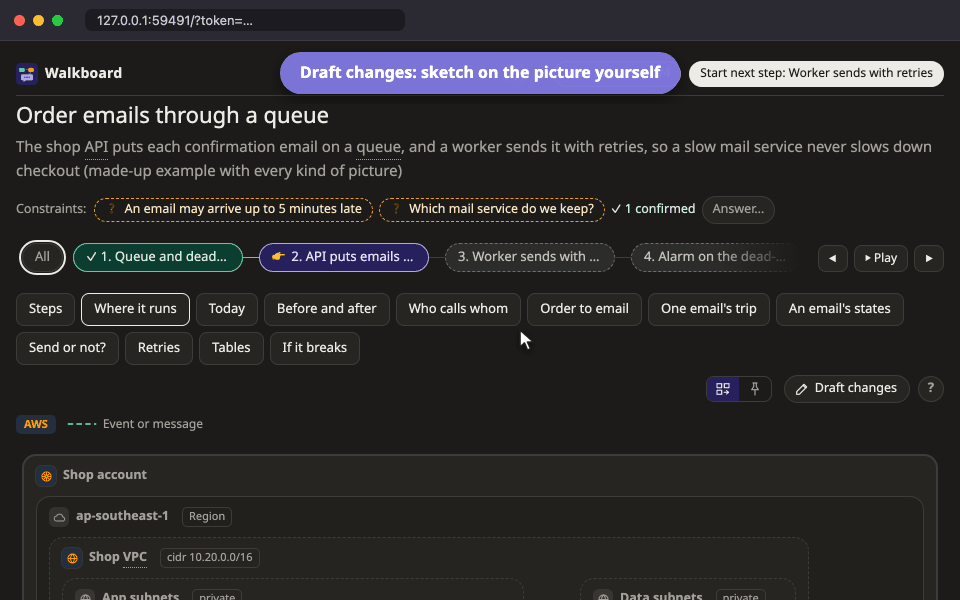

# Map (ภาพระบบ)

**map** คือภาพที่บอกว่าอะไรอยู่ข้างในอะไร และแต่ละส่วนเชื่อมกันยังไง เช่น AWS account ที่มี VPC และ subnet ข้างใน, Kubernetes cluster ที่มี namespace และ pod หรือ server หนึ่งเครื่องกับ container ที่รันอยู่

[เปิดภาพนี้ในหน้าตัวอย่าง ↗](https://aiyaruch1320.github.io/walkboard/examples/pictures.html?view=map&step=all)

## อ่าน map ยังไง

**zone** (โซน) คือกรอบที่ใส่กล่องและโซนอื่นไว้ข้างใน เช่น region, VPC, subnet, namespace หรือ server โซนซ้อนกันได้ถึง 8 ชั้น แต่ 3–4 ชั้นอ่านง่ายที่สุด

เส้นลากจากฝั่งที่เริ่มการเชื่อมต่อ ไปหาฝั่งที่รับการเชื่อมต่อ คำที่อยู่ใกล้หัวลูกศรมักเป็น port เช่น `← :5432`

สีและลายของเส้นบอกสถานะ

| เส้น | ความหมาย |
|---|---|
| เส้นทึบสีเขียว | อนุญาตแล้ว และใช้ได้ |
| เส้นประสีส้ม | ยังต้องเปิด |
| เส้นจุดสีแดง มีขีดขวาง | ถูก block |
| เส้นจุดสีน้ำเงิน | สำรอง (standby) เช่น เส้นทางสำรอง |

ความหมายอยู่ที่หัวลูกศร สี และลายเส้นเท่านั้น เส้นอาจเปลี่ยนทางเวลาคุณย้ายกล่อง เพราะฉะนั้นอย่าตีความจากเส้นทางที่มันอ้อมไป

ระบบใหญ่ที่มีกล่องเยอะ หรือมีโซนนอกสุดตั้งแต่ 4 โซนขึ้นไป จะถูกวาดให้เล็กลง โดยแบ่งเป็นหนึ่งคอลัมน์ต่อหนึ่ง site หรือหนึ่ง provider ให้อ่านจากซ้ายไปขวา และจากข้างนอกเข้าข้างใน

## แพลตฟอร์ม

กล่อง โซน หรือเส้น บอกได้ว่ามันคืออะไรบนแพลตฟอร์มไหน เช่น database RDS บน AWS หรือ CronJob บน Kubernetes แล้วมันจะได้ icon และช่องข้อมูลที่ตรงกับชนิดนั้น และภาพจะมีป้ายบอกแพลตฟอร์ม

ถ้าของชิ้นไหนอยู่ในที่ที่ปกติไม่ได้อยู่ เช่น database RDS ที่ไม่ได้อยู่ใน subnet ไหนเลย จะมีป้าย **⚠** สีเหลืองอำพันเล็กๆ ขึ้นข้างชื่อ ป้ายนี้เป็นแค่คำแนะนำ ไม่ได้ห้ามอะไร ชี้เมาส์ที่ ⚠ เพื่ออ่านเหตุผล และกดลิงก์ไปที่หน้าของแพลตฟอร์มนั้น ซึ่งรวมของทุกชนิดและบอกว่าปกติอยู่ตรงไหน ดู[แพลตฟอร์ม](../platforms/README.md)

## วาดระบบที่มีอยู่แล้ว

agent วาด map ของ infrastructure ที่คุณรันอยู่แล้วได้ จาก Terraform, Kubernetes manifest หรือ Compose file ใน repository ดู[วาดระบบที่มีอยู่แล้ว](../existing.md)

## จัด map

ลากกล่องและโซนเพื่อจัด map และลากขอบโซนเพื่อปรับขนาด เหนือ map มีตัวเลือก **จัดอัตโนมัติ | วางเอง** ให้เลือกว่าจะให้หน้าเว็บจัดภาพให้ หรือให้ทุกอย่างอยู่ตรงที่คุณวางไว้

ถ้าอยากเลือกว่าเส้นจะติดกล่องด้านไหน ให้คลิกเส้น หรือลากจุดที่ปลายเส้นด้านใดด้านหนึ่ง

## ร่างบน map

ใน[โหมดร่าง](../draft.md) มีเครื่องมือเหล่านี้

| เครื่องมือ | ใช้ทำอะไร |
|---|---|
| เพิ่มกล่อง (B) | คลิกในโซนที่จะวางกล่องใหม่ |
| เพิ่มโซน (Z) | คลิกในโซนเพื่อสร้างโซนย่อย หรือคลิกที่ว่างเพื่อสร้างโซนนอกสุด |
| ต่อเส้น (L) | ลากจากกล่องต้นทาง ไปปล่อยบนกล่องปลายทาง |
| แก้ไข (R) | คลิกกล่องหรือหัวโซนเพื่อแก้ชื่อ คำอธิบาย icon และชนิด คลิกเส้นเพื่อแก้คำและทิศ |
| เอาออก (D) | คลิกกล่อง หัวโซน หรือเส้น |

ถ้าจะย้ายกล่องหรือโซน ให้ลากเข้าไปในโซนอื่น เวลา copy แล้ว paste โซน ทุกอย่างข้างในจะตามไปด้วย

## อ่านต่อ

- [แพลตฟอร์ม](../platforms/README.md) กล่องและโซนแต่ละชนิดหมายถึงอะไร และปกติอยู่ตรงไหน
- [ร่างการแก้ไขเอง](../draft.md) ดูว่าสิ่งที่ร่างไว้กลายเป็นส่วนหนึ่งของแผนได้ยังไง
