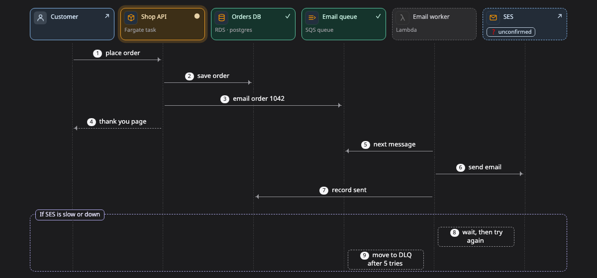

# Sequence (ลำดับการเรียก)

**sequence** คือภาพที่บอกว่าใครเรียกใคร เรียงลำดับยังไง และถ้ามีอะไรพังจะเกิดอะไรขึ้น เหมาะกับการตาม request หนึ่งตัวที่วิ่งผ่านหลาย service

[เปิดภาพนี้ในหน้าตัวอย่าง ↗](https://aiyaruch1320.github.io/walkboard/examples/pictures.html?view=calls&step=all)

## อ่าน sequence ยังไง

แต่ละ column คือส่วนหนึ่งของระบบ และเวลาเดินจากบนลงล่าง

- ลูกศรเส้นทึบคือการเรียก ส่วนลูกศรเส้นประที่ย้อนกลับคือคำตอบของการเรียกนั้น
- ลูกศรที่ออกจาก column แล้ววนกลับเข้า column เดิม คือสิ่งที่ส่วนนั้นทำเอง เช่น แบ่งงานเป็น batch หรือ retry
- กรอบที่ครอบข้อความบางส่วนไว้ คืออีกเส้นทางหนึ่งที่ request อาจไป ชื่อของกรอบอยู่ด้านบน เช่น "ถ้าเขียนไม่สำเร็จ"

พอเลือกขั้นไหน ข้อความของขั้นอื่นจะจางลง

คลิกข้อความเพื่อเปิดกล่องที่เป็นฝั่งรับ พร้อมรายละเอียดและบทสนทนาของกล่องนั้น

## แก้ sequence

sequence ไม่มีโหมดร่าง ถ้าอยากแก้ ให้บอก agent ในแชทว่าอะไรต่างไปจากนี้

## อ่านต่อ

- [Journey](journey.md) ตามข้อมูลชิ้นเดียว แล้วดูว่ามันเปลี่ยนไปยังไงในแต่ละจุด
- [Timeline](timeline.md) ดูว่าอะไรเกิดขึ้นตอนไหน และใช้เวลานานเท่าไร
