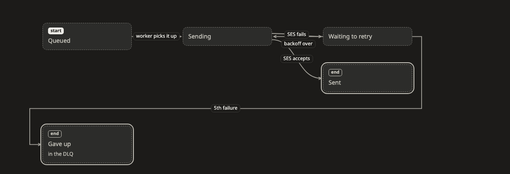

# State (สถานะ)

ภาพ **state** บอกว่าของสิ่งหนึ่งอยู่ในสถานะไหนได้บ้าง และอะไรทำให้มันเปลี่ยนจากสถานะหนึ่งไปอีกสถานะ ใช้ได้กับทุกอย่างที่มีวงจรชีวิตของตัวเอง เช่น order, job หรือ account

[เปิดภาพนี้ในหน้าตัวอย่าง ↗](https://aiyaruch1320.github.io/walkboard/examples/pictures.html?view=life&step=all)

## อ่านภาพ state ยังไง

แต่ละกล่องคือหนึ่งสถานะ เส้นจาก A ไป B แปลว่าเปลี่ยนจาก A ไปเป็น B ได้ label บนเส้นบอกว่าอะไรทำให้เปลี่ยน อาจเป็น event หรือ timeout เช่น "ไม่จ่ายภายใน 30 นาที"

เส้นที่วนกลับเข้ากล่องเดิม แปลว่าเรื่องเดิมเกิดซ้ำได้ เช่น retry

- **เริ่ม** คือสถานะแรกของของที่เพิ่งสร้างขึ้นมาใหม่ มีจุดเริ่มได้กล่องเดียว
- **จบ** คือสถานะที่หยุดได้ แต่ยังมีเส้นไปต่อได้ เช่น คืนเงินหลังส่งของถึงแล้ว

> **ควรรู้:** หน้าจอของแอปก็วาดแบบนี้ได้ แต่ละหน้าจอเป็นหนึ่งกล่อง แต่ละเส้นคือสิ่งที่ผู้ใช้ทำเพื่อไปหน้าถัดไป เช่น "กด Pay" ลองขอ agent ว่า "วาดหน้าจอของ checkout เป็นภาพ state"

## จัดภาพ state

ลากกล่องเพื่อจัดภาพ ส่วนอื่นของภาพจะอยู่นิ่งระหว่างที่คุณลาก

ถ้าอยากเลือกว่าเส้นจะติดกล่องด้านไหน ให้คลิกเส้น หรือลากจุดที่ปลายเส้นด้านใดด้านหนึ่ง

## ร่างบนภาพ state

ใน[โหมดร่าง](../draft.md) คุณเพิ่มสถานะ ลากเส้นเชื่อม เปลี่ยนชื่อ และเอาออกได้

- ถ้าจะแก้ชื่อ คำอธิบาย หรือ icon ของสถานะ ให้คลิกที่กล่อง ใน card ของกล่องยังเปิดปิด **จุดเริ่ม** และ **จบ** ได้ด้วย
- ถ้าจะแก้ label หรือทิศของเส้น ให้คลิกที่เส้น
- ถ้าจะย้ายเส้นไปต่อกับสถานะอื่น ให้ลากปลายเส้นไปวางบนกล่องนั้น

## อ่านต่อ

- [Decision](decision.md) แสดงกฎที่ใช้เลือกว่าจะไปทางไหน
- [Timeline](timeline.md) แสดงว่าแต่ละสถานะกินเวลานานเท่าไร
