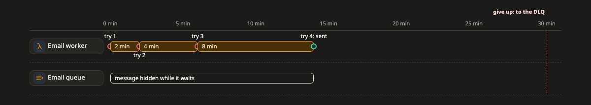

# Timeline (เส้นเวลา)

**timeline** คือภาพที่บอกว่าอะไรเกิดขึ้นตอนไหน และใช้เวลานานเท่าไร เหมาะกับเรื่อง retry, timeout และงานที่ตั้งเวลาไว้

[เปิดภาพนี้ในหน้าตัวอย่าง ↗](https://aiyaruch1320.github.io/walkboard/examples/pictures.html?view=retry&step=all)

## อ่าน timeline ยังไง

แต่ละแถวคือส่วนหนึ่งของระบบ เวลาเดินจากซ้ายไปขวา ในหน่วยที่บอกไว้บนแกน คือวินาที นาที หรือวัน

- จุดคือสิ่งที่เกิดขึ้นในชั่วขณะเดียว เช่น "fail #1"
- แท่งคือสิ่งที่กินเวลาช่วงหนึ่ง เช่น "รอ, timeout 3 s"
- เส้นตั้งที่ลากผ่านทุกแถว คือช่วงเวลาที่สำคัญกับทุกแถว เช่น "ยอมแพ้"

สีมีความหมายเหมือนบน [map](map.md) สีเขียวคือใช้ได้ สีส้มคือยังไม่ได้ทำหรือกำลังรอ สีแดงคือถูก block หรือล้มเหลว และสีน้ำเงินคือสำรอง (standby)

คลิกแถวไหนก็ได้เพื่อเปิดกล่องของแถวนั้น

## แก้ timeline

timeline ไม่มีโหมดร่าง ถ้าอยากแก้ ให้บอก agent ในแชทว่าอะไรต่างไปจากนี้

## อ่านต่อ

- [Sequence](sequence.md) ดูการเรียกที่อยู่เบื้องหลังแต่ละเหตุการณ์ ตามลำดับ
- [State](state.md) ดูว่าของสิ่งหนึ่งเปลี่ยนผ่านสถานะไหนบ้าง และเพราะอะไร
