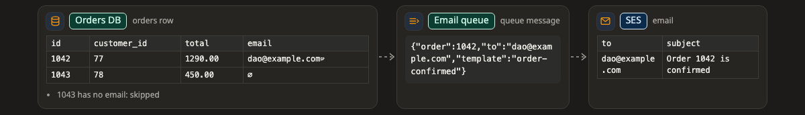

# Transform (การแปลงข้อมูล)

**transform** คือภาพที่บอกว่าข้อมูลหน้าตาเป็นยังไงก่อนและหลังแต่ละช่วง เหมาะกับงานที่ข้อมูลเปลี่ยนรูประหว่างทาง เช่น จากแถวใน database กลายเป็น message ใน queue แล้วกลายเป็นอีเมล

[เปิดภาพนี้ในหน้าตัวอย่าง ↗](https://aiyaruch1320.github.io/walkboard/examples/pictures.html?view=shape&step=all)

## อ่าน transform ยังไง

ช่วงต่างๆ เรียงจากซ้ายไปขวา แต่ละช่วงเป็นตารางเล็กๆ ที่มีคอลัมน์และแถวตัวอย่างไม่กี่แถว หรือเป็นข้อความก้อนหนึ่ง เช่น request body

ในข้อมูลจริงมีสองอย่างที่มองข้ามง่าย ภาพจึงแสดงให้เห็น

- **∅** คือค่าว่าง หรือ `null`
- **␠** คือช่องว่างที่ต้นหรือท้ายค่า

โน้ตใต้แต่ละช่วงบอกว่าต้องระวังอะไร เช่น "ทุกค่าเป็น text"

แถวในภาพเป็นตัวอย่างที่แต่งขึ้น ไม่ใช่ข้อมูลจริงของคุณ คลิกช่วงไหนก็ได้เพื่อเปิดกล่องของช่วงนั้น

## แก้ transform

transform ไม่มีโหมดร่าง ถ้าอยากแก้ ให้บอก agent ในแชทว่าอะไรต่างไปจากนี้

## อ่านต่อ

- [Journey](journey.md) ตาม record เดียวจากจุดหนึ่งไปอีกจุด
- [Data model](datamodel.md) ดูตาราง คีย์ และความสัมพันธ์ระหว่างตาราง
