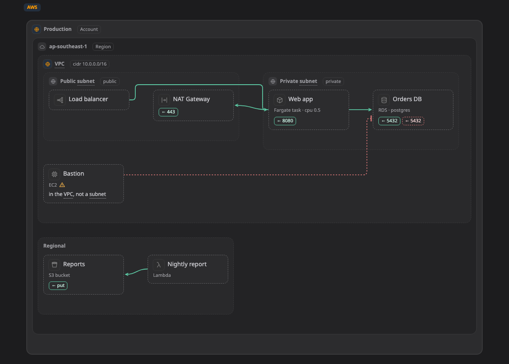

# แพลตฟอร์ม

บน [map](../pictures/map.md) (ภาพระบบ) กล่อง โซน หรือเส้น บอกได้ว่ามันคืออะไรบนแพลตฟอร์มจริง เช่น ฐานข้อมูล RDS ใน private subnet, CronJob ใน namespace หรือ VLAN ใน data centre ส่วนนี้รวบรวมว่า Walkboard รู้จักอะไรบ้างในแต่ละแพลตฟอร์ม

## Kind และ profile

สิ่งที่บอกว่าของชิ้นหนึ่งคืออะไรบนแพลตฟอร์ม เรียกว่า **kind** (ชนิด) เขียนเป็นชื่อแพลตฟอร์มกับชื่อของมัน เช่น `aws:rds` หรือ `k8s:cronjob` คุณไม่ต้องพิมพ์เอง agent ใส่ให้ และในโหมดร่างก็เลือกจากรายการได้

kind ทั้งหมดของแพลตฟอร์มหนึ่งรวมกันเรียกว่า **profile** ตอนนี้ Walkboard มี profile เหล่านี้

| Profile | ครอบคลุม |
|---|---|
| [AWS](aws.md) | account, region, VPC, Availability Zone, subnet, security group และ service ของ AWS |
| [Google Cloud](gcp.md) | organization, folder, project, VPC network, region, subnet และ service ของ Google Cloud |
| [Azure](azure.md) | subscription, resource group, virtual network, subnet และ service ของ Azure |
| [Huawei Cloud](huawei.md) | region, enterprise project, VPC, subnet และ service ของ Huawei Cloud |
| [Kubernetes](k8s.md) | cluster, node pool, namespace, workload, service, config และ network policy |
| [Container](container.md) | container host, Compose project, Swarm, Podman pod, container และ network ของมัน |
| [On-prem](onprem.md) | data centre, site, rack, VLAN, DMZ, server, virtualization และ appliance |

หน้าของแต่ละ profile มีรายการ kind ทั้งหมด บอกว่าแต่ละตัวมักอยู่ตรงไหน ชื่ออื่นที่ใช้เรียก และ field ของมัน

## kind เพิ่มอะไรให้ map

กล่องที่มี kind จะได้ icon และสีของแพลตฟอร์ม และ field ของมันจะขึ้นใต้ชื่อ เช่น กล่อง RDS จะแสดง engine และขนาด map ก็จะมีป้ายบอกแพลตฟอร์ม ให้คนอ่านรู้ว่ากำลังดูอะไรอยู่

kind ยังรู้ด้วยว่าของชิ้นนั้นมักอยู่ตรงไหน ถ้าคุณวางไว้ที่อื่น จะมีป้าย **⚠** สีเหลืองอำพันเล็กๆ ขึ้นข้างชื่อ ชี้ที่ ⚠ เพื่ออ่านเหตุผล เช่น "RDS ปกติอยู่ใน Subnet, VPC" แล้วกดลิงก์ของมันเพื่อไปที่ kind นั้นในหน้าของแพลตฟอร์ม

[ชี้ที่ ⚠ ข้าง Bastion ในหน้าตัวอย่าง ↗](https://aiyaruch1320.github.io/walkboard/examples/platforms.html?view=aws&step=all)

> **ควรรู้:** ⚠ เป็นแค่คำแนะนำ ไม่ใช่ error ไม่มีอะไรถูกห้าม คุณจึงร่างไปก่อนเร็วๆ แล้วค่อยจัดทีหลังได้ บางแบบก็ตั้งใจวางของไว้ในที่แปลกๆ และแบบนั้นก็ไม่เป็นไร

โซนที่ไม่มี kind จะถูกข้ามไป ⚠ ดูแค่โซนที่ใกล้ที่สุดรอบกล่องที่มี kind ถ้าไม่มีโซนไหนรอบกล่องที่มี kind เลย กล่องนั้นจะไม่มี ⚠ วาดได้ตามสบาย อะไรที่ไม่มี profile ไหนครอบคลุม ก็วาดได้โดยไม่ต้องมี kind ใช้ชื่อที่คุณตั้งไว้

## ใช้หลายแพลตฟอร์มใน map เดียว

ใช้หลาย profile ปนกันใน map เดียวได้ เช่น EKS cluster ใน VPC ของ AWS คือโซน cluster ของ Kubernetes ที่อยู่ในโซน VPC ของ AWS และมี namespace กับ workload อยู่ข้างใน

ถ้ากล่องของแพลตฟอร์มหนึ่งไปอยู่ในโซนของอีกแพลตฟอร์ม ⚠ จะบอกทั้งสองแพลตฟอร์ม เช่น "VM เป็นของ Google Cloud แต่อยู่ใน AWS subnet" แต่จะไม่ขึ้นถ้าโซนนั้นรันของแบบนั้นได้ เช่น container บน EC2 instance

## เลือก kind ในโหมดร่าง

ใน[โหมดร่าง](../draft.md) การ์ดของกล่องหรือโซนจะมีช่องค้นหา kind ของมัน kind จากแพลตฟอร์มของโซนที่มันอยู่จะขึ้นก่อน ตามด้วย kind จากโซนรอบๆ แล้วค่อยเป็น kind จากแพลตฟอร์มอื่นที่ภาพนั้นใช้อยู่แล้ว

## ไม่เจอ kind ที่ต้องการ?

profile ครอบคลุมส่วนที่ใช้กันบ่อยในรายการผลิตภัณฑ์ทางการของแต่ละเจ้า แต่ไม่ได้มีครบทุกตัว ถ้าต้องการตัวที่ยังไม่มี [เปิด issue](https://github.com/aiyaruch1320/walkboard/issues/new/choose) ได้เลย ระหว่างนี้วาดไปก่อนโดยไม่ต้องมี kind

## อ่านต่อ

- [AWS](aws.md) kind ทั้งหมดของ AWS และตำแหน่งที่มักอยู่
- [Kubernetes](k8s.md) cluster, namespace และ workload
