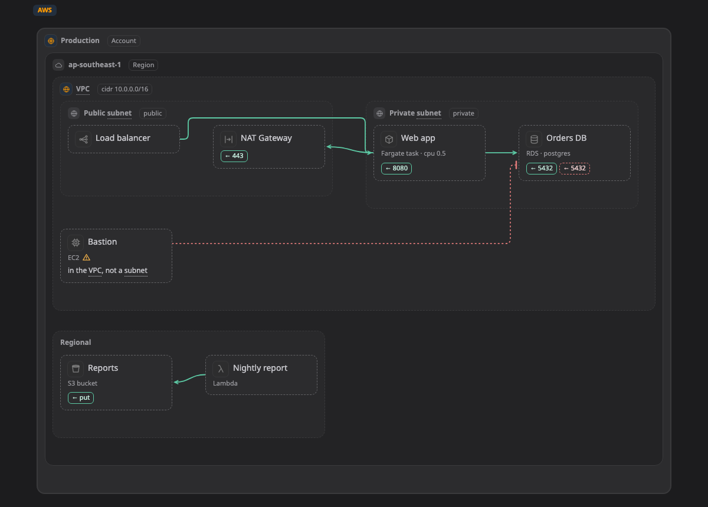

# AWS

หน้านี้รวม kind ทั้งหมดของ AWS ที่ Walkboard รู้จัก คือ box, zone และ line ที่วาดบน [map](../pictures/map.md) ได้ และบอกว่าแต่ละอย่างมักอยู่ตรงไหน

ถ้า box มี kind จากหน้านี้ map จะแสดง icon และ field ของมัน ถ้าวางไว้นอก zone ที่อยู่ในคอลัมน์ "มักอยู่ใน" จะมีป้าย ⚠ เล็กๆ ขึ้นข้างชื่อ เป็นแค่คำเตือน ถ้าตั้งใจวางแบบนั้นก็ไม่เป็นไร อ่านว่า kind ทำงานยังไงได้ที่หน้า[แพลตฟอร์ม](README.md)

[เปิด map นี้ใน live example แล้วคลิก box เพื่อดู kind ของมัน ↗](https://aiyaruch1320.github.io/walkboard/examples/platforms.html?view=aws&step=all)

## Zone

zone คือกรอบที่มี box หรือ zone อื่นอยู่ข้างใน

| Kind | มักอยู่ใน | หมายเหตุ | ชื่ออื่น | Field |
|---|---|---|---|---|
| **Account** `aws:account` | ที่ไหนก็ได้ |  |  |  |
| **Region** `aws:region` | [Account](#account) |  |  |  |
| **VPC** `aws:vpc` | [Account](#account), [Region](#region) |  |  | cidr |
| **Availability Zone** `aws:az` | [VPC](#vpc), [Region](#region) |  |  |  |
| **Subnet** `aws:subnet` | [VPC](#vpc), [Availability Zone](#az) |  |  | access (private, public); cidr |
| **Security group** `aws:sg` | [VPC](#vpc), [Subnet](#subnet), [Availability Zone](#az) | box ข้างในจะถูกเช็กกับ zone ที่ครอบมันอีกชั้น | security group, firewall | rules |

## Box

box คือ resource หนึ่งตัว เช่น server, database หรือ queue

| Kind | มักอยู่ใน | หมายเหตุ | ชื่ออื่น | Field |
|---|---|---|---|---|
| **EC2** `aws:ec2` | [Subnet](#subnet) | เป็น box หรือเป็น zone เมื่อมีอะไรรันอยู่ข้างใน; มี [Container](container.md) อยู่ข้างในได้ | vm, server, instance | type; os |
| **ECS cluster** `aws:ecs` | [VPC](#vpc), [Subnet](#subnet), [Region](#region) | เป็น box หรือเป็น zone เมื่อมีอะไรรันอยู่ข้างใน; มี [Container](container.md) อยู่ข้างในได้ | container |  |
| **Fargate task** `aws:fargate` | [ECS cluster](#ecs), [Subnet](#subnet) |  | container, task | cpu; memory |
| **EKS cluster** `aws:eks` | [VPC](#vpc), [Region](#region) | เป็น box หรือเป็น zone เมื่อมีอะไรรันอยู่ข้างใน; มี [Kubernetes](k8s.md) อยู่ข้างในได้ | kubernetes, k8s | version |
| **Lambda** `aws:lambda` | [Region](#region), [Account](#account), [VPC](#vpc), [Subnet](#subnet) |  | function, serverless | runtime |
| **Application Load Balancer** `aws:alb` | [Subnet](#subnet), [VPC](#vpc) |  | lb, load balancer | scheme (internet-facing, internal) |
| **Network Load Balancer** `aws:nlb` | [Subnet](#subnet), [VPC](#vpc) |  | lb, load balancer | scheme (internet-facing, internal) |
| **Internet Gateway** `aws:internetgateway` | [VPC](#vpc) |  | igw |  |
| **NAT Gateway** `aws:natgateway` | [Subnet](#subnet) |  | nat |  |
| **VPC endpoint** `aws:endpoint` | [VPC](#vpc), [Subnet](#subnet) |  | privatelink, private link | service |
| **Transit Gateway** `aws:transitgateway` | [Region](#region), [Account](#account) |  |  |  |
| **Site-to-Site VPN** `aws:vpn` | [VPC](#vpc), [Region](#region) |  |  |  |
| **Direct Connect** `aws:directconnect` | [Region](#region), [Account](#account) |  |  | bandwidth |
| **API Gateway** `aws:apigateway` | [Region](#region), [Account](#account) |  | api | type (REST, HTTP, WebSocket) |
| **CloudFront** `aws:cloudfront` | [Account](#account) |  | cdn |  |
| **Route 53** `aws:route53` | [Account](#account) |  | dns |  |
| **WAF** `aws:waf` | [Account](#account), [Region](#region) |  |  |  |
| **RDS** `aws:rds` | [Subnet](#subnet), [VPC](#vpc) |  | db, database, postgres, mysql | engine (postgres, mysql, mariadb, oracle, sqlserver); size; multiAz (yes, no) |
| **Aurora** `aws:aurora` | [Subnet](#subnet), [VPC](#vpc) |  | db, database, postgres, mysql | engine (postgres, mysql); size; serverless (yes, no) |
| **DynamoDB** `aws:dynamodb` | [Region](#region), [Account](#account) |  | db, nosql, table | capacity (on-demand, provisioned) |
| **ElastiCache** `aws:elasticache` | [Subnet](#subnet), [VPC](#vpc) |  | redis, cache, valkey | engine (redis, valkey, memcached); size |
| **Redshift** `aws:redshift` | [Subnet](#subnet), [VPC](#vpc) |  |  |  |
| **S3 bucket** `aws:s3` | [Region](#region), [Account](#account) |  | bucket, object storage | versioning (on, off) |
| **EFS** `aws:efs` | [VPC](#vpc), [Subnet](#subnet) |  | nfs, file share |  |
| **SQS queue** `aws:sqs` | [Region](#region), [Account](#account) |  | queue | type (standard, fifo) |
| **SNS topic** `aws:sns` | [Region](#region), [Account](#account) |  | topic, notification |  |
| **EventBridge** `aws:eventbridge` | [Region](#region), [Account](#account) |  |  |  |
| **Kinesis** `aws:kinesis` | [Region](#region), [Account](#account) |  | stream |  |
| **MSK (Kafka)** `aws:msk` | [VPC](#vpc), [Subnet](#subnet) |  | kafka, stream |  |
| **Step Functions** `aws:stepfunctions` | [Region](#region), [Account](#account) |  |  |  |
| **Secrets Manager** `aws:secretsmanager` | [Region](#region), [Account](#account) |  | secret, password |  |
| **KMS key** `aws:kms` | [Region](#region), [Account](#account) |  |  |  |
| **IAM role** `aws:iam` | [Account](#account) |  | role, permission |  |
| **Cognito** `aws:cognito` | [Region](#region), [Account](#account) |  | login, auth |  |
| **CloudWatch** `aws:cloudwatch` | [Region](#region), [Account](#account) |  | logs, monitor, alarm |  |
| **ECR** `aws:ecr` | [Region](#region), [Account](#account) |  | registry, image |  |
| **SES** `aws:ses` | [Region](#region), [Account](#account) |  |  |  |
| **Athena** `aws:athena` | [Region](#region), [Account](#account) |  |  |  |
| **Glue** `aws:glue` | [Region](#region), [Account](#account) |  |  |  |
| **Bedrock** `aws:bedrock` | [Region](#region), [Account](#account) |  |  |  |
| **CodePipeline** `aws:codepipeline` | [Region](#region), [Account](#account) |  |  |  |

## Line

line ที่ไม่มี kind คือ traffic ธรรมดา ส่วนหนึ่งเรียกอีกส่วน kind ด้านล่างใช้กับ line ที่หมายถึงอย่างอื่น

| Kind | หมายถึง |
|---|---|
| `aws:event` | Event or message |
| `aws:peering` | VPC peering |
| `aws:iam` | Permission (IAM) |
| `aws:replication` | Replication |

> **ควรรู้:** หน้านี้สร้างอัตโนมัติจาก `skills/walkboard/lib/profiles.mjs` ถ้าจะเพิ่ม kind ให้แก้ไฟล์นั้น แล้วรัน `node scripts/profiles-doc.mjs`
