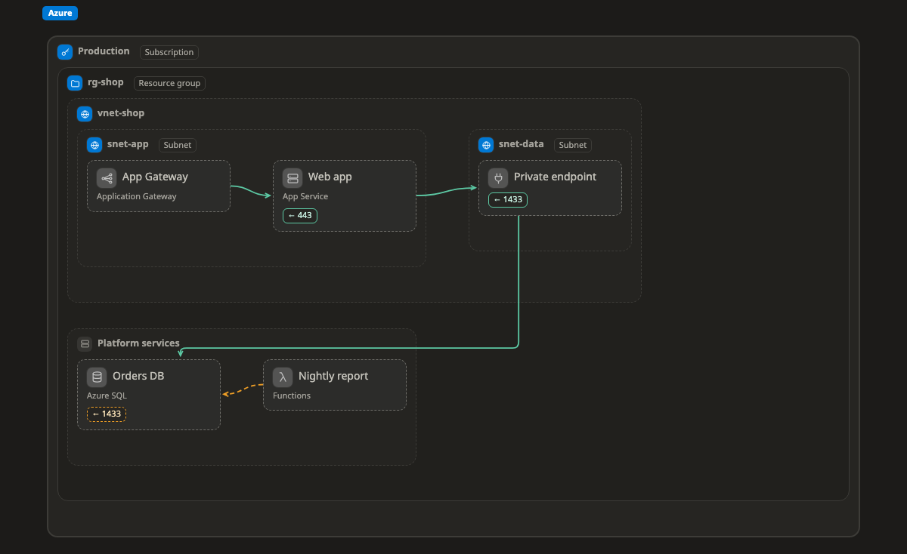

# Azure

หน้านี้รวม kind ทั้งหมดของ Azure ที่ Walkboard รู้จัก คือกล่อง โซน และเส้นที่วาดบน[ภาพระบบ (map)](../pictures/map.md) ได้ และบอกว่าแต่ละอย่างมักอยู่ตรงไหน

ถ้ากล่องมี kind จากหน้านี้ ภาพจะแสดงไอคอนและช่องข้อมูลของมัน ถ้าวางไว้นอกโซนที่อยู่ในคอลัมน์ "มักอยู่ใน" จะมีป้าย ⚠ เล็กๆ ขึ้นข้างชื่อ เป็นแค่คำเตือน ถ้าตั้งใจวางแบบนั้นก็ไม่เป็นไร อ่านว่า kind ทำงานยังไงได้ที่หน้า[แพลตฟอร์ม](README.md)

[เปิดภาพนี้ในตัวอย่างที่ลองได้ แล้วคลิกกล่องเพื่อดู kind ของมัน ↗](https://aiyaruch1320.github.io/walkboard/examples/platforms.html?view=azure&step=all)

## โซน (zone)

โซนคือกรอบที่มีกล่องหรือโซนอื่นอยู่ข้างใน

| Kind | มักอยู่ใน | หมายเหตุ | ชื่ออื่น | ช่องข้อมูล |
|---|---|---|---|---|
| **Subscription** `azure:subscription` | [Management group](#managementgroup) |  |  |  |
| **Management group** `azure:managementgroup` | [Management group](#managementgroup) |  |  |  |
| **Resource group** `azure:resourcegroup` | [Subscription](#subscription) |  |  |  |
| **Region** `azure:region` | [Subscription](#subscription), [Resource group](#resourcegroup) |  |  |  |
| **Virtual network** `azure:vnet` | [Resource group](#resourcegroup), [Region](#region), [Subscription](#subscription) |  |  | cidr |
| **Availability Zone** `azure:availabilityzone` | [Region](#region), [Virtual network](#vnet) |  |  |  |
| **Subnet** `azure:subnet` | [Virtual network](#vnet) |  |  | cidr |
| **Network security group** `azure:nsg` | [Virtual network](#vnet), [Subnet](#subnet) | กล่องข้างในจะถูกเช็กกับโซนที่ครอบมันอีกชั้น | security group, firewall | rules |

## กล่อง (box)

กล่องคือทรัพยากรหนึ่งชิ้น เช่น server ฐานข้อมูล หรือ queue

| Kind | มักอยู่ใน | หมายเหตุ | ชื่ออื่น | ช่องข้อมูล |
|---|---|---|---|---|
| **Virtual machine** `azure:vm` | [Subnet](#subnet) | เป็นกล่อง หรือเป็นโซนเมื่อมีอะไรรันอยู่ข้างใน; มี [Container](container.md) อยู่ข้างในได้ | server, instance | size; os |
| **AKS cluster** `azure:aks` | [Virtual network](#vnet), [Subnet](#subnet), [Resource group](#resourcegroup) | เป็นกล่อง หรือเป็นโซนเมื่อมีอะไรรันอยู่ข้างใน; มี [Kubernetes](k8s.md) อยู่ข้างในได้ | kubernetes, k8s |  |
| **App Service** `azure:appservice` | [Resource group](#resourcegroup), [Region](#region), [Subnet](#subnet) |  | web app | plan |
| **Functions** `azure:functions` | [Resource group](#resourcegroup), [Region](#region) |  | function, serverless | runtime |
| **Container Apps** `azure:containerapps` | [Resource group](#resourcegroup), [Region](#region), [Subnet](#subnet) |  | container |  |
| **Container Instances** `azure:aci` | [Resource group](#resourcegroup), [Subnet](#subnet) |  | container |  |
| **Logic Apps** `azure:logicapps` | [Resource group](#resourcegroup), [Region](#region) |  | workflow |  |
| **Application Gateway** `azure:appgateway` | [Subnet](#subnet), [Virtual network](#vnet) |  |  |  |
| **Load Balancer** `azure:loadbalancer` | [Subnet](#subnet), [Virtual network](#vnet), [Resource group](#resourcegroup) |  | lb | scheme (public, internal) |
| **Front Door** `azure:frontdoor` | [Subscription](#subscription), [Resource group](#resourcegroup) |  |  |  |
| **Azure Firewall** `azure:firewall` | [Subnet](#subnet), [Virtual network](#vnet) |  |  |  |
| **Private endpoint** `azure:privateendpoint` | [Subnet](#subnet) |  | private link |  |
| **Private DNS zone** `azure:privatednszone` | [Resource group](#resourcegroup), [Virtual network](#vnet) |  | dns |  |
| **Bastion** `azure:bastion` | [Subnet](#subnet), [Virtual network](#vnet) |  | jump host |  |
| **NAT Gateway** `azure:natgateway` | [Subnet](#subnet), [Virtual network](#vnet) |  | nat |  |
| **VPN Gateway** `azure:vpngateway` | [Subnet](#subnet), [Virtual network](#vnet) |  |  |  |
| **ExpressRoute** `azure:expressroute` | [Resource group](#resourcegroup), [Region](#region), [Subscription](#subscription) |  |  |  |
| **API Management** `azure:apim` | [Resource group](#resourcegroup), [Subnet](#subnet) |  |  |  |
| **Azure SQL** `azure:sql` | [Resource group](#resourcegroup), [Region](#region), [Subnet](#subnet), [Virtual network](#vnet) |  | db, database, sql server | tier |
| **Database for PostgreSQL** `azure:postgres` | [Resource group](#resourcegroup), [Subnet](#subnet), [Region](#region) |  | db, database | tier |
| **Cosmos DB** `azure:cosmosdb` | [Resource group](#resourcegroup), [Region](#region), [Subnet](#subnet), [Virtual network](#vnet) |  | db, nosql, mongodb | api (nosql, mongodb, cassandra, gremlin, table) |
| **Azure Managed Redis** `azure:redis` | [Resource group](#resourcegroup), [Subnet](#subnet), [Region](#region) |  | cache, azure cache for redis | tier |
| **Storage account** `azure:storage` | [Resource group](#resourcegroup), [Region](#region), [Subnet](#subnet), [Virtual network](#vnet) |  | blob, bucket, object storage | kind (blob, files, queue, table) |
| **Service Bus** `azure:servicebus` | [Resource group](#resourcegroup), [Region](#region), [Subnet](#subnet), [Virtual network](#vnet) |  | queue |  |
| **Event Hubs** `azure:eventhubs` | [Resource group](#resourcegroup), [Region](#region), [Subnet](#subnet), [Virtual network](#vnet) |  |  |  |
| **Event Grid** `azure:eventgrid` | [Resource group](#resourcegroup), [Region](#region) |  |  |  |
| **Key Vault** `azure:keyvault` | [Resource group](#resourcegroup), [Region](#region), [Subnet](#subnet), [Virtual network](#vnet) |  | secret, key |  |
| **Entra ID** `azure:entra` | [Subscription](#subscription) |  | login, identity, ad |  |
| **Managed identity** `azure:managedidentity` | [Resource group](#resourcegroup), [Subscription](#subscription) |  | identity |  |
| **Azure Monitor** `azure:monitor` | [Subscription](#subscription), [Resource group](#resourcegroup) |  |  |  |
| **Container Registry** `azure:acr` | [Resource group](#resourcegroup), [Region](#region), [Subnet](#subnet), [Virtual network](#vnet) |  | registry, image |  |
| **Azure OpenAI / Foundry** `azure:openai` | [Resource group](#resourcegroup), [Region](#region) |  | foundry, gpt, llm, ai |  |
| **VM scale set** `azure:vmss` | [Subnet](#subnet) | เป็นกล่อง หรือเป็นโซนเมื่อมีอะไรรันอยู่ข้างใน; มี [Container](container.md) อยู่ข้างในได้ | autoscaling, scale set, vm | min; max; size |
| **Managed disk** `azure:disk` | [Resource group](#resourcegroup), [Region](#region), [Availability Zone](#availabilityzone) |  | disk, volume, block storage | size; sku |
| **Azure Red Hat OpenShift** `azure:aro` | [Virtual network](#vnet), [Subnet](#subnet), [Resource group](#resourcegroup) | เป็นกล่อง หรือเป็นโซนเมื่อมีอะไรรันอยู่ข้างใน; มี [Kubernetes](k8s.md) อยู่ข้างในได้ | openshift, kubernetes |  |
| **Static Web Apps** `azure:staticwebapps` | [Resource group](#resourcegroup), [Region](#region) |  | static site, frontend, spa |  |
| **Batch** `azure:batch` | [Resource group](#resourcegroup), [Subnet](#subnet) |  | batch job, hpc |  |
| **Azure Virtual Desktop** `azure:avd` | [Resource group](#resourcegroup), [Subnet](#subnet), [Virtual network](#vnet) |  | vdi, desktop |  |
| **Azure VMware Solution** `azure:vmware` | [Resource group](#resourcegroup), [Region](#region) | เป็นกล่อง หรือเป็นโซนเมื่อมีอะไรรันอยู่ข้างใน | vmware, vsphere |  |
| **App Configuration** `azure:appconfig` | [Resource group](#resourcegroup), [Region](#region), [Subnet](#subnet) |  | config, feature flags |  |
| **SQL Managed Instance** `azure:sqlmi` | [Subnet](#subnet), [Virtual network](#vnet) |  | sql server, db, database | tier |
| **Database for MySQL** `azure:mysql` | [Resource group](#resourcegroup), [Subnet](#subnet), [Region](#region) |  | db, database | tier |
| **Azure DocumentDB (MongoDB)** `azure:documentdb` | [Resource group](#resourcegroup), [Region](#region), [Subnet](#subnet), [Virtual network](#vnet) |  | mongodb, document |  |
| **Azure Files share** `azure:files` | [Resource group](#resourcegroup), [Region](#region), [Subnet](#subnet), [Virtual network](#vnet) |  | smb, nfs, file share |  |
| **Azure NetApp Files** `azure:netappfiles` | [Subnet](#subnet), [Virtual network](#vnet) |  | nfs, smb, file share |  |
| **Data Lake Storage** `azure:datalake` | [Resource group](#resourcegroup), [Region](#region), [Subnet](#subnet), [Virtual network](#vnet) |  | adls, data lake |  |
| **Data Factory** `azure:datafactory` | [Resource group](#resourcegroup), [Region](#region) |  | etl, pipeline |  |
| **Synapse Analytics** `azure:synapse` | [Resource group](#resourcegroup), [Region](#region) |  | warehouse, analytics |  |
| **Azure Databricks** `azure:databricks` | [Resource group](#resourcegroup), [Virtual network](#vnet) |  | spark, lakehouse |  |
| **Microsoft Fabric** `azure:fabric` | [Subscription](#subscription), [Resource group](#resourcegroup) |  | lakehouse, warehouse, onelake |  |
| **Stream Analytics** `azure:streamanalytics` | [Resource group](#resourcegroup), [Region](#region) |  | stream, real-time |  |
| **Data Explorer** `azure:dataexplorer` | [Resource group](#resourcegroup), [Region](#region), [Subnet](#subnet) |  | kusto, logs analytics |  |
| **Power BI** `azure:powerbi` | [Subscription](#subscription) |  | bi, dashboard, report |  |
| **SignalR Service** `azure:signalr` | [Resource group](#resourcegroup), [Region](#region) |  | websocket, real-time |  |
| **Web PubSub** `azure:webpubsub` | [Resource group](#resourcegroup), [Region](#region) |  | websocket, pubsub |  |
| **Notification Hubs** `azure:notificationhubs` | [Resource group](#resourcegroup), [Region](#region) |  | push, notification |  |
| **Communication Services** `azure:communication` | [Resource group](#resourcegroup), [Region](#region) |  | sms, email, voice |  |
| **IoT Hub** `azure:iothub` | [Resource group](#resourcegroup), [Region](#region) |  | iot, device |  |
| **Azure DNS zone** `azure:dns` | [Resource group](#resourcegroup), [Subscription](#subscription) |  | dns |  |
| **Traffic Manager** `azure:trafficmanager` | [Resource group](#resourcegroup), [Subscription](#subscription) |  | dns load balancing, failover |  |
| **Web Application Firewall policy** `azure:waf` | [Resource group](#resourcegroup), [Subscription](#subscription) |  | waf |  |
| **DDoS Protection plan** `azure:ddos` | [Resource group](#resourcegroup), [Subscription](#subscription), [Virtual network](#vnet) |  | ddos |  |
| **Virtual WAN hub** `azure:vwan` | [Resource group](#resourcegroup), [Region](#region), [Subscription](#subscription) | เป็นกล่อง หรือเป็นโซนเมื่อมีอะไรรันอยู่ข้างใน | hub, transit, virtual wan |  |
| **Route Server** `azure:routeserver` | [Subnet](#subnet), [Virtual network](#vnet) |  | bgp |  |
| **Private Link service** `azure:privatelinkservice` | [Subnet](#subnet), [Virtual network](#vnet) |  | private link |  |
| **Log Analytics workspace** `azure:loganalytics` | [Resource group](#resourcegroup), [Region](#region) |  | logs, kql |  |
| **Application Insights** `azure:appinsights` | [Resource group](#resourcegroup), [Region](#region) |  | apm, tracing, monitor |  |
| **Managed Grafana** `azure:grafana` | [Resource group](#resourcegroup), [Region](#region) |  | dashboard, grafana |  |
| **Microsoft Sentinel** `azure:sentinel` | [Resource group](#resourcegroup), [Subscription](#subscription) |  | siem, soar |  |
| **Defender for Cloud** `azure:defender` | [Subscription](#subscription) |  | security, posture |  |
| **Backup vault** `azure:backup` | [Resource group](#resourcegroup), [Region](#region) |  | backup, recovery services |  |
| **Site Recovery** `azure:siterecovery` | [Resource group](#resourcegroup), [Region](#region) |  | disaster recovery, dr |  |
| **Azure Arc** `azure:arc` | [Resource group](#resourcegroup), [Subscription](#subscription) |  | hybrid, multicloud |  |
| **Entra External ID** `azure:externalid` | [Subscription](#subscription) |  | customer login, b2c, auth |  |
| **Azure AI Search** `azure:aisearch` | [Resource group](#resourcegroup), [Region](#region), [Subnet](#subnet), [Virtual network](#vnet) |  | search, vector search, rag |  |
| **Azure Machine Learning** `azure:machinelearning` | [Resource group](#resourcegroup), [Region](#region) |  | ml, model training |  |
| **Document Intelligence** `azure:documentintelligence` | [Resource group](#resourcegroup), [Region](#region) |  | ocr, document, form recognizer |  |
| **Azure DevOps / Pipelines** `azure:devops` | ที่ไหนก็ได้ |  | ci, cd, pipeline |  |

## เส้น (line)

เส้นที่ไม่มี kind คือ traffic ธรรมดา คือส่วนหนึ่งเรียกอีกส่วน kind ด้านล่างใช้กับเส้นที่หมายถึงอย่างอื่น

| Kind | หมายถึง |
|---|---|
| `azure:event` | Event or message |
| `azure:peering` | VNet peering |
| `azure:iam` | Permission (RBAC) |
| `azure:replication` | Replication |

> **ควรรู้:** หน้านี้สร้างอัตโนมัติจาก `skills/walkboard/lib/profiles.mjs` ถ้าจะเพิ่ม kind ให้แก้ไฟล์นั้น แล้วรัน `node scripts/profiles-doc.mjs`
