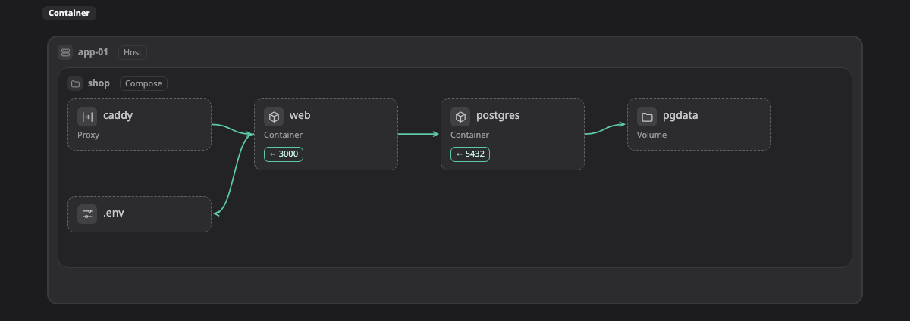

# Container

หน้านี้รวม kind ทั้งหมดของ Container ที่ Walkboard รู้จัก คือกล่อง โซน และเส้นที่วาดบน[ภาพระบบ (map)](../pictures/map.md) ได้ และบอกว่าแต่ละอย่างมักอยู่ตรงไหน

ถ้ากล่องมี kind จากหน้านี้ ภาพจะแสดงไอคอนและช่องข้อมูลของมัน ถ้าวางไว้นอกโซนที่อยู่ในคอลัมน์ "มักอยู่ใน" จะมีป้าย ⚠ เล็กๆ ขึ้นข้างชื่อ เป็นแค่คำเตือน ถ้าตั้งใจวางแบบนั้นก็ไม่เป็นไร อ่านว่า kind ทำงานยังไงได้ที่หน้า[แพลตฟอร์ม](README.md)

[เปิดภาพนี้ในตัวอย่างที่ลองได้ แล้วคลิกกล่องเพื่อดู kind ของมัน ↗](https://aiyaruch1320.github.io/walkboard/examples/platforms.html?view=container&step=all)

## โซน (zone)

โซนคือกรอบที่มีกล่องหรือโซนอื่นอยู่ข้างใน

| Kind | มักอยู่ใน | หมายเหตุ | ชื่ออื่น | ช่องข้อมูล |
|---|---|---|---|---|
| **Container host** `container:host` | [Swarm cluster](#swarm) |  | docker, podman, docker host | runtime (docker, podman, containerd); os |
| **Compose project** `container:compose` | [Container host](#host) |  | docker compose, stack |  |
| **Container network** `container:network` | [Container host](#host), [Compose project](#compose) |  | docker network, bridge | driver (bridge, host, overlay, macvlan, ipvlan) |
| **Swarm cluster** `container:swarm` | ที่ไหนก็ได้ |  | docker swarm, cluster |  |

## กล่อง (box)

กล่องคือทรัพยากรหนึ่งชิ้น เช่น server ฐานข้อมูล หรือ queue

| Kind | มักอยู่ใน | หมายเหตุ | ชื่ออื่น | ช่องข้อมูล |
|---|---|---|---|---|
| **Container** `container:container` | [Container host](#host), [Compose project](#compose), [Container network](#network), [Podman pod](#pod), [Swarm cluster](#swarm) |  | docker, service | image; ports; replicas; restart (no, always, unless-stopped, on-failure) |
| **Volume** `container:volume` | [Container host](#host), [Compose project](#compose), [Swarm cluster](#swarm) |  | disk, mount | mount; driver |
| **Env / config file** `container:envfile` | [Container host](#host), [Compose project](#compose) |  | env, .env, config |  |
| **Image registry** `container:registry` | ที่ไหนก็ได้ |  | image |  |
| **Podman pod** `container:pod` | [Container host](#host), [Container network](#network) | เป็นกล่อง หรือเป็นโซนเมื่อมีอะไรรันอยู่ข้างใน | podman pod |  |
| **Reverse proxy** `container:proxy` | [Container host](#host), [Compose project](#compose), [Container network](#network), [Swarm cluster](#swarm) |  | traefik, nginx, caddy, ingress | ports |
| **Secret** `container:secret` | [Container host](#host), [Compose project](#compose), [Swarm cluster](#swarm) |  | password, compose secret |  |
| **Config** `container:config` | [Container host](#host), [Compose project](#compose), [Swarm cluster](#swarm) |  | compose config, config file |  |
| **Bind mount (host folder)** `container:bindmount` | [Container host](#host), [Compose project](#compose) |  | host path, folder | path |

## เส้น (line)

เส้นที่ไม่มี kind คือ traffic ธรรมดา คือส่วนหนึ่งเรียกอีกส่วน kind ด้านล่างใช้กับเส้นที่หมายถึงอย่างอื่น

| Kind | หมายถึง |
|---|---|
| `container:uses` | Mounts or reads |
| `container:depends` | Starts after (depends_on) |
| `container:publishes` | Publishes a port |

> **ควรรู้:** หน้านี้สร้างอัตโนมัติจาก `skills/walkboard/lib/profiles.mjs` ถ้าจะเพิ่ม kind ให้แก้ไฟล์นั้น แล้วรัน `node scripts/profiles-doc.mjs`
